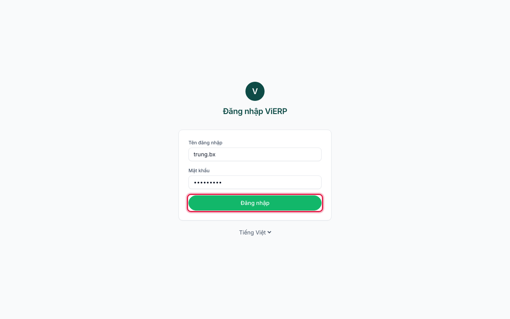
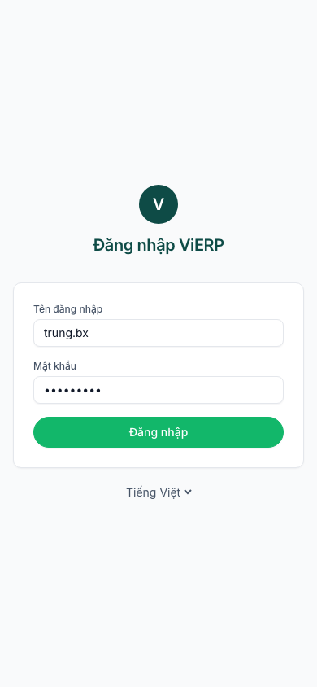
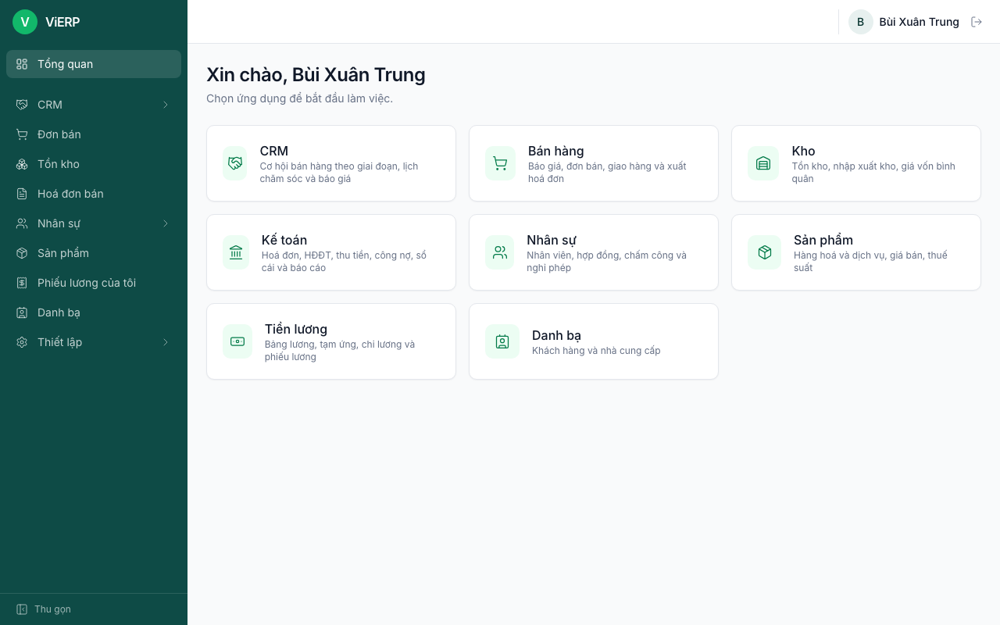
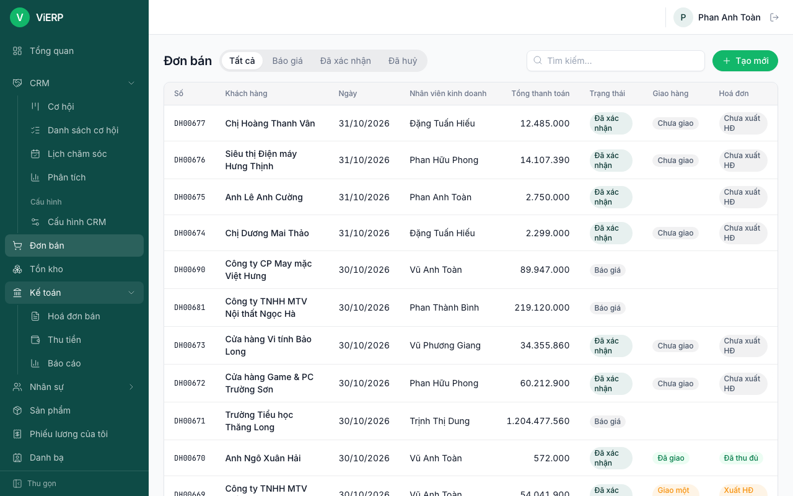
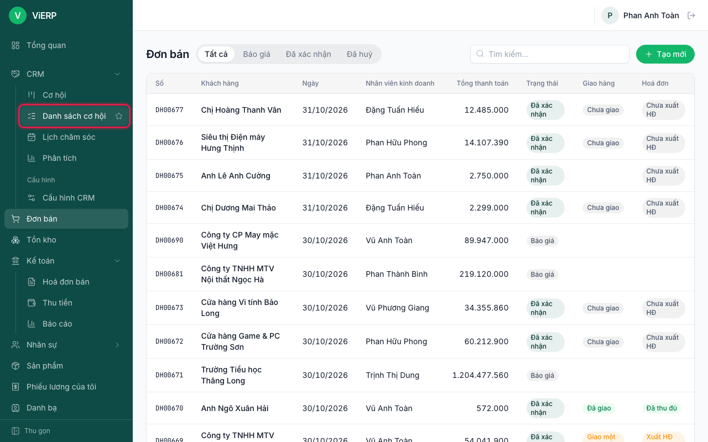
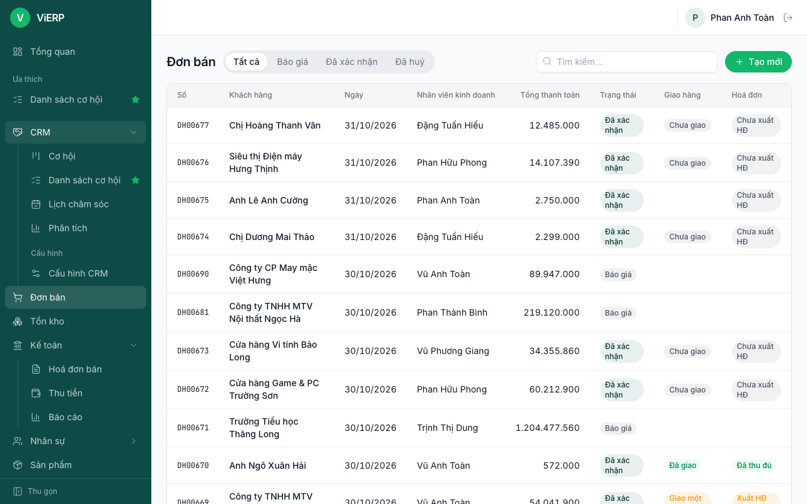
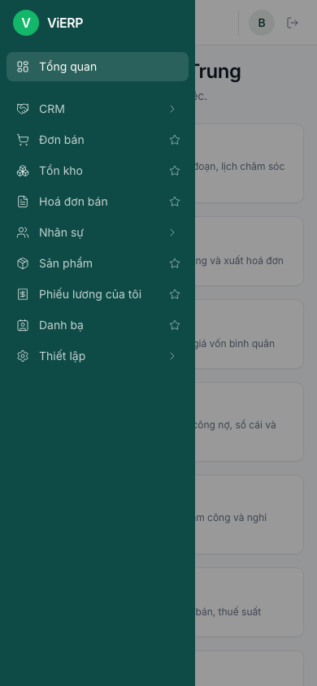
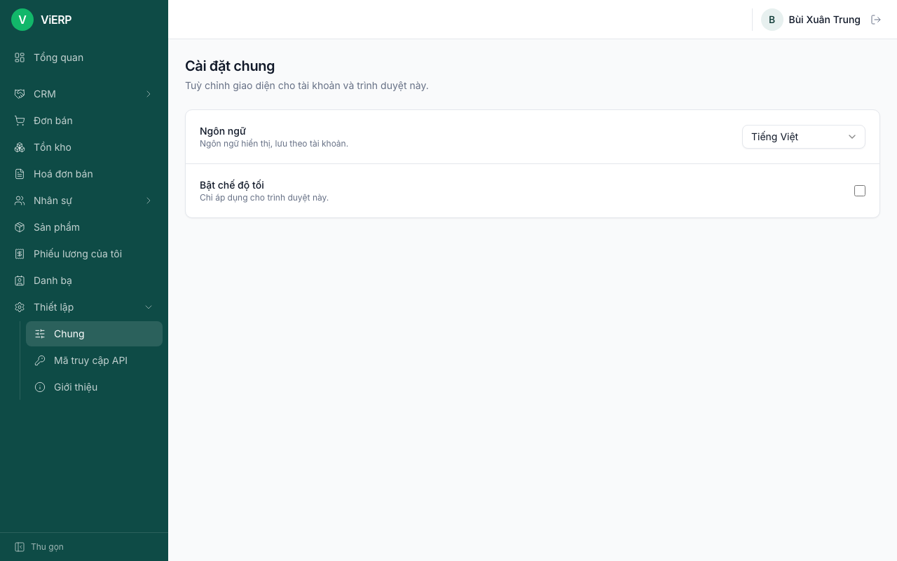
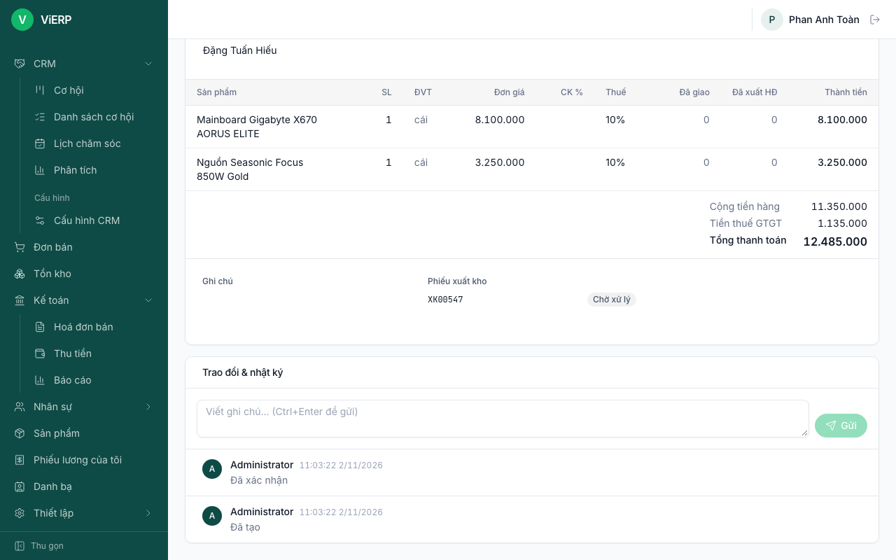

# 1. Bắt đầu

ViERP chạy trên trình duyệt (Chrome, Edge, Safari, Firefox) cả trên máy tính và điện thoại. Mỗi người chỉ thấy menu đúng với quyền của mình.

## 1.1. Đăng nhập

**Mục đích:** vào hệ thống bằng tài khoản do quản trị viên cấp.

1. Mở địa chỉ ViERP mà công ty cung cấp. Màn hình đăng nhập hiện ra.
2. Nhập **Tên đăng nhập** và **Mật khẩu**.
3. Nhấn **Đăng nhập**.

Trên điện thoại, màn hình đăng nhập gọn lại theo chiều dọc:

**Kết quả:** vào màn hình Tổng quan. Nếu nhập sai, hệ thống báo "Sai tên đăng nhập hoặc mật khẩu".

**Lưu ý:** dưới ô đăng nhập có nút đổi ngôn ngữ (Tiếng Việt / English). Để thoát, nhấn biểu tượng mũi tên cạnh tên bạn ở góc trên bên phải (**Đăng xuất**).

## 1.2. Màn hình Tổng quan

1. Sau khi đăng nhập, bạn thấy lời chào "Xin chào, [tên bạn]" và các thẻ ứng dụng (CRM, Bán hàng, Kho, Kế toán...).
2. Nhấn một thẻ để mở trang đầu tiên của ứng dụng đó.

**Lưu ý:** bạn chỉ thấy thẻ của những ứng dụng mình được phép dùng.

## 1.3. Dùng menu bên trái

1. Nhấn tên một nhóm (ví dụ **Đơn bán**, **Kế toán**) để mở hoặc đóng các mục con.
2. Mục **Cấu hình** của từng ứng dụng nằm ở cuối nhóm; thường chỉ quản lý mới thấy.

3. Để ghim mục hay dùng: rê chuột vào mục, nhấn biểu tượng ngôi sao (**Ghim lên đầu**).

4. Mục đã ghim xuất hiện ở phần **Ưa thích** ngay dưới Tổng quan. Nhấn lại ngôi sao (**Bỏ ghim**) để bỏ.

5. Nhấn **Thu gọn** ở cuối menu để thu menu thành các biểu tượng cho rộng chỗ làm việc.

**Trên điện thoại:** menu ẩn đi. Nhấn nút ba gạch ở góc trên bên trái để mở.

## 1.4. Cài đặt chung: ngôn ngữ và chế độ tối

1. Vào **Thiết lập**, **Chung**.
2. Chọn **Ngôn ngữ**. Lựa chọn này lưu theo tài khoản của bạn.
3. Bật **chế độ tối** nếu muốn. Lựa chọn này chỉ áp dụng cho trình duyệt đang dùng.

## 1.5. Đọc trạng thái và nhật ký của chứng từ

Mỗi chứng từ (đơn bán, hoá đơn, phiếu kho...) có một nhãn trạng thái cạnh số chứng từ (Báo giá, Đã xác nhận, Nháp, Đã ghi sổ...). Ở cuối trang là khung **Trao đổi & nhật ký**.

1. Cuộn xuống cuối chứng từ.
2. Hệ thống tự ghi lại các sự kiện: "Đã tạo", "Đã xác nhận", "Đã ghi sổ...", kèm tên người và giờ.
3. Muốn ghi chú cho đồng nghiệp, gõ vào ô **Viết ghi chú...** rồi nhấn **Gửi** (hoặc Ctrl+Enter).

## 1.6. Quy tắc chung cần nhớ

- Chứng từ **nháp** sửa được. Chứng từ **đã ghi sổ** không sửa được; muốn huỷ phải dùng bút toán đảo hoặc nút huỷ tương ứng.
- Chỉ **người nhập** nháp mới được xoá hoặc huỷ nháp đó. Người khác sẽ thấy "Bạn chỉ được xoá/huỷ chứng từ nháp do mình nhập".
- Người nhập không tự duyệt chứng từ của mình, trừ khi được cấp quyền "Được duyệt chứng từ do chính mình nhập". Nếu không có, hệ thống báo "Bạn không được duyệt chứng từ do chính mình nhập".
- Bấm **Lưu** trên chứng từ của người khác sẽ biến bạn thành người nhập, và bạn không duyệt được nó nữa. Vì vậy chỉ sửa khi thật cần, đừng sửa trước khi duyệt.
- Không ghi được bút toán có ngày từ **Ngày khoá sổ** trở về trước.
- Hộp thoại xác nhận của trình duyệt (kiểu "Bạn có chắc không?") xuất hiện ở các thao tác không hoàn tác được như huỷ đơn, hạch toán lương. Đọc kỹ rồi mới chọn OK.
