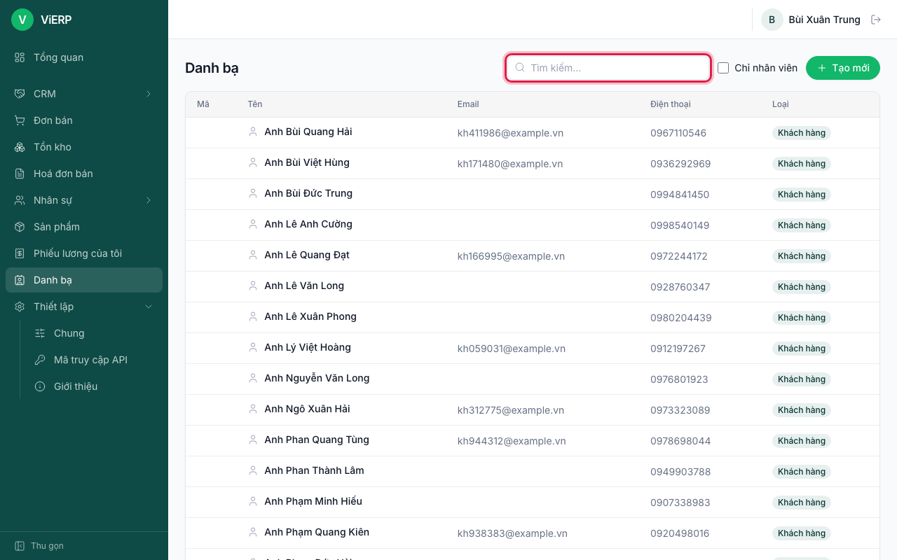
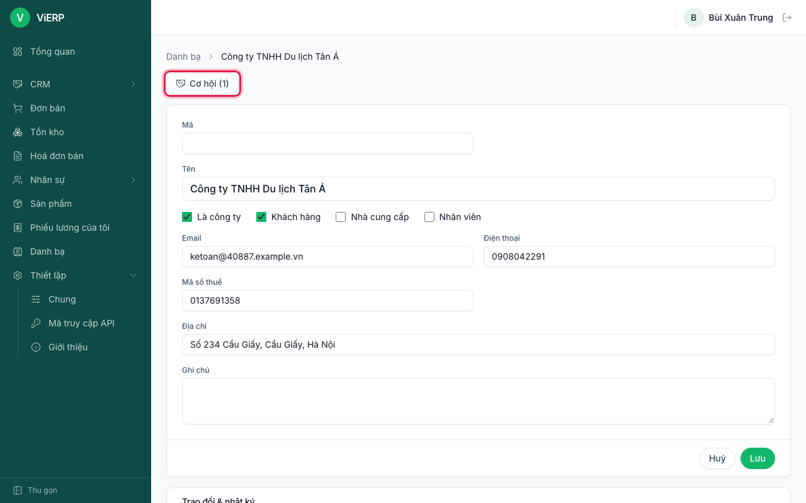
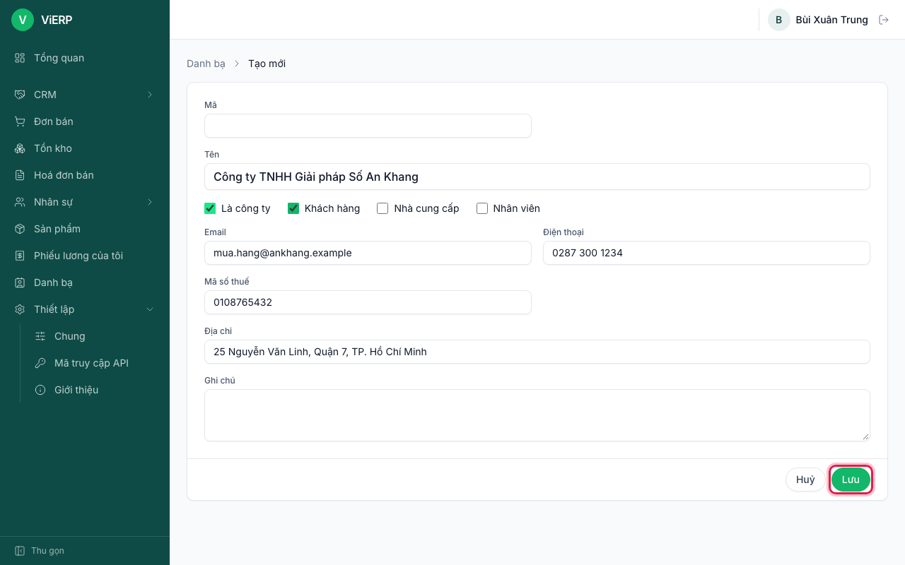
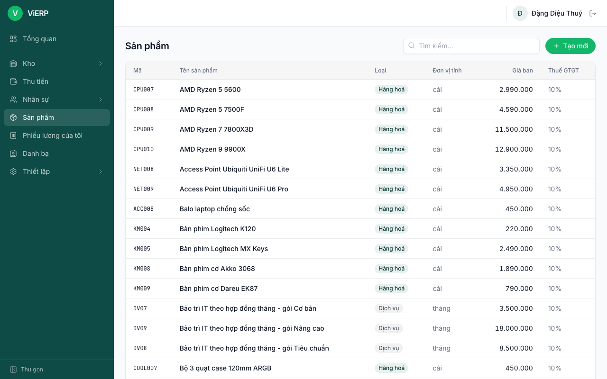
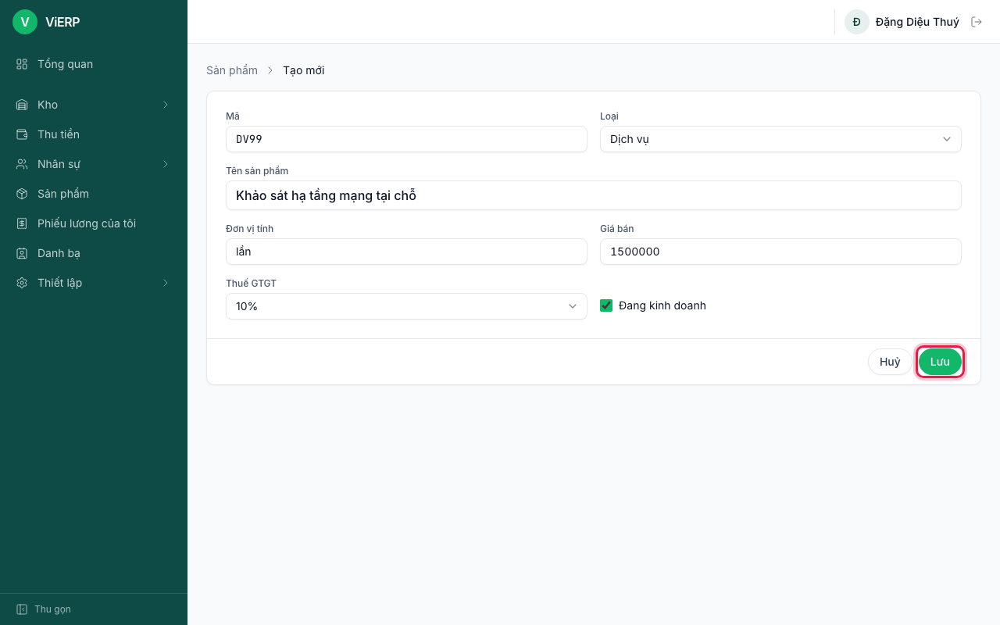

# 2. Danh bạ và Sản phẩm

Danh bạ lưu khách hàng, nhà cung cấp và nhân viên. Sản phẩm lưu hàng hoá và dịch vụ kèm giá bán, thuế GTGT. Hai danh mục này được dùng lại ở mọi chứng từ nên nhập đúng ngay từ đầu.

## 2.1. Tìm một liên hệ

1. Mở **Danh bạ** ở menu bên trái.
2. Gõ tên, mã, email hoặc điện thoại vào ô **Tìm kiếm...**. Có thể tick **Chỉ nhân viên** để lọc.
3. Nhìn cột **Loại** để biết là Khách hàng, Nhà cung cấp hay Nhân viên.

Khi một liên hệ đã có cơ hội bán hàng, trang liên hệ có nút **Cơ hội (n)** để xem nhanh các cơ hội đó.

## 2.2. Thêm khách hàng hoặc nhà cung cấp

1. Ở **Danh bạ**, nhấn **Tạo mới**.
2. Nhập **Tên**. Tick **Là công ty** nếu là doanh nghiệp.
3. Tick **Khách hàng** và/hoặc **Nhà cung cấp** (một liên hệ có thể là cả hai).
4. Nhập **Email**, **Điện thoại**, **Mã số thuế**, **Địa chỉ**, **Ghi chú**. Ô **Mã** để trống thì hệ thống tự đánh số.
5. Nhấn **Lưu** (khung đỏ).

**Kết quả:** liên hệ xuất hiện trong danh bạ và chọn được ở báo giá, hoá đơn, phiếu thu.

**Lưu ý:** hoá đơn điện tử cần mã số thuế người mua đúng (10 số, hoặc dạng 10-XXX, hoặc 12 số). Nhập sai sẽ bị báo "Mã số thuế người mua không hợp lệ" khi phát hành hoá đơn.

## 2.3. Xem danh sách sản phẩm

1. Mở **Sản phẩm** ở menu.
2. Tìm theo mã hoặc tên ở ô **Tìm kiếm...**.

## 2.4. Thêm sản phẩm hoặc dịch vụ

1. Ở **Sản phẩm**, nhấn **Tạo mới**.
2. Nhập **Mã** và **Tên sản phẩm**.
3. Chọn **Loại**: **Hàng hoá** (có theo dõi tồn kho) hoặc **Dịch vụ** (không theo dõi kho).
4. Nhập **Đơn vị tính** (cái, m, kg, lần...) và **Giá bán**.
5. Chọn **Thuế GTGT** (10%, 8%, 5%, 0%, KCT, KKKNT).
6. Để tick **Đang kinh doanh** nếu còn bán. Nhấn **Lưu**.

**Lưu ý:**
- Chỉ **Hàng hoá** được theo dõi tồn kho và giá vốn. Dịch vụ được xuất hoá đơn theo số lượng đặt.
- Không đổi được **Loại** của sản phẩm đã phát sinh chứng từ ("Không thể đổi loại sản phẩm đã phát sinh chứng từ").
- Số lượng có thể lẻ, ví dụ 1,5 m.
