# 3. CRM (chăm sóc khách hàng)

CRM giúp theo dõi từng cơ hội bán hàng từ lúc có người hỏi mua đến lúc chốt đơn hoặc thất bại. Nhân viên kinh doanh chỉ thấy cơ hội của mình; trưởng phòng (có quyền "Xem và giao cơ hội của mọi nhân viên") thấy của mọi người. Cơ hội của người khác với bạn coi như không tồn tại.

## 3.1. Xem bảng Cơ hội

1. Mở **CRM**, **Cơ hội**.
2. Mỗi cột là một giai đoạn: Mới, Đủ điều kiện, Báo giá, Đàm phán, Thắng. Đầu cột có số cơ hội và tổng doanh thu dự kiến.
3. Thanh màu nhỏ dưới tên cột cho biết lịch chăm sóc: quá hạn (đỏ), hôm nay, đã lên lịch, chưa có lịch. Nhấn một đoạn màu để lọc cột.
4. Mỗi thẻ cho thấy tên cơ hội, khách, doanh thu, số sao ưu tiên, hạn chăm sóc kế tiếp và chữ cái đầu của người phụ trách.
5. Kéo thả thẻ sang cột khác để đổi giai đoạn.

Nhân viên kinh doanh thấy bảng chỉ có cơ hội của mình:

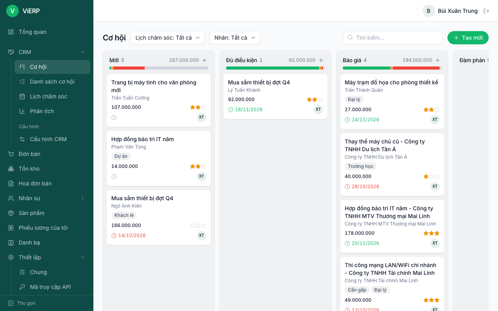

Trưởng phòng có thêm ô **Của tôi**, bộ lọc **Nhân viên phụ trách** và thấy cơ hội của mọi người:

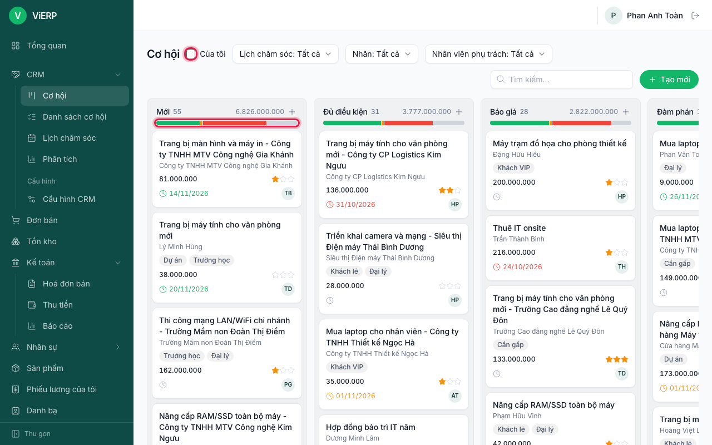

## 3.2. Thêm nhanh một cơ hội

1. Ở cột muốn thêm (thường là **Mới**), nhấn dấu **+** (**Thêm nhanh cơ hội**).

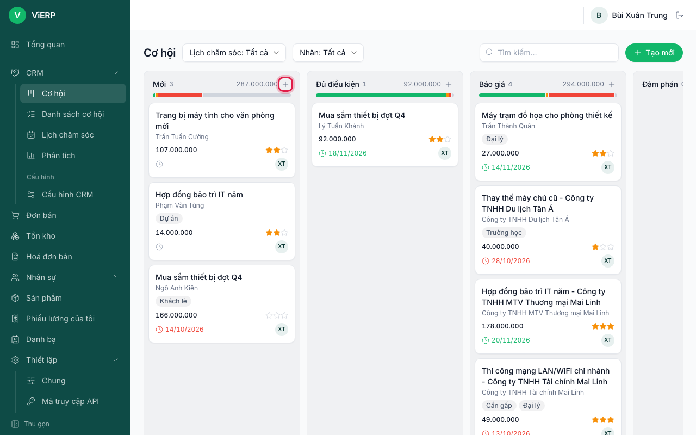

2. Nhập tên cơ hội. Chọn khách hàng có sẵn ở ô tìm kiếm, hoặc nếu chưa có thì gõ **Tên người liên hệ**.
3. Nhập doanh thu dự kiến và chấm số sao ưu tiên.
4. Nhấn **Tạo mới**.

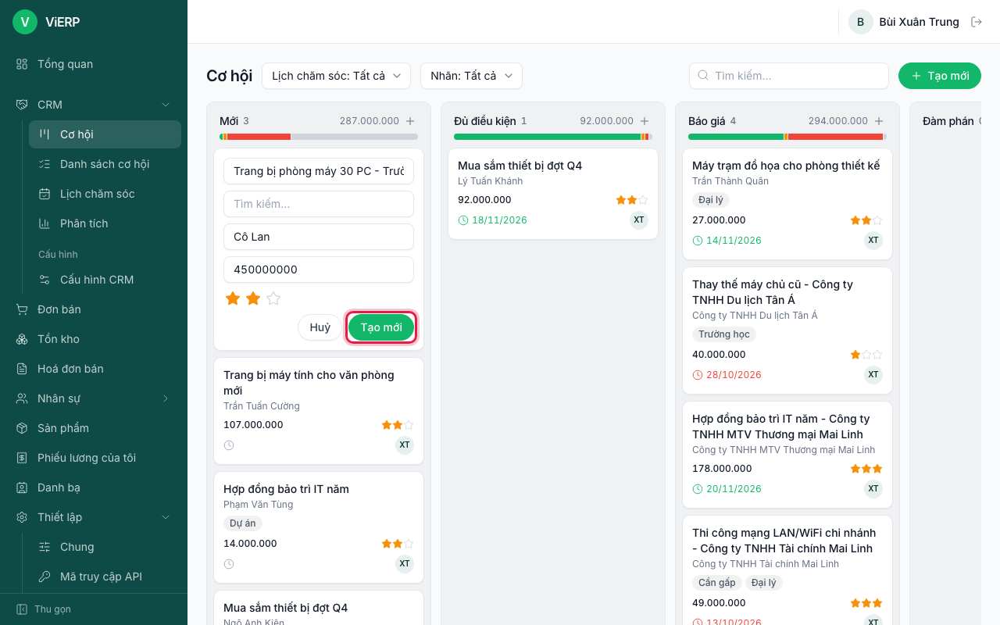

**Kết quả:** thẻ mới xuất hiện đầu cột. Nhấn vào thẻ để mở chi tiết.

## 3.3. Mở và bổ sung thông tin cơ hội

1. Nhấn vào thẻ cơ hội. Phía trên là các nút giai đoạn; bấm một giai đoạn để chuyển nhanh.
2. Bổ sung: **Điện thoại**, **Email**, **Nhân viên phụ trách**, **Doanh thu dự kiến**, **Xác suất (%)**, **Dự kiến chốt**, **Mức ưu tiên**, **Nhãn**, **Nguồn**, **Ghi chú**. Nếu chưa có **Khách hàng** thì nhập **Tên người liên hệ**.
3. Nhấn **Lưu**.

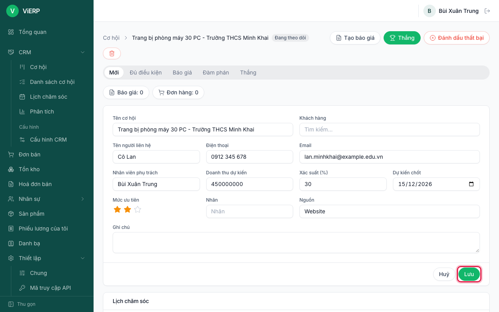

**Lưu ý:** nếu hệ thống thấy cơ hội khác trùng người liên hệ, một khung vàng "Có cơ hội trùng liên hệ..." hiện ra để bạn kiểm tra trước khi tạo thêm.

## 3.4. Lên lịch chăm sóc và hoàn thành

1. Trong cơ hội, kéo xuống mục **Lịch chăm sóc**.
2. Chọn **Loại** (Gọi điện, Email, Cuộc họp, Việc cần làm, Tải tài liệu). Nội dung và hạn mặc định được điền sẵn theo loại.
3. Sửa **Nội dung**, hạn nếu cần, rồi nhấn **Thêm lịch**.

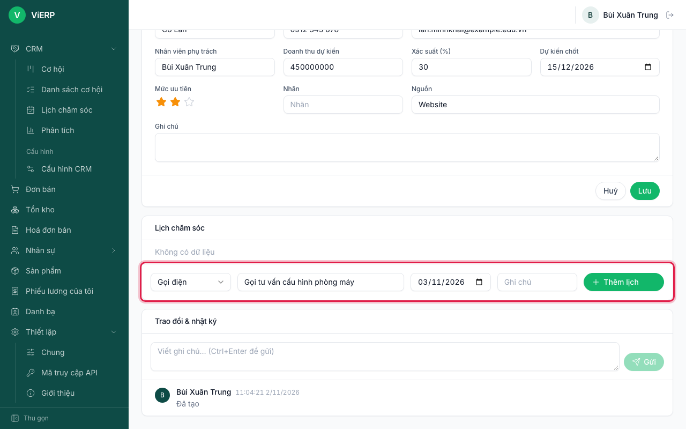

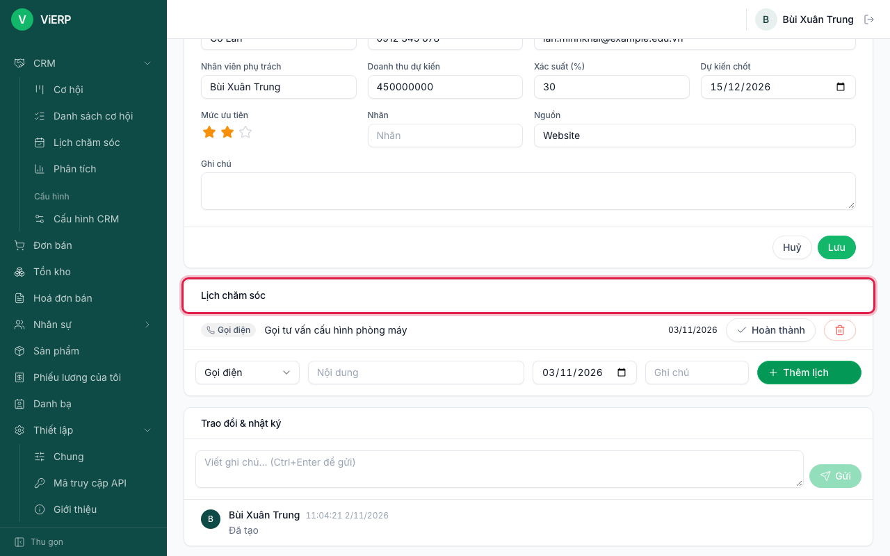

4. Khi đã làm xong, nhấn **Hoàn thành** ở dòng lịch. Cửa sổ **Kết quả / phản hồi** hiện ra.
5. Ghi kết quả, rồi chọn **Hoàn thành**, hoặc **Xong & lên lịch tiếp** để tạo luôn việc kế tiếp.

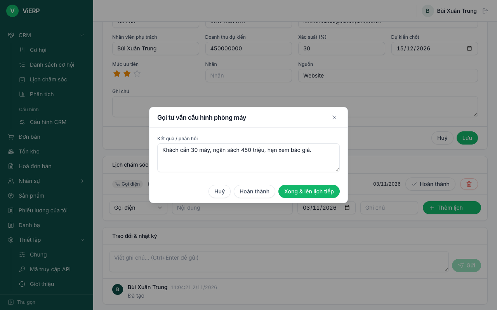

## 3.5. Tạo báo giá từ cơ hội

1. Mở cơ hội, nhấn **Tạo báo giá**.
2. Nếu cơ hội chưa có khách hàng, hệ thống hỏi: chọn **Tạo khách hàng mới** (dùng tên, điện thoại, email của cơ hội) hoặc **Chọn khách hàng có sẵn**. Nếu email hoặc điện thoại trùng một liên hệ cũ, liên hệ đó được chọn sẵn.

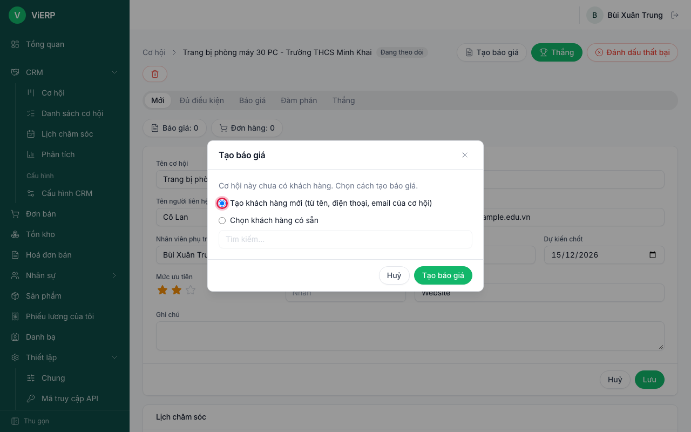

3. Nhấn **Tạo báo giá** trong hộp thoại.

**Kết quả:** mở ra đơn bán nháp mới, có liên kết **Từ cơ hội bán hàng** cạnh số đơn. Thêm sản phẩm như ở [chương 4](04-ban-hang.md). Trên cơ hội sẽ hiện "Báo giá: n" và "Đơn hàng: n".

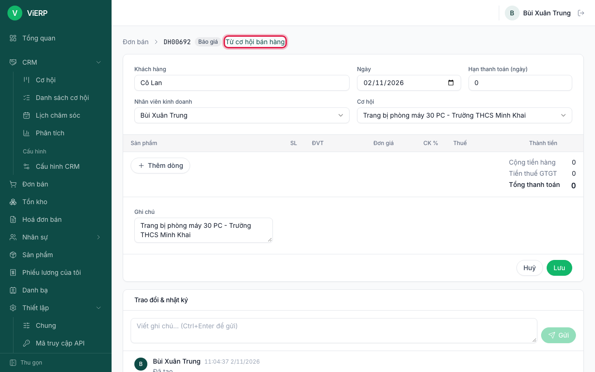

**Lưu ý:** khi đơn bán này được xác nhận, cơ hội tự chuyển sang **Thắng** và nhật ký ghi "Thắng do đơn hàng ... được xác nhận".

## 3.6. Đánh dấu thất bại và mở lại

1. Mở cơ hội, nhấn **Đánh dấu thất bại**.
2. Chọn **Lý do thất bại** (Giá cao, Chọn đối thủ, Không có nhu cầu, Không liên lạc được, Ngân sách không đủ) và ghi **Ghi chú**.

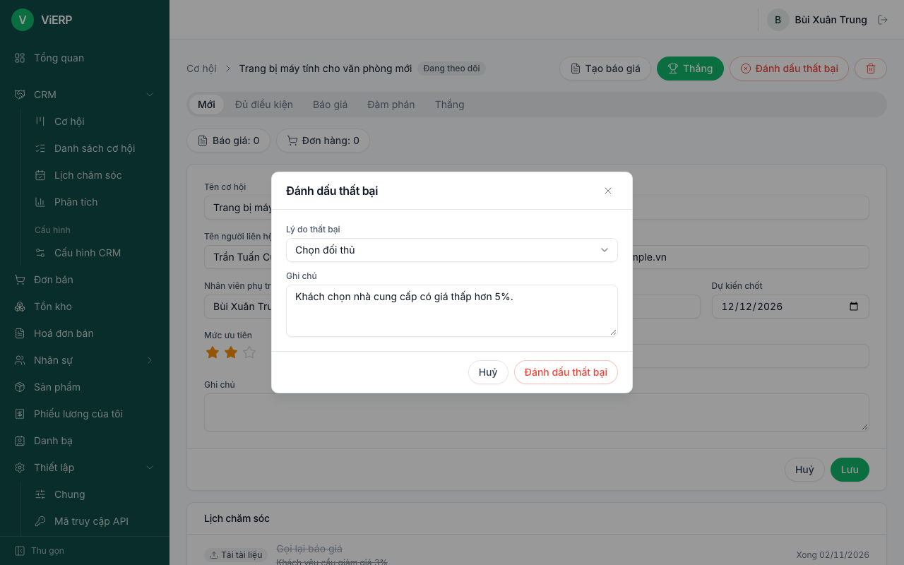

3. Nhấn **Đánh dấu thất bại** trong hộp thoại.

**Kết quả:** cơ hội có nhãn **THUA** và dòng lý do. Nhấn **Mở lại** nếu khách quay lại. Để chốt thành công, nhấn **Thắng** (chuyển sang giai đoạn Thắng).

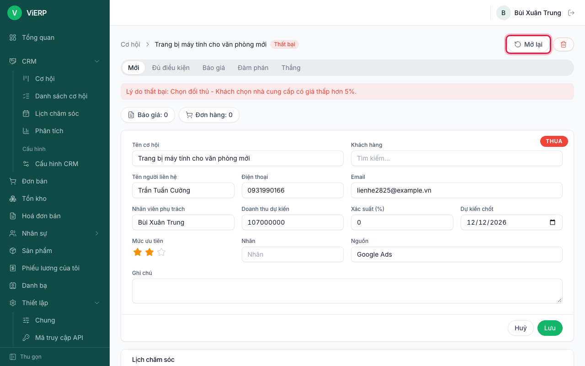

## 3.7. Danh sách cơ hội

1. Mở **Danh sách cơ hội**: dạng bảng, dễ lọc và tìm.
2. Lọc theo trạng thái; trưởng phòng có thêm **Của tôi**.

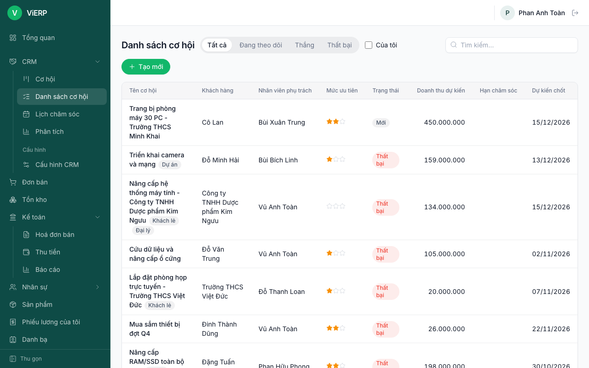

## 3.8. Lịch chăm sóc

1. Mở **Lịch chăm sóc**: mọi việc cần làm, cột **Hạn**, **Loại**, **Nội dung**, **Cơ hội**. Việc quá hạn hiện màu đỏ.
2. Nhấn **Hoàn thành** ở từng việc. Trưởng phòng có thêm lựa chọn xem lịch **của mọi người**.

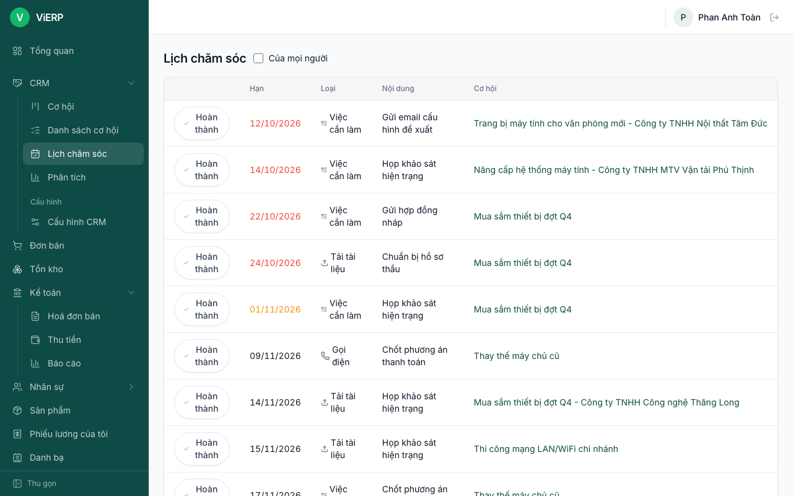

## 3.9. Phân tích

1. Mở **Phân tích**.
2. Chọn **Nhóm theo**: Giai đoạn, Nhân viên, Tháng dự kiến chốt hoặc Lý do thua; chọn khoảng **Từ/Đến**.
3. Đọc **Số cơ hội**, **Doanh thu dự kiến** và **Doanh thu theo xác suất** (doanh thu nhân xác suất).

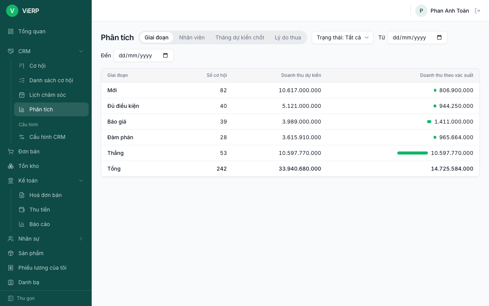

## 3.10. Cấu hình CRM (quản lý)

1. Mở **Cấu hình CRM** (nhóm Cấu hình).
2. Các tab: **Giai đoạn** (tên, thứ tự, thu gọn, yêu cầu của giai đoạn), **Nhãn**, **Lý do thua**, **Loại hoạt động** (biểu tượng, số ngày hạn, việc tiếp theo).

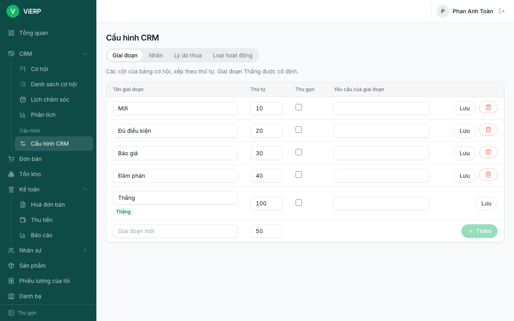

**Lưu ý:** không xoá được giai đoạn **Thắng**.

## 3.11. Dùng trên điện thoại

Bảng cơ hội trên điện thoại cuộn ngang qua từng giai đoạn:

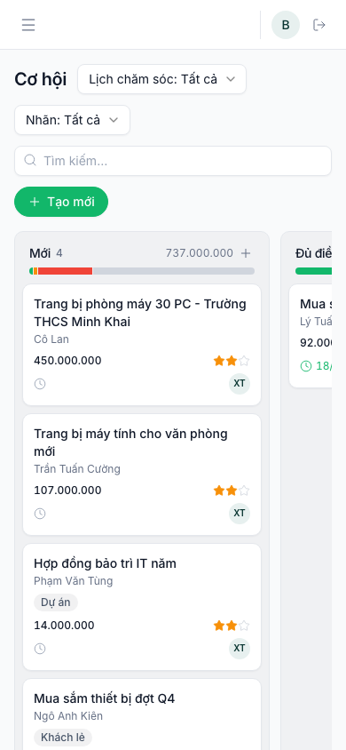
