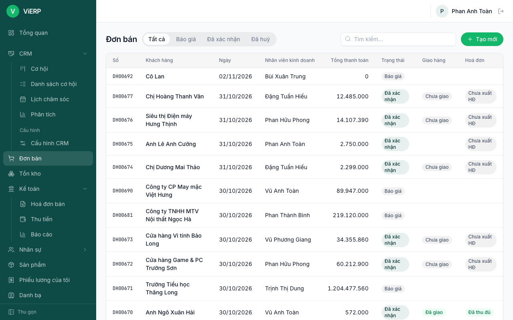
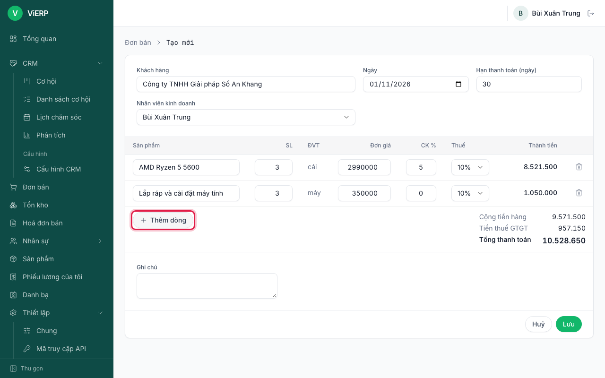
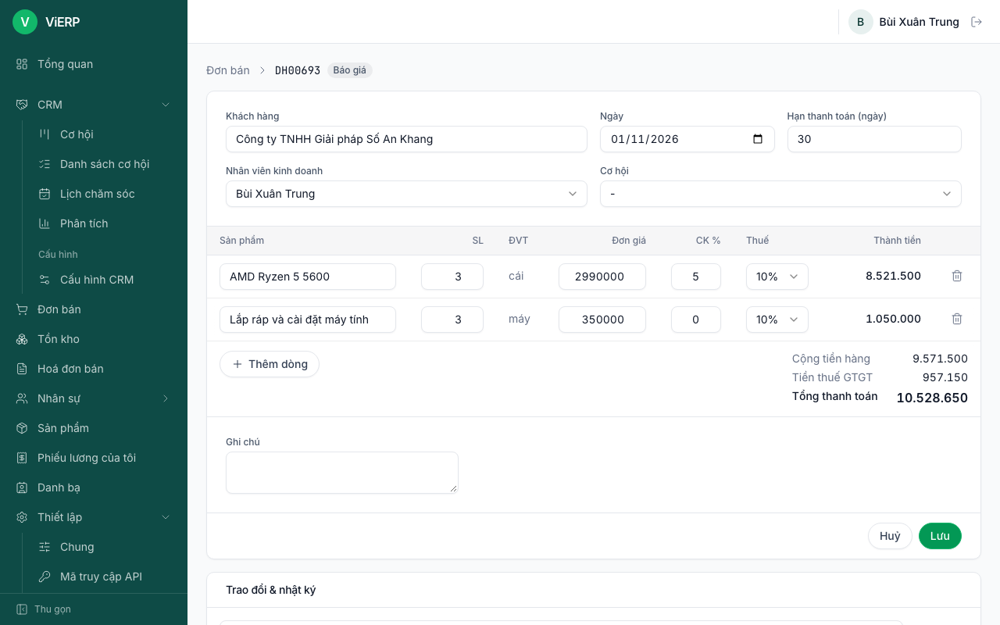
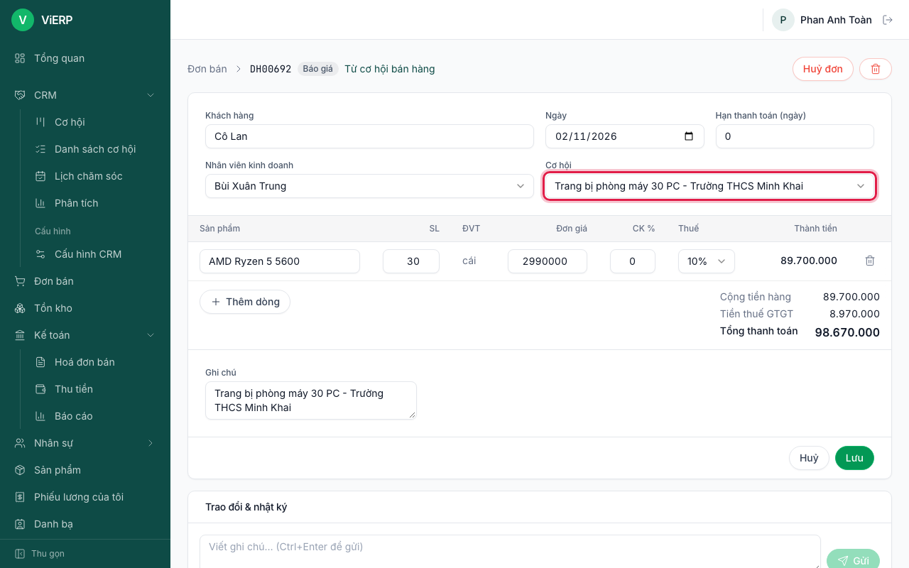
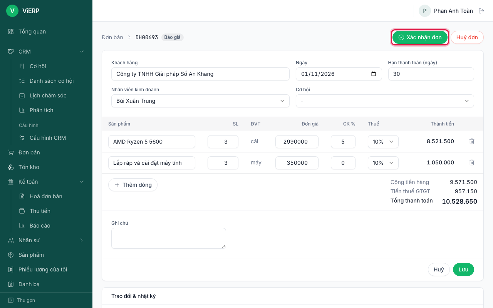
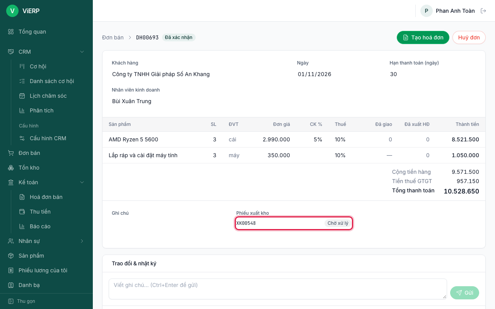
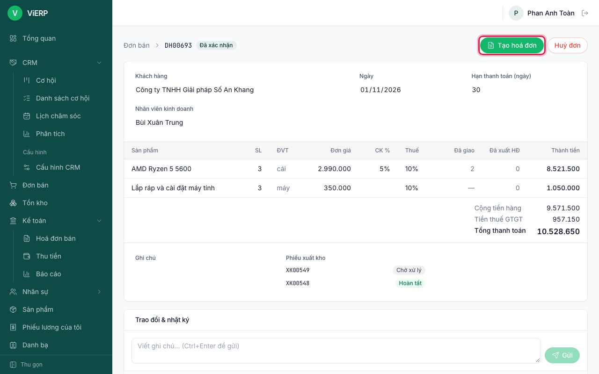
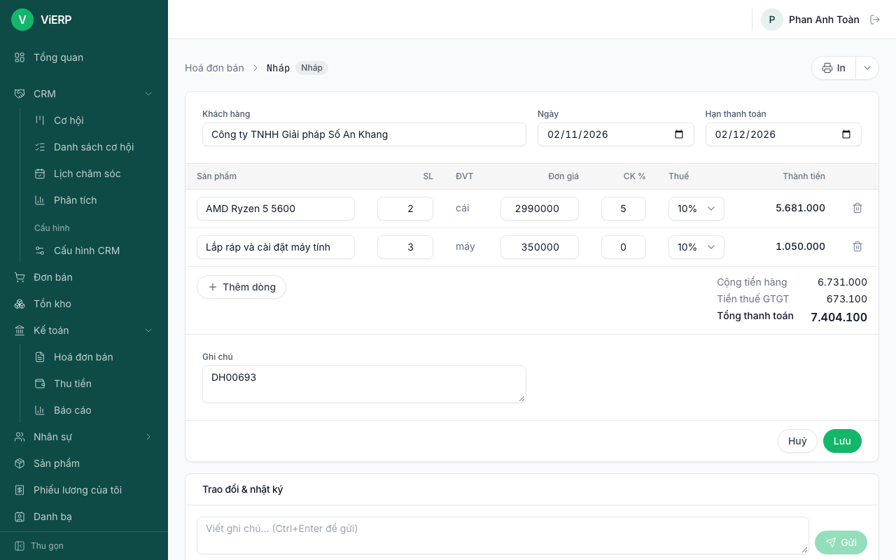
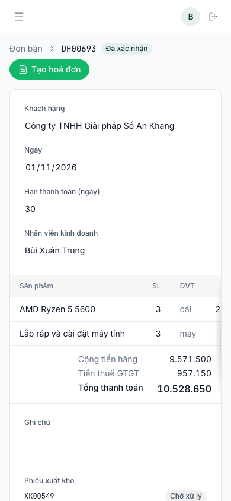

# 4. Bán hàng

Luồng chung của một đơn hàng:

```
Báo giá --Xác nhận đơn--> Phiếu xuất kho (tự tạo) --giao hàng--> Tạo hoá đơn --Ghi sổ--> HĐĐT --> Thu tiền
```

Nhân viên kinh doanh tạo báo giá; trưởng phòng (có quyền "Duyệt: đơn bán") xác nhận. Ví dụ trong chương này dùng chung một đơn cho khách "Công ty TNHH Giải pháp Số An Khang" (tạo ở [chương 2](02-danh-ba-san-pham.md)); đơn đó đi tiếp qua [chương 5](05-kho.md) và [chương 6](06-ke-toan.md).

## 4.1. Xem danh sách đơn bán

1. Mở **Đơn bán**.
2. Dùng các nút **Tất cả / Báo giá / Đã xác nhận / Đã huỷ** để lọc, hoặc gõ vào **Tìm kiếm...**.
3. Đọc các cột: **Số**, **Khách hàng**, **Ngày**, **Nhân viên kinh doanh**, **Tổng thanh toán**, **Trạng thái**, **Giao hàng** (Chưa giao, Giao một phần, Đã giao), **Hoá đơn** (Chưa xuất HĐ, Xuất HĐ một phần, Đã xuất HĐ, Thu một phần, Đã thu đủ).



## 4.2. Tạo báo giá

1. Nhấn **Tạo mới**.
2. Ở **Khách hàng**, gõ vài chữ rồi chọn khách trong danh sách gợi ý.
3. Nhập **Hạn thanh toán (ngày)**; kiểm tra **Ngày** và **Nhân viên kinh doanh**.
4. Nhấn **Thêm dòng**. Ở cột **Sản phẩm** gõ mã hoặc tên rồi chọn; **Đơn giá** và **Thuế** tự điền từ sản phẩm.
5. Nhập **SL** (có thể lẻ) và **CK %** nếu có chiết khấu. **Thành tiền** tự tính. Thêm dòng khác nếu cần.
6. Kiểm tra **Cộng tiền hàng**, **Tiền thuế GTGT**, **Tổng thanh toán**.



7. Nhấn **Lưu**.



**Kết quả:** đơn ở trạng thái **Báo giá** (nháp), chưa ảnh hưởng kho và sổ sách. Nhân viên kinh doanh không có quyền xác nhận nên không thấy nút **Xác nhận đơn**.

## 4.3. Gắn đơn với một cơ hội CRM

1. Mở báo giá nháp đã lưu (ô **Cơ hội** chỉ hiện trên đơn nháp đã lưu, khi ứng dụng CRM đang bật và bạn có quyền sửa cả cơ hội lẫn đơn bán, ví dụ trưởng phòng kinh doanh).
2. Ở ô **Cơ hội**, chọn một cơ hội (chưa thất bại) của cùng khách. Việc liên kết được lưu ngay khi chọn, không cần nhấn **Lưu**.
3. Khi đơn được xác nhận, cơ hội đó tự chuyển sang **Thắng**.



## 4.4. Xác nhận đơn (trưởng phòng)

1. Mở báo giá, kiểm tra lại các dòng.
2. Nhấn **Xác nhận đơn**.



**Kết quả:** đơn chuyển **Đã xác nhận**; mục **Phiếu xuất kho** hiện số phiếu mới (trạng thái Chờ xử lý); bảng dòng hàng có thêm cột **Đã giao** và **Đã xuất HĐ**.



**Lưu ý:**
- Người tạo báo giá không tự xác nhận được, trừ khi có quyền tự duyệt. Nếu bạn sửa đơn trước khi xác nhận, bạn trở thành người nhập đơn và cũng không xác nhận được nữa.
- **Huỷ đơn** chỉ được khi chưa giao hàng và chưa có hoá đơn ("Đơn đã giao hàng hoặc đã có hoá đơn, không thể huỷ").

## 4.5. Tạo hoá đơn từ đơn bán

Hàng hoá phải được giao (chương 5) rồi mới xuất hoá đơn. Dịch vụ xuất hoá đơn ngay theo số lượng đặt.

1. Mở đơn đã xác nhận. Sau khi giao một phần, mục **Phiếu xuất kho** của đơn liệt kê hai phiếu: phiếu đã **Hoàn tất** và phiếu phần còn lại ở **Chờ xử lý** (cột **Giao hàng** của danh sách đơn hiện "Giao một phần"). Nút **Tạo hoá đơn** đã sẵn sàng.



2. Nhấn **Tạo hoá đơn**.

**Kết quả:** hệ thống tạo hoá đơn **nháp**: hàng hoá tính theo số lượng đã giao, dịch vụ theo số lượng đặt. Kế toán kiểm tra và ghi sổ ở [chương 6](06-ke-toan.md). Đơn hiện liên kết tới các hoá đơn của nó.



**Lưu ý:** nếu không còn gì để xuất, hệ thống báo "Không còn gì để xuất hoá đơn (hàng hoá phải giao trước)". Tạo hoá đơn cần quyền sửa đơn bán.

## 4.6. Dùng trên điện thoại

Form đơn bán tự xếp lại cho vừa màn hình nhỏ:


