# 5. Kho

Kho theo dõi tồn, nhập và xuất hàng hoá theo giá vốn bình quân gia quyền di động. Dịch vụ không qua kho.

> Việc tạo kho (địa điểm kho) hiện chưa có màn hình; công ty dùng sẵn một kho tên "Kho chính".

## 5.1. Xem tồn kho

1. Mở **Kho**, **Tồn kho**.
2. Các cột: **Mã**, **Tên sản phẩm**, **Tồn**, **ĐVT**, **Giá vốn BQ**, **Giá trị**.

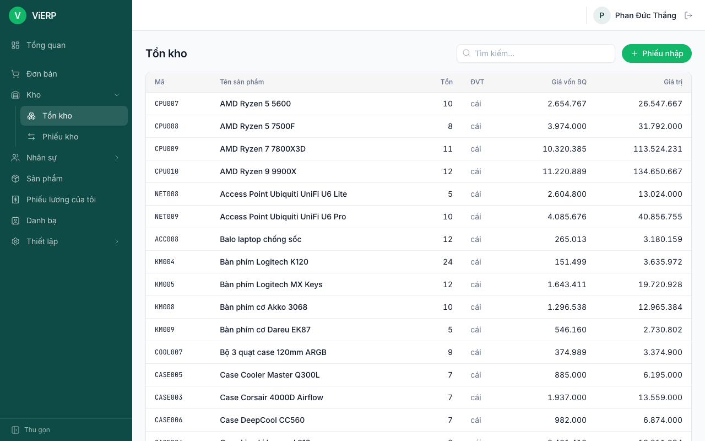

3. Gõ mã hoặc tên vào **Tìm kiếm...**, rồi nhấn vào một dòng để xem tồn theo từng kho.

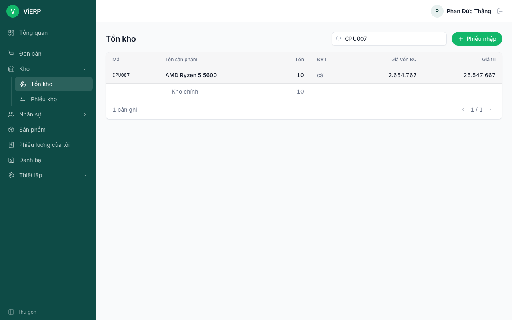

## 5.2. Danh sách phiếu kho

1. Mở **Kho**, **Phiếu kho**.
2. Lọc **Tất cả / Nhập kho / Xuất kho**. Tick **Chờ xử lý** để chỉ xem phiếu chưa xác nhận.
3. Cột **Nguồn** có liên kết **Đơn bán** cho phiếu xuất sinh từ đơn bán.

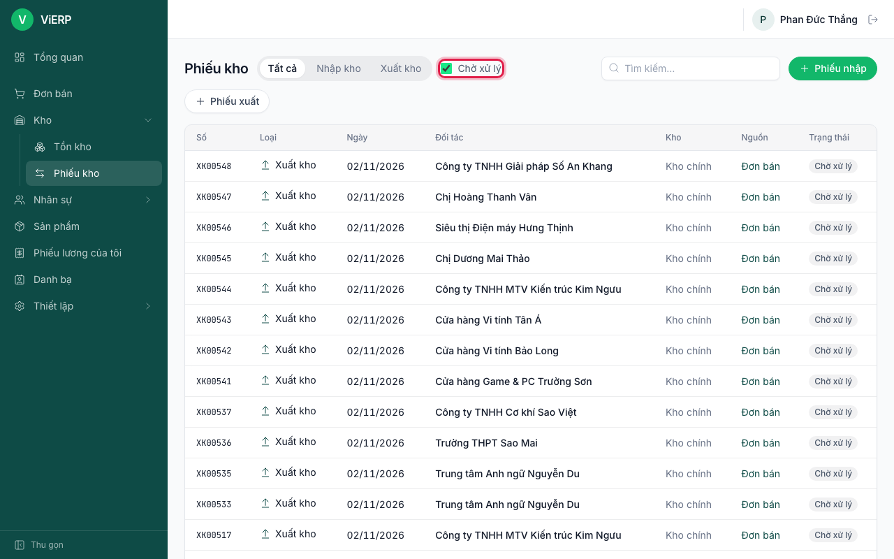

## 5.3. Xuất kho cho đơn bán

Khi trưởng phòng xác nhận đơn bán, hệ thống tự tạo **phiếu xuất kho** ở trạng thái **Chờ xử lý**.

1. Mở phiếu từ danh sách (hoặc từ liên kết **Phiếu xuất kho** trong đơn bán). Phiếu có liên kết **Đơn bán** về đơn gốc.

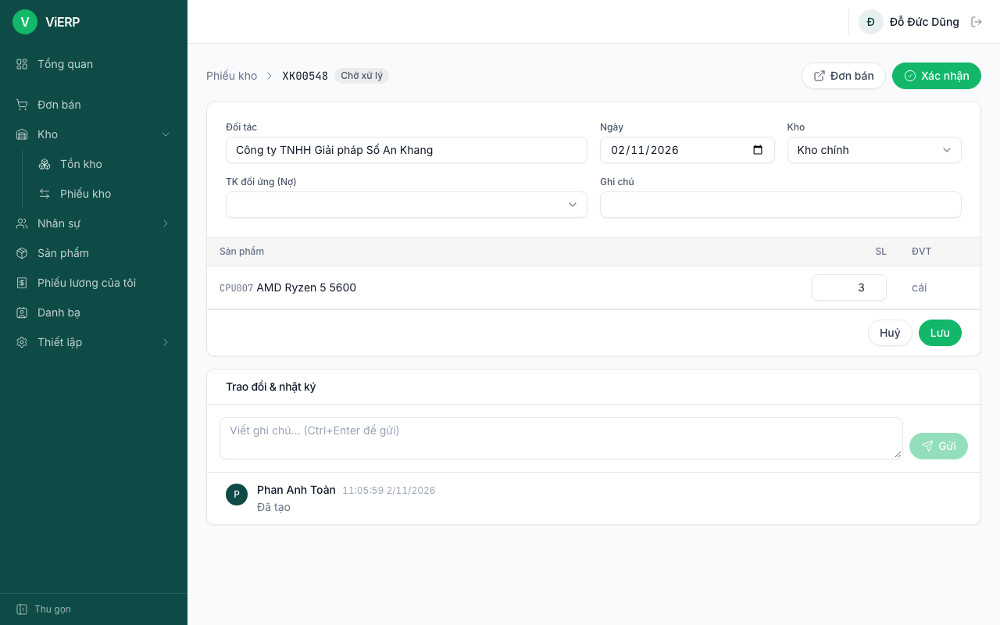

2. Kiểm tra **Kho** và số lượng từng dòng. Ô **TK đối ứng (Nợ)** để trống là bình thường với phiếu sinh từ đơn bán: hệ thống tự dùng tài khoản giá vốn đã cấu hình.
3. Nhấn **Xác nhận** (khung đỏ). Trong ví dụ này phiếu ban đầu ghi 3 cái nhưng đã được giảm còn 2 trước khi xác nhận (xem 5.4), nên ảnh kết quả bên dưới ghi 2.

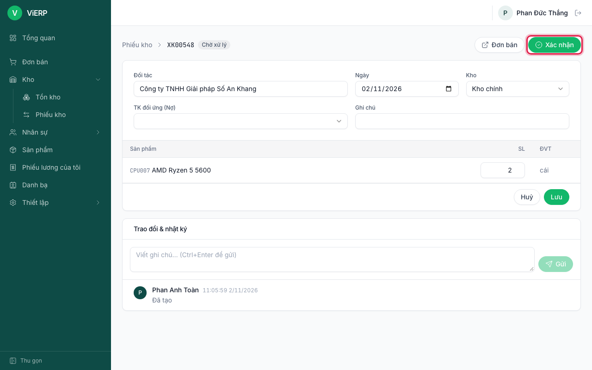

**Kết quả:** phiếu chuyển **Hoàn tất**; cột **Đơn giá vốn** và **Giá trị** hiện theo giá vốn bình quân; xuất hiện nút **Bút toán**.

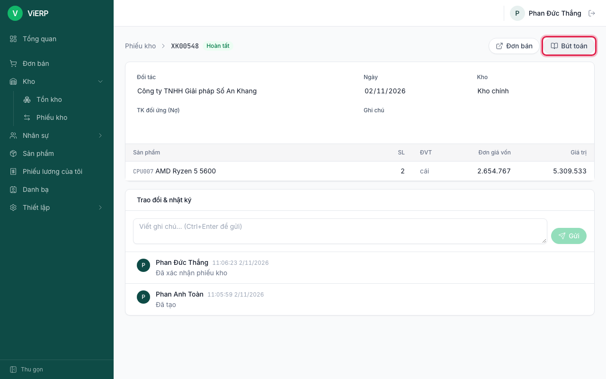

Bút toán ghi giá vốn: **Nợ 632 (giá vốn hàng bán) / Có 156 (hàng hoá)** theo giá vốn bình quân. Nhấn **Bút toán** để xem (cần quyền xem bút toán, ví dụ kế toán):

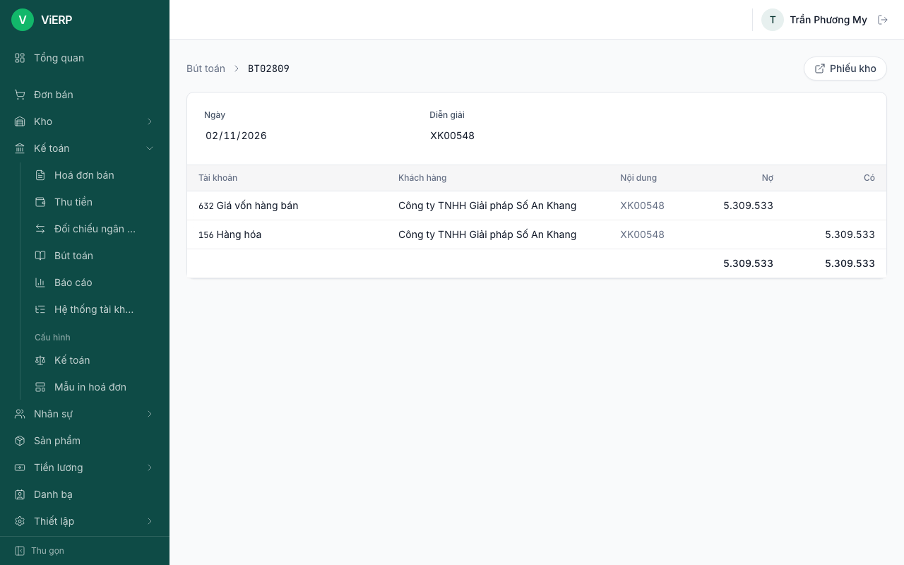

**Lưu ý:** không đủ tồn thì hệ thống báo "Không đủ tồn kho cho ...". Số hiệu tài khoản (632, 156) là mặc định TT200/TT99, có thể khác nếu công ty đổi cấu hình.

## 5.4. Giao một phần (phiếu giao phần còn lại)

Khi khách chỉ nhận trước một phần, sửa số lượng trên phiếu trước khi xác nhận.

1. Mở phiếu xuất Chờ xử lý. Sửa **SL** của dòng thành số lượng thực giao (ví dụ 3 giảm còn 2).

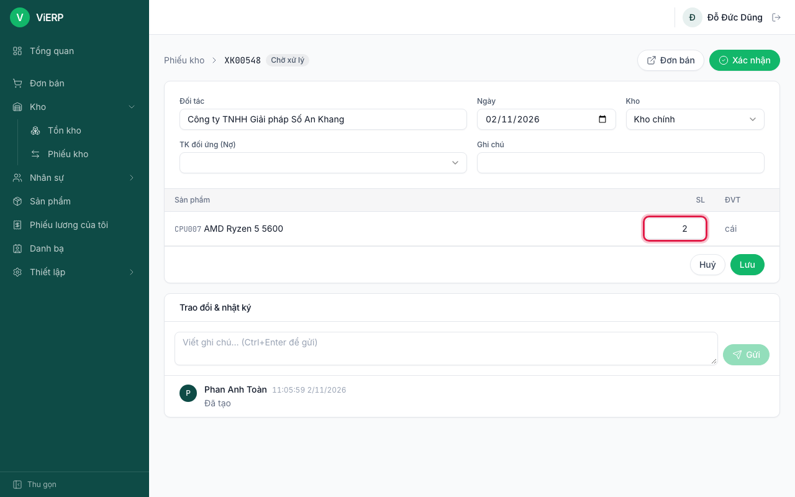

2. Nhấn **Lưu**. Rồi **một người khác** (thủ kho có quyền duyệt) mở phiếu và nhấn **Xác nhận**.
3. Hệ thống tự tạo **phiếu xuất mới cho phần còn lại** (còn gọi là backorder), vẫn ở Chờ xử lý.

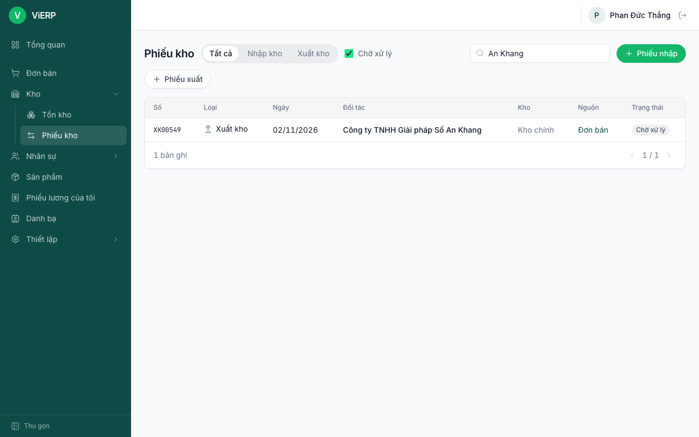

**Lưu ý:** bấm **Lưu** biến bạn thành người nhập phiếu, nên người xác nhận phải là người khác (trừ khi có quyền tự duyệt).

## 5.5. Nhập kho

1. Ở **Phiếu kho** hoặc **Tồn kho**, nhấn **Phiếu nhập**.
2. Chọn **Đối tác** (nhà cung cấp), kiểm tra **Ngày**, **Kho**, **TK đối ứng (Có)** (331 Phải trả cho người bán).
3. Ở dòng hàng đầu tiên, chọn **Sản phẩm**, nhập **SL** và **Đơn giá vốn**. Nhấn **Thêm dòng** nếu nhiều mặt hàng.

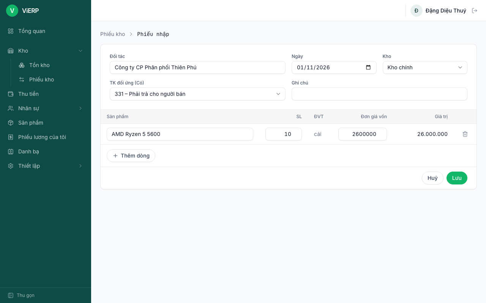

4. Nhấn **Lưu**. Người khác (thủ kho) mở phiếu và nhấn **Xác nhận**.

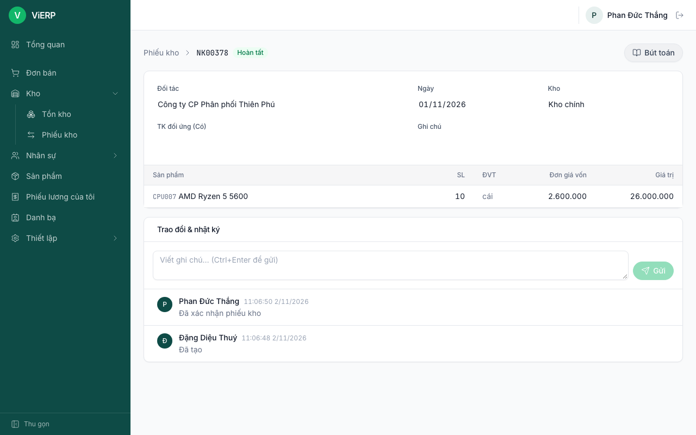

**Kết quả:** tồn tăng, giá vốn bình quân được tính lại. Bút toán: **Nợ 156 / Có 331**.

**Lưu ý:** ViERP chưa có phân hệ mua hàng. Thuế GTGT đầu vào (Nợ 1331 / Có 331) và thanh toán nhà cung cấp được ghi bằng bút toán thủ công ở [chương 6](06-ke-toan.md#67-bút-toán-thủ-công).

## 5.6. Huỷ phiếu

Phiếu **nháp** tự tạo (không sinh từ chứng từ khác) có nút **Huỷ phiếu**, chỉ người nhập mới huỷ được. Phiếu sinh từ đơn bán không huỷ tại đây: hệ thống báo "Phiếu kho được tạo từ chứng từ nguồn, hãy huỷ từ chứng từ đó".
