# 6. Kế toán

Kế toán nhận hoá đơn nháp từ đơn bán, ghi sổ, phát hành hoá đơn điện tử, thu tiền, ghi bút toán thủ công, đối chiếu ngân hàng và xem báo cáo. Số hiệu tài khoản dưới đây là mặc định TT200/TT99; chương trình luôn hạch toán theo "Tài khoản hạch toán" đã cấu hình ([mục 10.5](10-quan-tri.md)), nên số hiệu có thể khác nếu công ty đổi cấu hình.

## 6.1. Xem danh sách hoá đơn bán

1. Mở **Kế toán**, **Hoá đơn bán**.
2. Lọc **Tất cả / Nháp / Chưa thu / Đã huỷ** hoặc gõ vào **Tìm kiếm...**.
3. Các cột: **Số**, **Khách hàng**, **Ngày**, **Hạn thanh toán** (quá hạn hiện đỏ), **Tổng thanh toán**, **Còn phải thu**, **Trạng thái** (Nháp, Chưa thu, Thu một phần, Đã thu, Đã huỷ), **HĐĐT**.

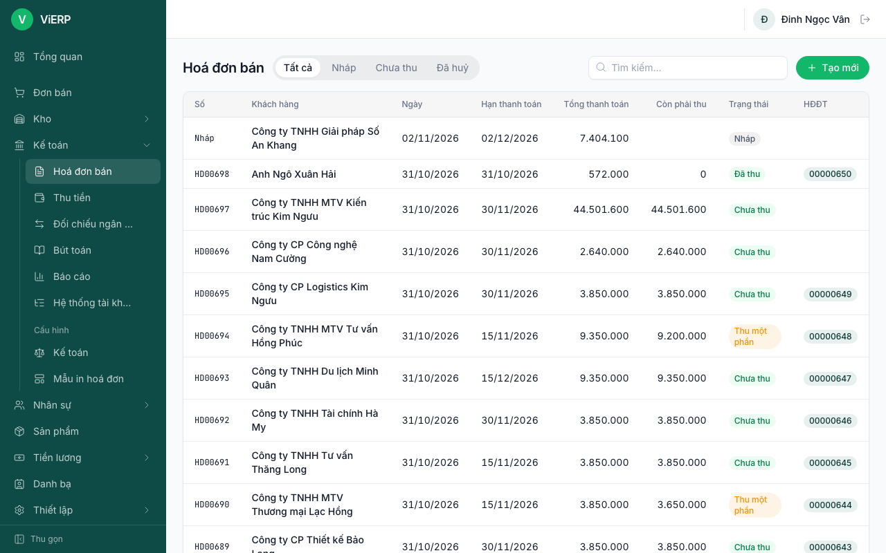

## 6.2. Kiểm tra và ghi sổ hoá đơn

1. Mở hoá đơn nháp (tạo từ đơn bán). Kiểm tra **Khách hàng**, **Ngày**, **Hạn thanh toán** và các dòng hàng.
2. Nhấn **Ghi sổ** (khung đỏ).

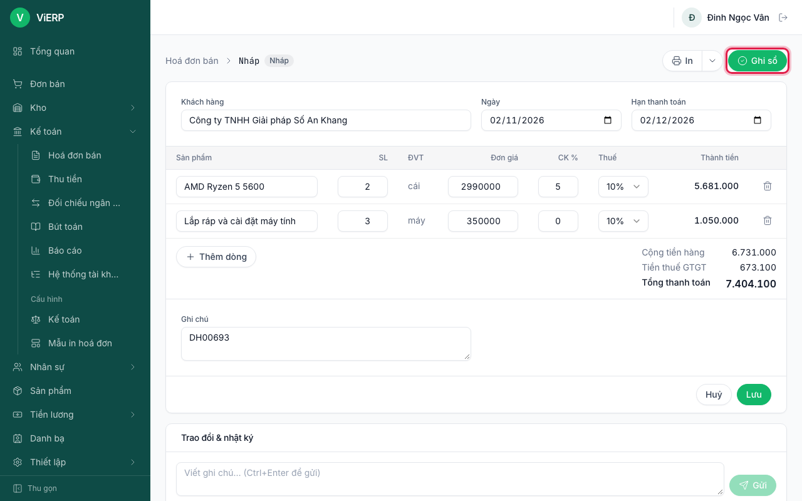

**Kết quả:** trạng thái thành **Chưa thu**. Hệ thống tạo mã QR chuyển khoản (VietQR) kèm dòng "Quét để chuyển khoản ... đ" và hiện các nút **Thu tiền**, **Phát hành HĐĐT**, **In**.

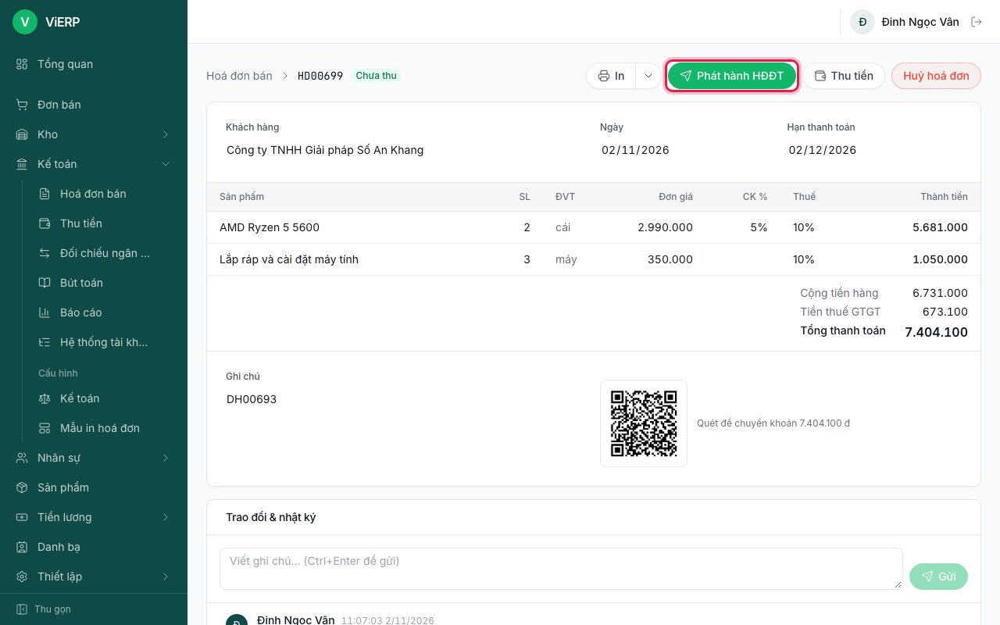

Bút toán: **Nợ 131 (phải thu khách hàng) / Có 511 (doanh thu), Có 3331 (thuế GTGT phải nộp)**.

**Lưu ý:** nếu ngày hoá đơn nằm trong kỳ đã khoá, hệ thống báo "Kỳ kế toán đã khoá sổ đến ngày ...". Người nhập hoá đơn nháp cần có quyền tự duyệt mới ghi sổ được chính hoá đơn mình nhập.

## 6.3. Phát hành hoá đơn điện tử (HĐĐT)

1. Mở hoá đơn đã ghi sổ, nhấn **Phát hành HĐĐT**.
2. Chờ hệ thống trả kết quả.

**Kết quả:** khung xanh hiện **Ký hiệu**, **Số HĐ**, **Mã tra cứu** và liên kết **Tệp hoá đơn** để tải bản thể hiện (PDF).

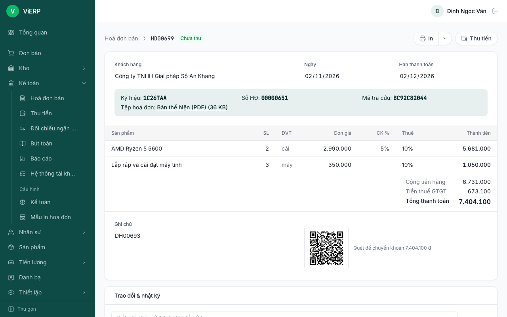

**Lưu ý:**
- Lỗi thường gặp: "Mã số thuế người mua không hợp lệ" (sửa MST ở Danh bạ rồi thử lại), hoặc "Lỗi phát hành HĐĐT".
- Sau khi đã phát hành HĐĐT, không huỷ được hoá đơn trên ViERP (cần hoá đơn điều chỉnh hoặc thay thế, tính năng này chưa có).
- Bản cài đặt thử dùng nhà cung cấp "sandbox", không có giá trị pháp lý.

## 6.4. In hoặc tải PDF

1. Nhấn **In** để mở hoá đơn A4 ở thẻ mới của trình duyệt rồi in.
2. Nhấn mũi tên nhỏ cạnh nút **In** (**Tuỳ chọn in**) để **Tải PDF** hoặc chọn mẫu in khác nếu công ty có nhiều mẫu.

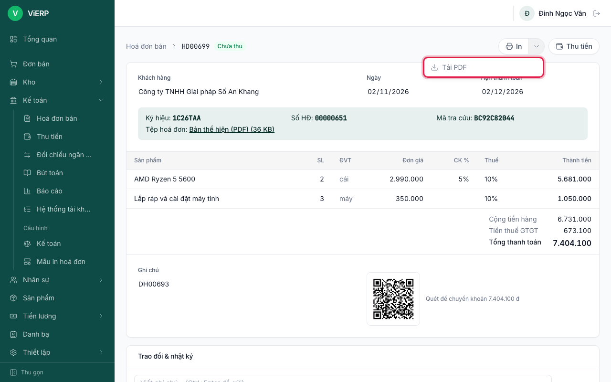

**Lưu ý:** nếu thiếu thông tin công ty, trang hiện cảnh báo "Thông tin công ty chưa đầy đủ ..." kèm liên kết để bổ sung.

## 6.5. Huỷ hoá đơn

Nút **Huỷ hoá đơn** chỉ có khi hoá đơn đã ghi sổ, chưa thu tiền và chưa phát hành HĐĐT. Hệ thống tự ghi bút toán đảo. (Thao tác này có hộp thoại xác nhận nên không có hình minh hoạ.)

## 6.6. Thu tiền

1. Mở hoá đơn đã ghi sổ, nhấn **Thu tiền**. Form phiếu thu mở ra, đã điền sẵn **Khách hàng** và số tiền còn phải thu.
2. Kiểm tra **Ngày**, **Số tiền**, **Hình thức** (Chuyển khoản hoặc Tiền mặt) và **Ghi chú**.
3. Nhấn **Lưu nháp** để nhờ người khác duyệt, hoặc **Lưu & duyệt** nếu bạn có quyền tự duyệt.

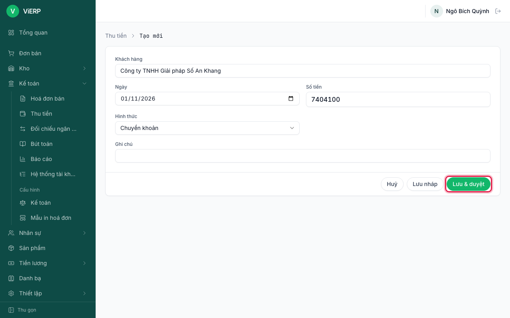

**Kết quả:** phiếu thu **Đã ghi sổ**; tiền được cấn trừ cho hoá đơn cũ nhất ("Đã cấn trừ cho hoá đơn ..."). Phần dư (nếu có) hiện là "Chưa cấn trừ (tạm ứng)".

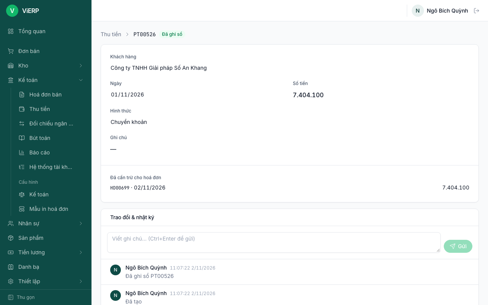

Bút toán: **Nợ 112 (hoặc 111) / Có 131**. Hoá đơn chuyển **Đã thu** (hoặc **Thu một phần**):

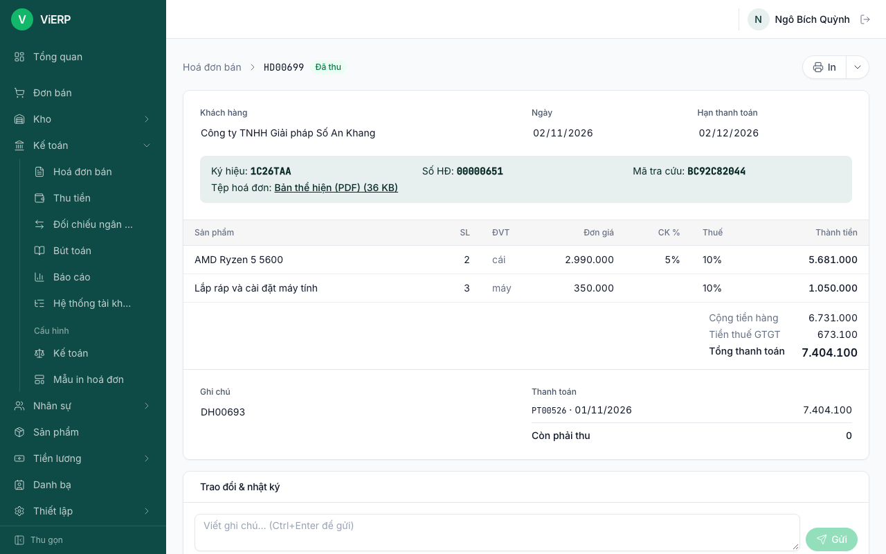

Xem mọi phiếu thu ở **Kế toán**, **Thu tiền**:

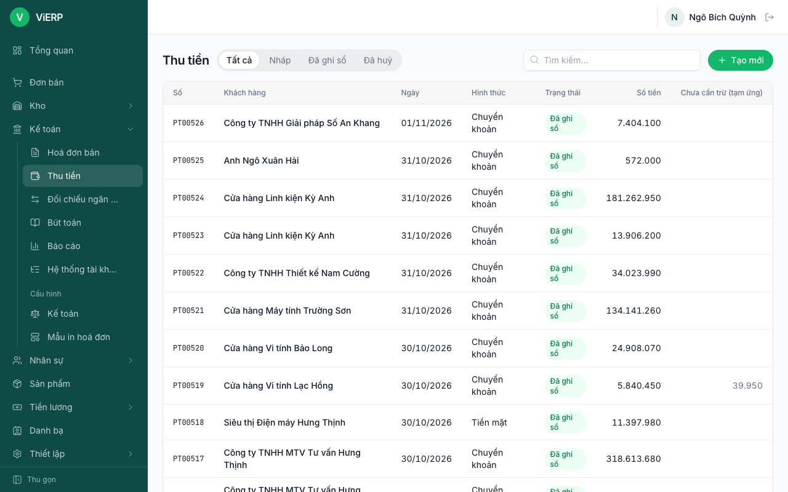

**Lưu ý:** phiếu thu nháp huỷ được bằng **Huỷ nháp**. Phiếu đã ghi sổ hiện chưa huỷ được.

## 6.7. Bút toán thủ công

Dùng cho nghiệp vụ chưa có chứng từ riêng, ví dụ thuế GTGT đầu vào của hoá đơn mua hàng (Nợ 1331 / Có 331).

1. Mở **Kế toán**, **Bút toán**, nhấn **Bút toán thủ công**.
2. Nhập **Ngày** và **Diễn giải**.
3. Mỗi dòng chọn **Tài khoản**, **Khách hàng** (nếu cần), **Nội dung**, rồi nhập **Nợ** hoặc **Có**. Nhấn **Thêm dòng** để thêm.
4. Tổng Nợ phải bằng tổng Có; nếu lệch, chữ đỏ **Chênh lệch** hiện ra ("Tổng Nợ phải bằng tổng Có").

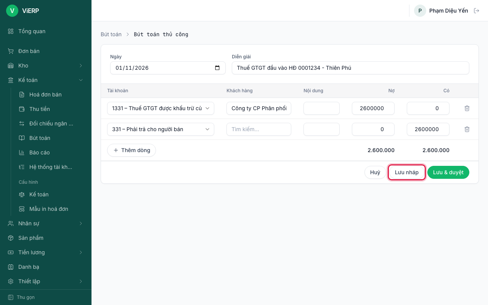

5. Nhấn **Lưu nháp**. Bút toán sang tab **Chờ duyệt**.

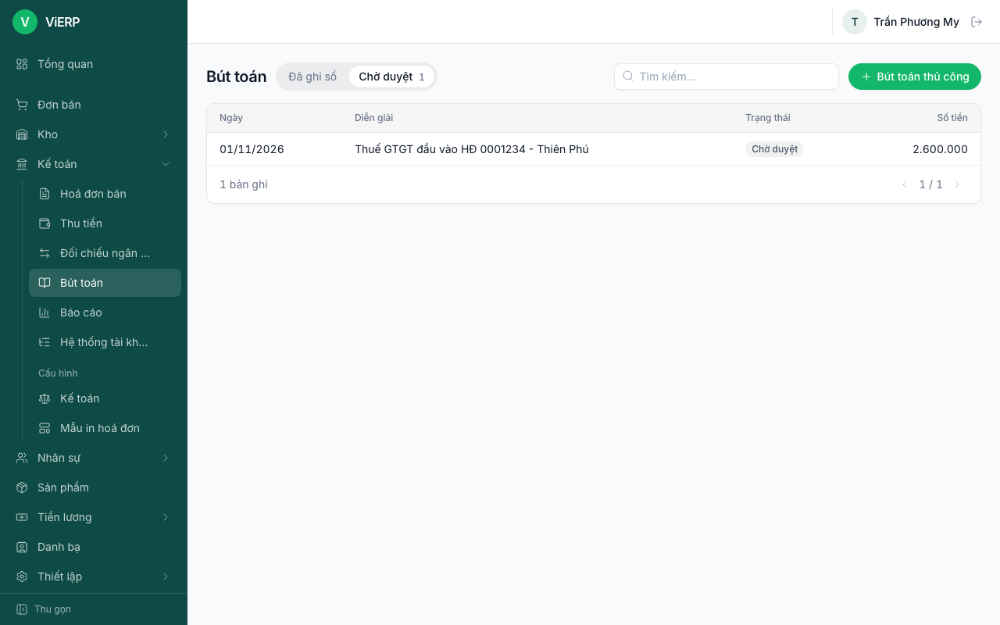

6. Người duyệt (khác người nhập) mở bút toán và nhấn **Duyệt**.

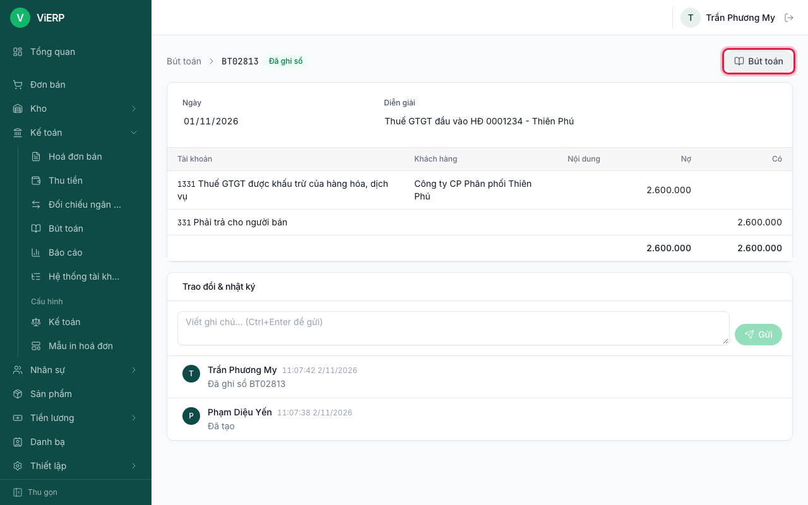

## 6.8. Sổ bút toán và đảo bút toán

1. Mở **Bút toán**, tab **Đã ghi sổ**. Cột **Nguồn** cho biết bút toán sinh từ đâu: Hoá đơn, Phiếu thu, Phiếu kho, Thủ công, Bảng lương, Chi lương, Tạm ứng lương.

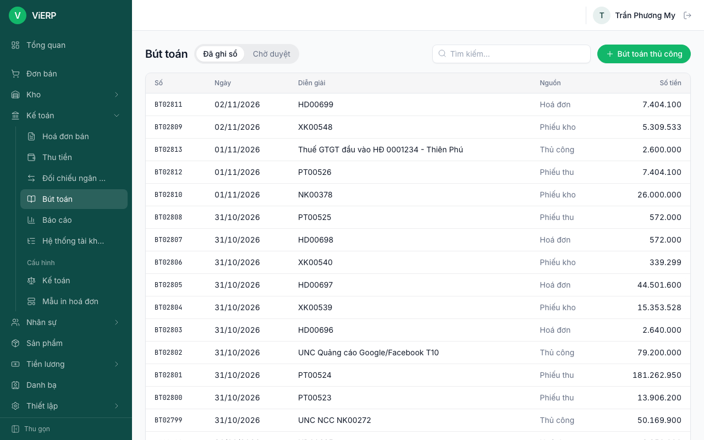

2. Mở một bút toán thủ công. Nhấn **Đảo bút toán** để ghi bút toán ngược, huỷ ảnh hưởng của nó. Bút toán gốc hiện nhãn **Đã đảo**.

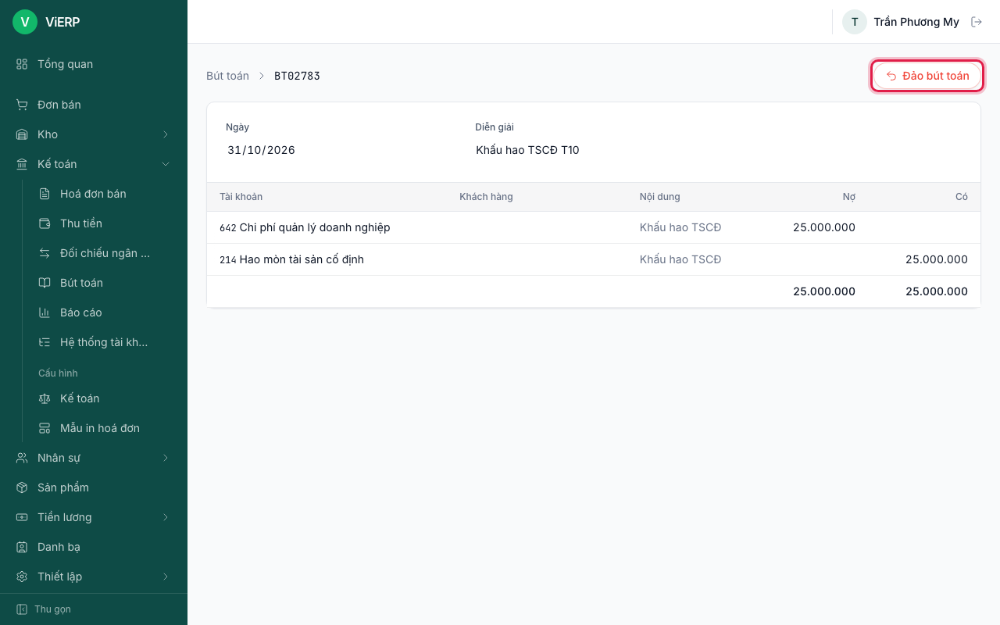

**Lưu ý:** bút toán sinh từ hoá đơn, phiếu kho... không đảo ở đây mà huỷ ngay trên chứng từ gốc.

## 6.9. Đối chiếu ngân hàng

Đối chiếu để chắc chắn sao kê ngân hàng khớp với sổ sách.

1. Mở **Kế toán**, **Đối chiếu ngân hàng**. Phần đầu cho biết **Số dư theo sao kê**, **Số dư sổ cái (TK ngân hàng)** và **Chênh lệch**. Cột trái là **Sao kê ngân hàng**, cột phải là **Sổ cái chưa khớp**; chuyển giữa các tài khoản ngân hàng và giữa **Chưa khớp / Đã khớp / Bỏ qua** ở các nút phía trên.

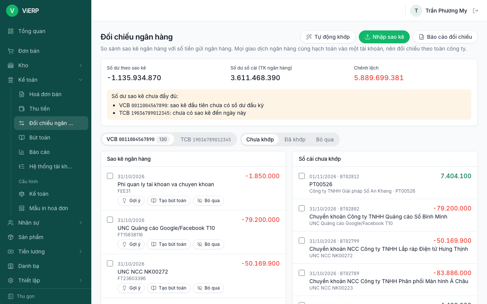

2. Tick một dòng sao kê và một (hoặc vài) dòng sổ cái có tổng bằng nhau, rồi nhấn **Khớp**. Hoặc nhấn **Tự động khớp** để hệ thống khớp các dòng giống nhau.
3. Ở mỗi dòng sao kê chưa khớp có các nút:
   - **Gợi ý**: xem dòng sổ cái có thể khớp, nhấn **Khớp dòng này** nếu đúng.

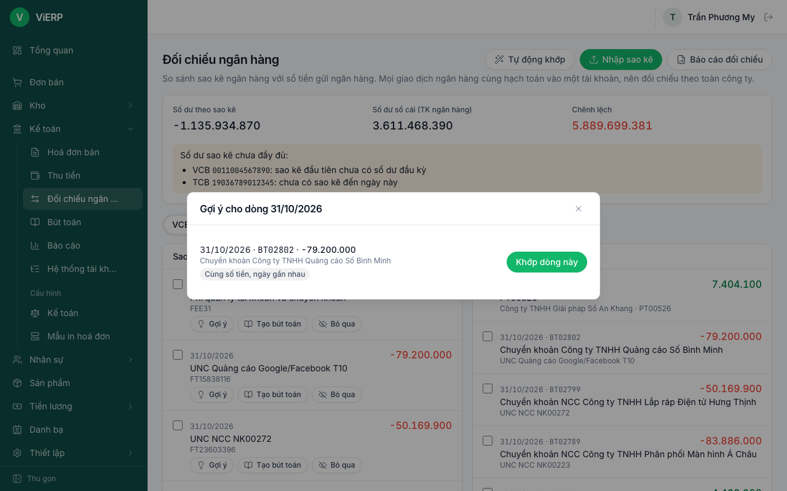

   - **Tạo phiếu thu**: với tiền vào chưa có chứng từ.
   - **Tạo bút toán**: với phí hoặc lãi ngân hàng. Chọn **Loại**: Phí ngân hàng (Nợ 6427 / Có 112; theo TT133 là 6422, hoặc tài khoản phí ngân hàng đã cấu hình), Lãi tiền gửi (Nợ 112 / Có 515) hoặc Khác.

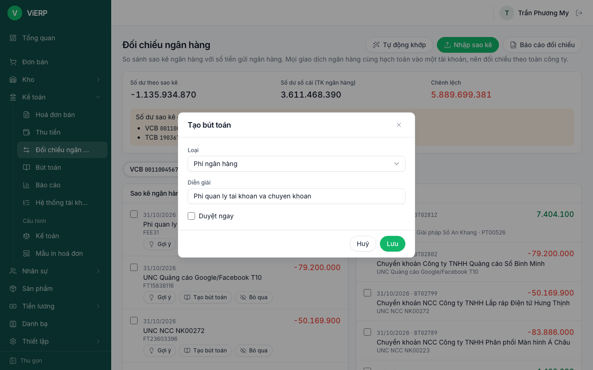

   - **Bỏ qua**: nhập "Lý do bỏ qua".
4. Dòng liên quan đến lương hiển thị "Ẩn (lương)" với người không có quyền xem lương.

**Lưu ý:** trong dữ liệu mẫu, sao kê chưa có số dư đầu kỳ nên màn hình cảnh báo "Số dư sao kê chưa đầy đủ" và Chênh lệch lớn. Với dữ liệu thật, hãy nhập số dư đầu kỳ cho sao kê đầu tiên.

## 6.10. Nhập sao kê

1. Ở màn hình đối chiếu, nhấn **Nhập sao kê**.
2. Chọn **Tài khoản ngân hàng** và **Tệp sao kê** (CSV hoặc .xlsx tải từ ngân hàng).
3. Ghép **Các cột trong tệp**: ngày giao dịch, nội dung, số tiền (một cột có dấu, hoặc hai cột Ghi có/Ghi nợ), số dư. Chọn **Định dạng ngày** và **Định dạng số** cho đúng với tệp. Có thể tick **Nhớ cách chọn cột cho tài khoản này** cho lần sau.
4. Xem bảng **Xem trước**, rồi nhấn **Nhập**. Dòng đã nhập trước đó tự bị bỏ qua, không trùng lặp.

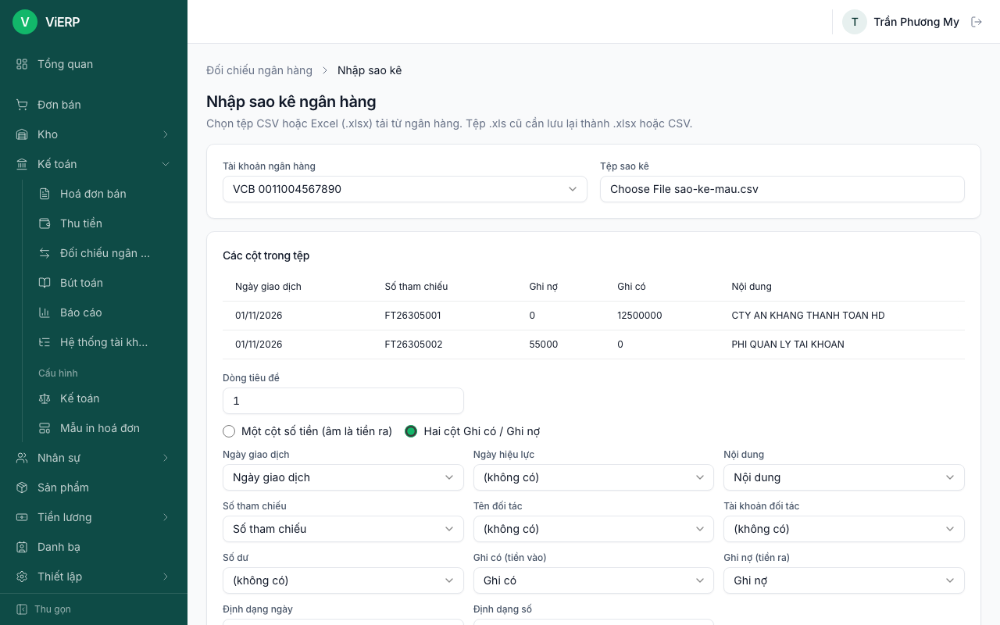

Cuộn xuống để chọn **Định dạng ngày**, **Định dạng số**, xem bảng **Xem trước**, nhập **Số dư đầu kỳ** nếu tệp không có cột số dư, rồi nhấn **Nhập**:

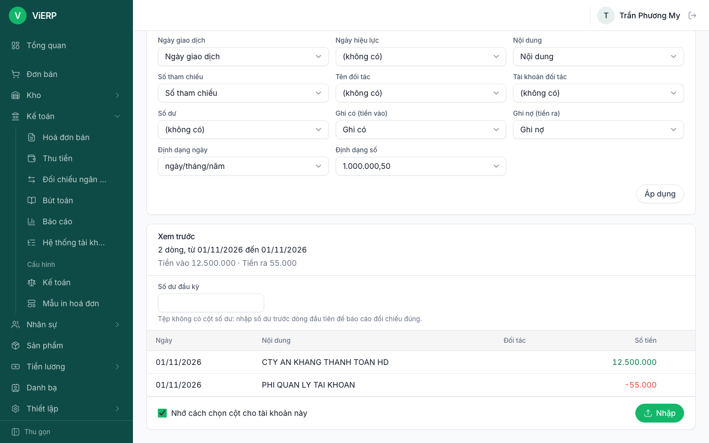

## 6.11. Báo cáo đối chiếu

1. Từ màn hình đối chiếu, nhấn **Báo cáo đối chiếu**.
2. Chọn **Tính đến ngày**. Báo cáo liệt kê số dư, các dòng chưa khớp và kết luận: "Sổ và sao kê khớp nhau." hoặc "Còn chênh lệch chưa giải thích."

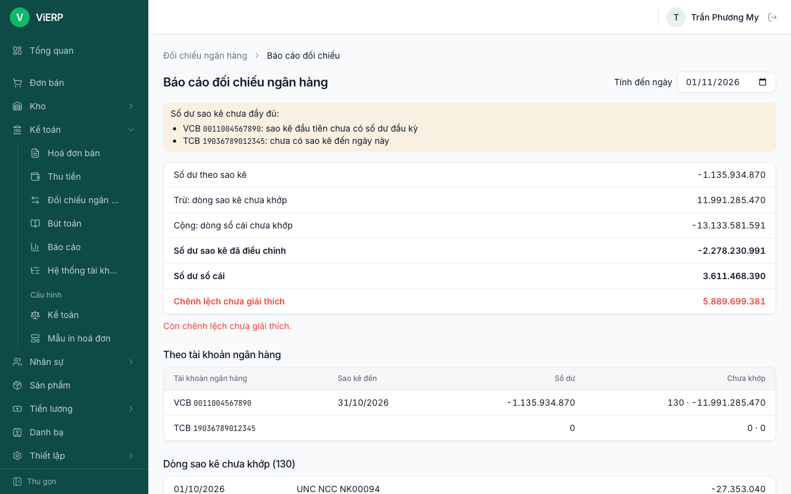

## 6.12. Báo cáo kế toán

Mở **Kế toán**, **Báo cáo**. Có ba báo cáo ở các tab phía trên.

**Cân đối số phát sinh.** Chọn **Từ ngày** và **Đến ngày**. Bảng cho số dư đầu kỳ, phát sinh trong kỳ, số dư cuối kỳ theo từng tài khoản, tổng Nợ phải bằng tổng Có.

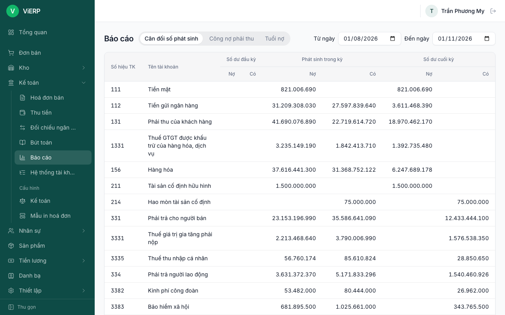

**Công nợ phải thu.** Số tiền từng khách còn nợ.

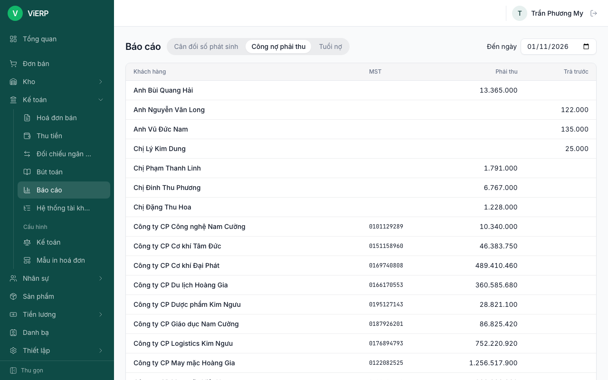

Nhấn một khách để xem **Sổ chi tiết công nợ** của khách đó:

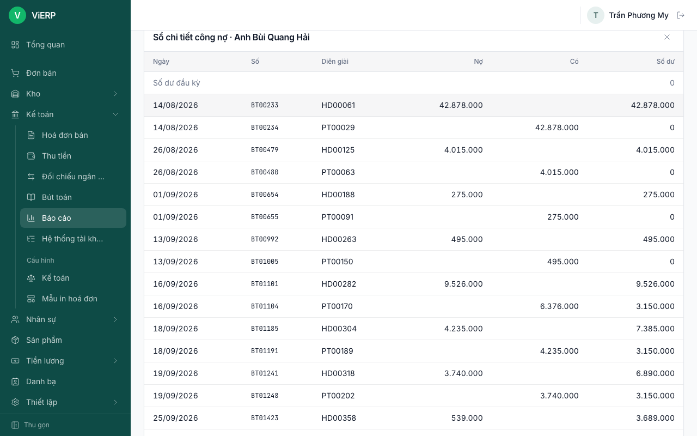

**Tuổi nợ.** Phân nhóm công nợ theo thời gian: Trong hạn, Quá 1-30 ngày, 31-60, 61-90, Trên 90 ngày.

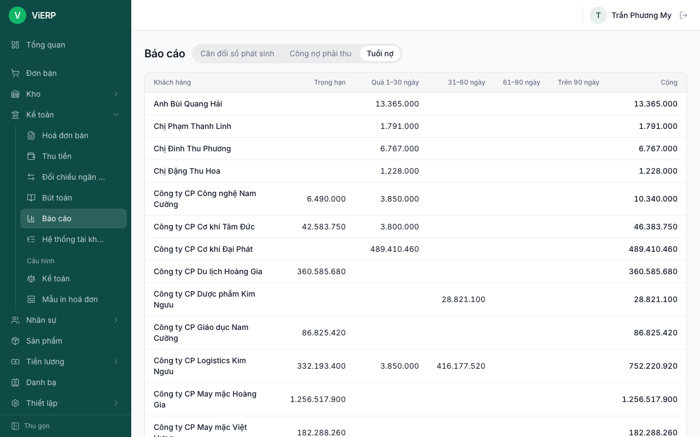

## 6.13. Hệ thống tài khoản và Ngày khoá sổ

1. Mở **Kế toán**, **Hệ thống tài khoản** để xem danh sách (**Số hiệu TK**, **Tên tài khoản**, **Loại**).
2. Ô **Ngày khoá sổ** (khung đỏ): từ ngày này trở về trước không ghi được bút toán. Đặt ngày rồi nhấn **Lưu**.

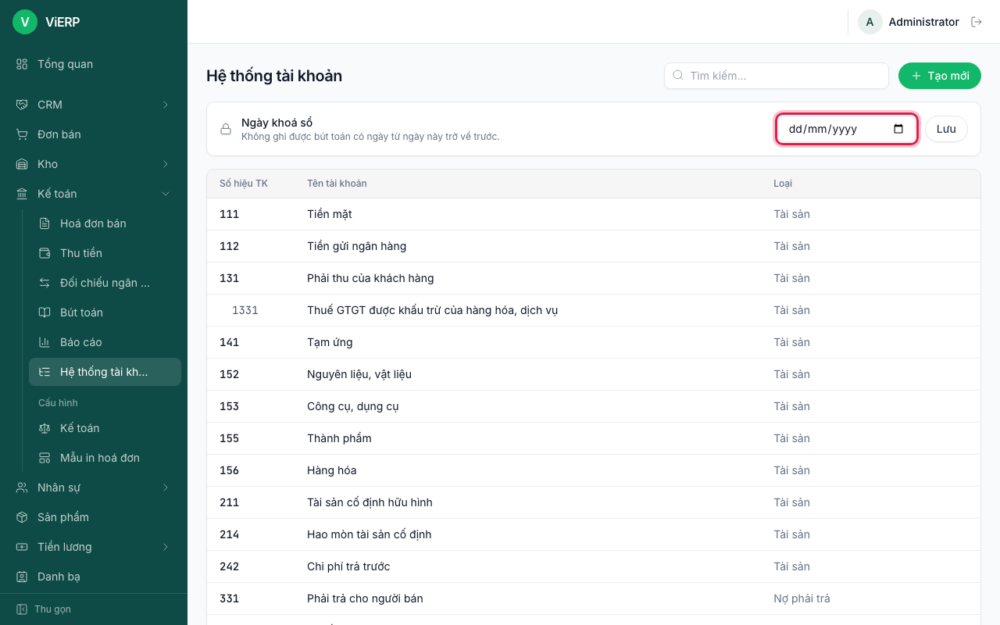

**Lưu ý:** chỉ người có quyền "Khoá sổ và cấu hình kế toán" (thường là quản trị) đổi được ngày khoá sổ.
