# 7. Nhân sự

Chương này có hai phần:
- **Phần A** dành cho mọi nhân viên: xin nghỉ phép, chấm công, giải trình đi trễ. Tài khoản của bạn phải được gắn với một hồ sơ nhân viên; nếu không, hệ thống báo "Tài khoản của bạn chưa gắn với hồ sơ nhân viên...". Hãy nhờ bộ phận nhân sự gắn.
- **Phần B** dành cho bộ phận nhân sự: hồ sơ, hợp đồng, bảng chấm công, duyệt nghỉ phép, cấu hình.

---

# Phần A. Dành cho mọi nhân viên

## 7.1. Xin nghỉ phép (Nghỉ phép của tôi)

1. Mở **Nhân sự**, **Nghỉ phép của tôi**. Phần **Còn lại 2026** cho biết số ngày phép từng loại: **Được cấp**, **Đã nghỉ**, **Chờ duyệt**.
2. Ở **Tạo đơn nghỉ**, chọn **Loại nghỉ** (ví dụ Nghỉ phép năm), **Từ ngày**, **Đến ngày**.
3. Tick **Ngày đầu nghỉ nửa ngày** hoặc **Ngày cuối nghỉ nửa ngày** nếu chỉ nghỉ nửa ngày. Ghi **Lý do**.

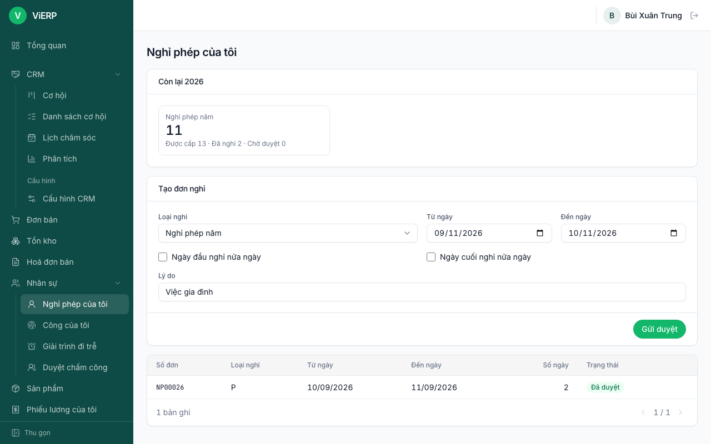

4. Nhấn **Gửi duyệt**.

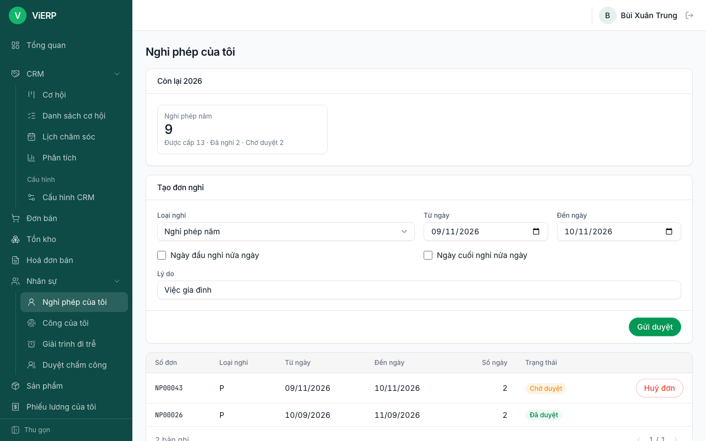

**Kết quả:** đơn xuất hiện trong danh sách với trạng thái **Chờ duyệt**, sau đó **Đã duyệt** hoặc **Từ chối**. Trước ngày nghỉ bạn có thể nhấn **Huỷ đơn**.

**Lưu ý:** các lỗi thường gặp là "Không đủ ngày phép của năm ..." và "Trùng đơn nghỉ khác ngày ...".

Trên điện thoại:

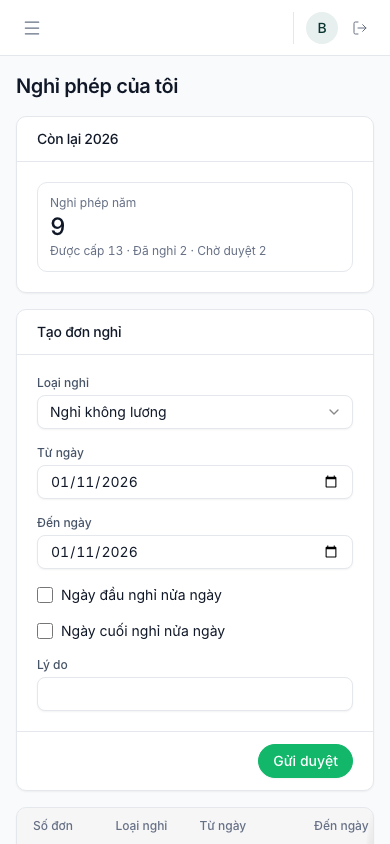

## 7.2. Chấm công (Công của tôi)

1. Mở **Nhân sự**, **Công của tôi**. Giờ hiển thị là giờ của máy chủ.
2. Đầu ngày nhấn **Check-in**, cuối ngày nhấn **Check-out**.
3. Quên check-in: nhấn **Quên check-in**, chọn ngày và giờ, ghi lý do, nhấn **Gửi yêu cầu**. Làm thêm giờ: nhấn **Đăng ký làm thêm giờ** rồi **Gửi yêu cầu**.
4. Bảng **Nhật ký chấm công** liệt kê vào/ra, số phút trễ, về sớm từng ngày của tháng; bảng **Yêu cầu của tôi** cho biết yêu cầu đã được duyệt chưa.

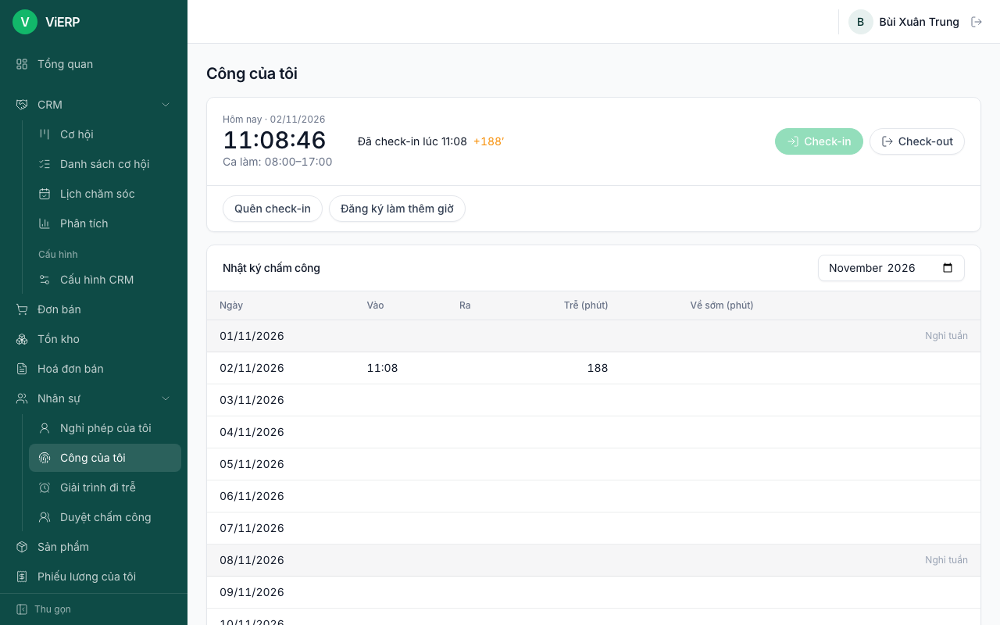

Hộp thoại đăng ký làm thêm giờ trên điện thoại:

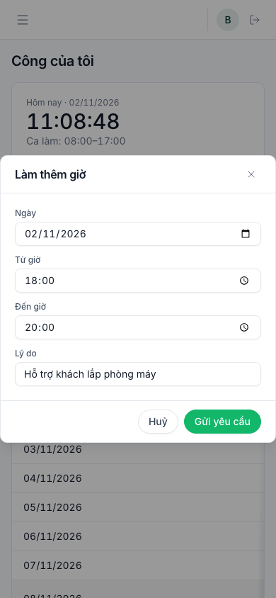

**Lưu ý:** nếu bộ phận nhân sự chưa bật chấm công, hệ thống báo "Chưa bật chấm công. Hãy liên hệ bộ phận nhân sự." (xem [mục 7.14](#714-cấu-hình-nhân-sự)). Ngày nghỉ tuần hiện chữ "Nghỉ tuần".

## 7.3. Giải trình đi trễ

1. Mở **Nhân sự**, **Giải trình đi trễ**. Bảng liệt kê các ngày bạn đi trễ.
2. (Nếu bạn có ngày đi trễ; hình bên dưới là màn hình khi chưa có ngày nào.) Ở ngày cần giải trình, nhấn **Giải trình**, ghi lý do rồi gửi.
3. Nếu quản lý duyệt, ngày đó không bị trừ lương theo quy định công ty.

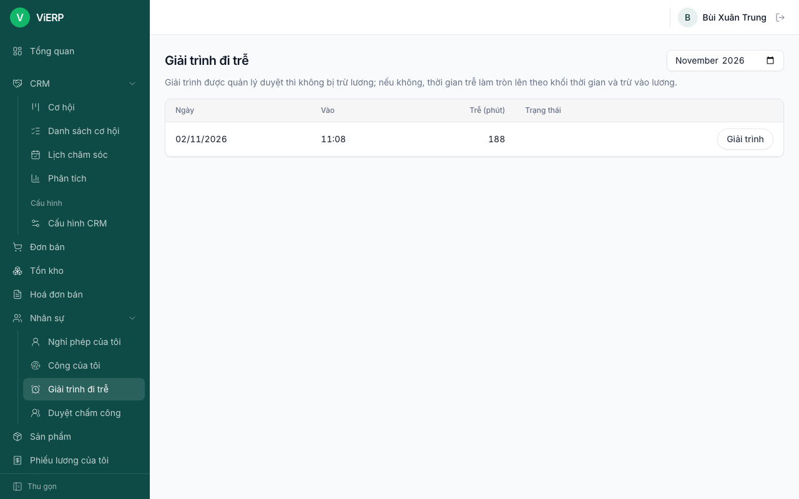

## 7.4. Duyệt chấm công (trưởng phòng)

1. Mở **Nhân sự**, **Duyệt chấm công**. Hộp thư **Yêu cầu chờ duyệt** chỉ có khi bạn là Trưởng phòng của một phòng ban.
2. Nhấn **Duyệt**, hoặc **Từ chối** và nhập **Lý do từ chối**.

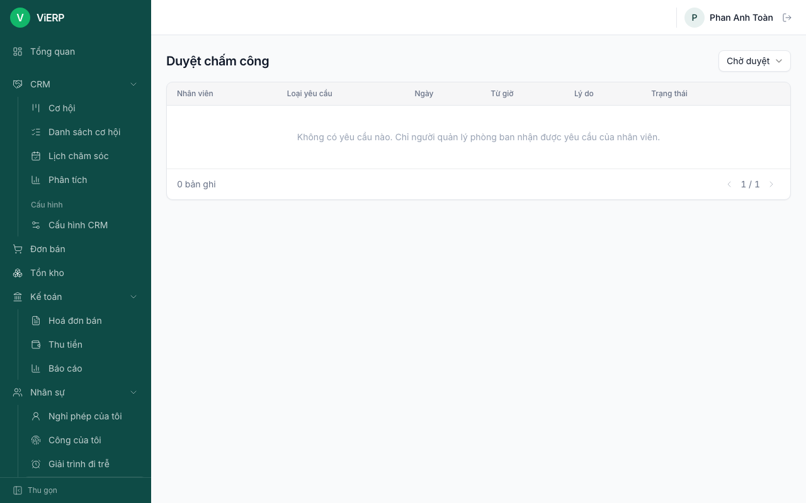

---

# Phần B. Dành cho bộ phận nhân sự

## 7.5. Danh sách nhân viên

1. Mở **Nhân sự**, **Nhân viên**. Dùng ô **Tìm kiếm...** để tìm theo mã hoặc tên.
2. Nhấn **Tạo mới** để thêm nhân viên.

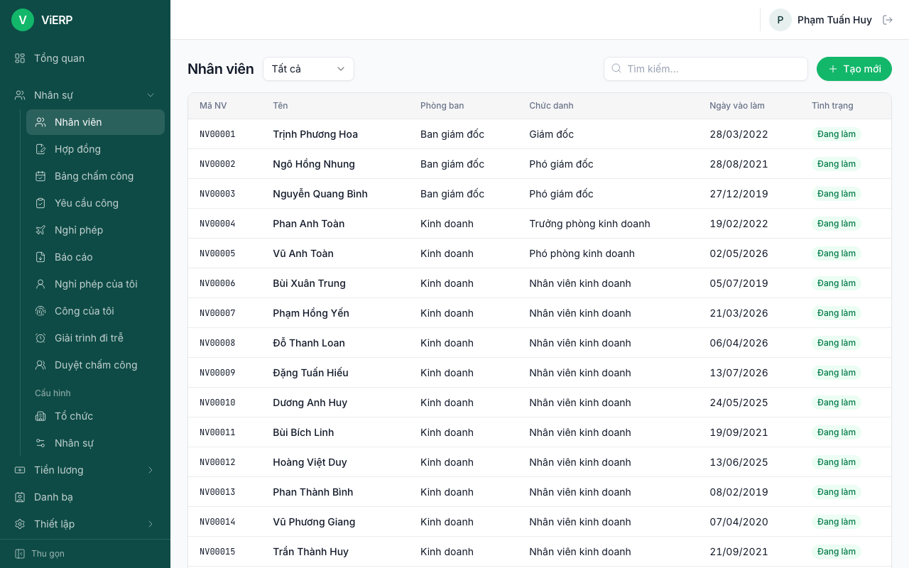

## 7.6. Hồ sơ nhân viên

Hồ sơ chia tab. Tạo **liên hệ** trong Danh bạ trước, vì tên nhân viên lấy từ liên hệ (có nút **Mở liên hệ** / **Thêm liên hệ mới**).

**Tab Thông tin:** giới tính, ngày sinh, email công việc, phòng ban, chức danh, ngày vào làm, **Tình trạng** (Thử việc, Đang làm, Nghỉ dài hạn, Đã nghỉ việc), cư trú, vùng lương tối thiểu, tham gia bảo hiểm, đoàn viên công đoàn, và **Tài khoản đăng nhập** (gắn với người dùng để họ dùng các trang "của tôi").

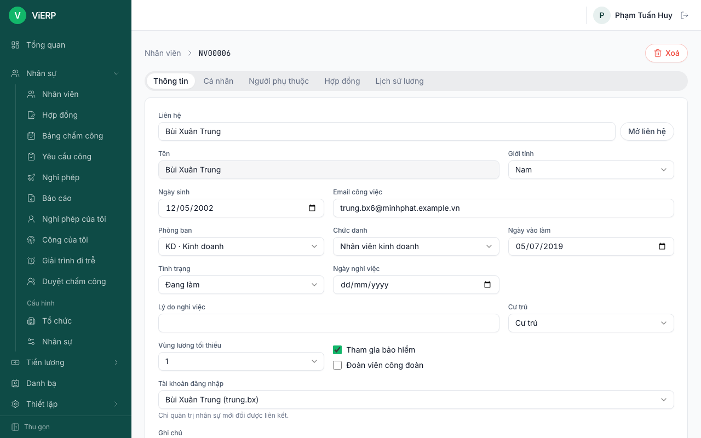

**Tab Cá nhân:** số CCCD, ngày cấp, nơi cấp, mã số thuế, số sổ BHXH, ngân hàng, số tài khoản, chủ tài khoản. Đây là dữ liệu nhạy cảm, chỉ người có quyền xem/sửa dữ liệu cá nhân mới thấy.

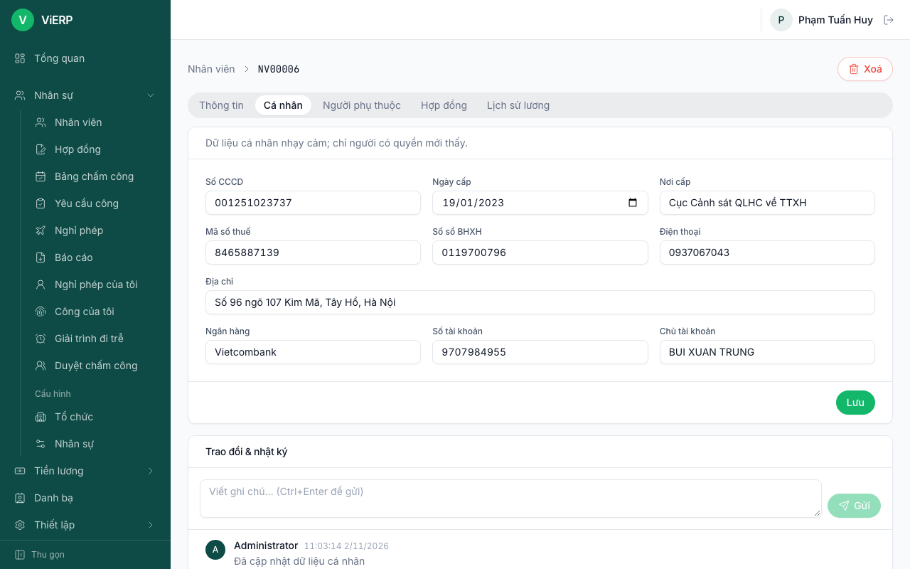

**Tab Người phụ thuộc:** khai quan hệ, từ tháng, đến tháng để tính giảm trừ gia cảnh khi tính thuế TNCN.

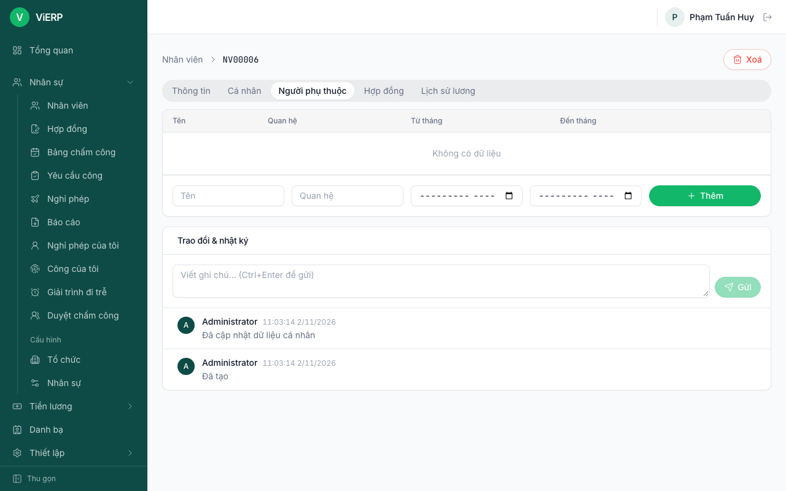

**Tab Hợp đồng:** các hợp đồng của nhân viên.

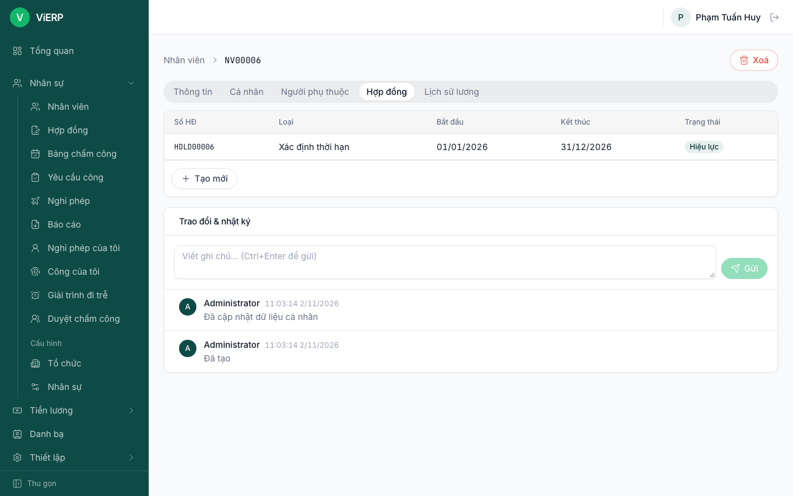

**Tab Lịch sử lương:** lương theo từng ngày hiệu lực (hợp đồng và phụ lục).

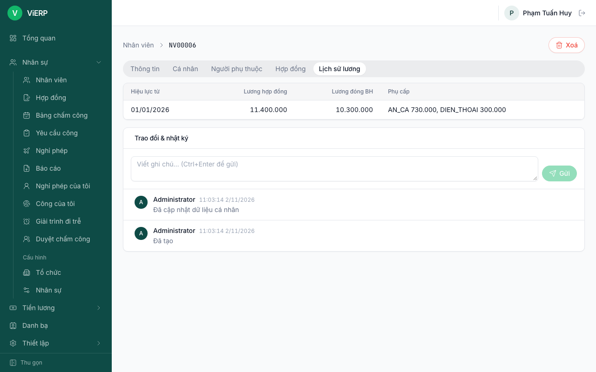

## 7.7. Hợp đồng lao động

1. Mở **Nhân sự**, **Hợp đồng**. Lọc **Tất cả / Nháp / Hiệu lực / Đã chấm dứt / Đã huỷ**. Tick **Sắp hết hạn (30 ngày)** để thấy hợp đồng sắp hết.

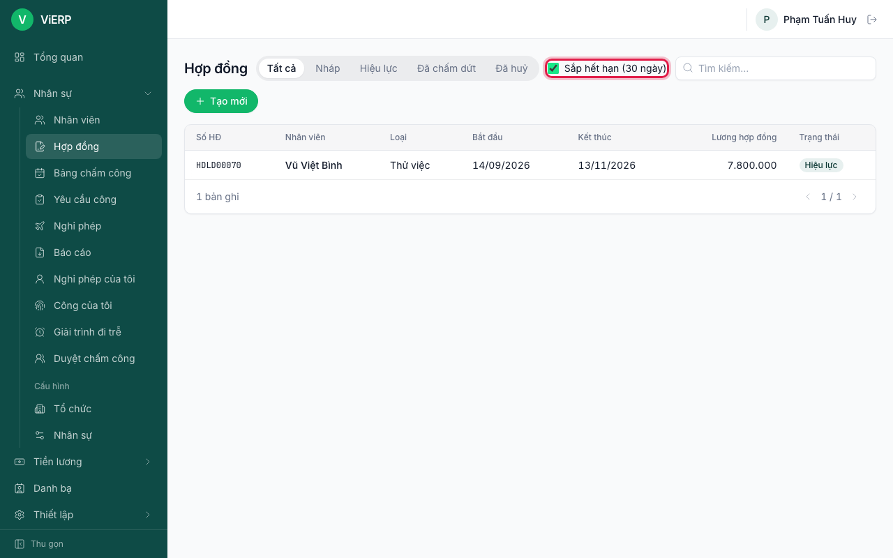

2. Nhấn **Tạo mới**: chọn nhân viên, **Loại** (Thử việc, Xác định thời hạn, Không xác định thời hạn, Dịch vụ/khoán), **Bắt đầu**, **Kết thúc**, **Hình thức lương**, **Lương hợp đồng**, **Lương đóng BH**, **% lương thử việc**, **Cách tính thuế TNCN**, **Phụ cấp**, **Ca làm việc**.
3. Nhấn **Lưu**. Người khác (có quyền duyệt hợp đồng) mở và nhấn **Duyệt** để hợp đồng có hiệu lực.

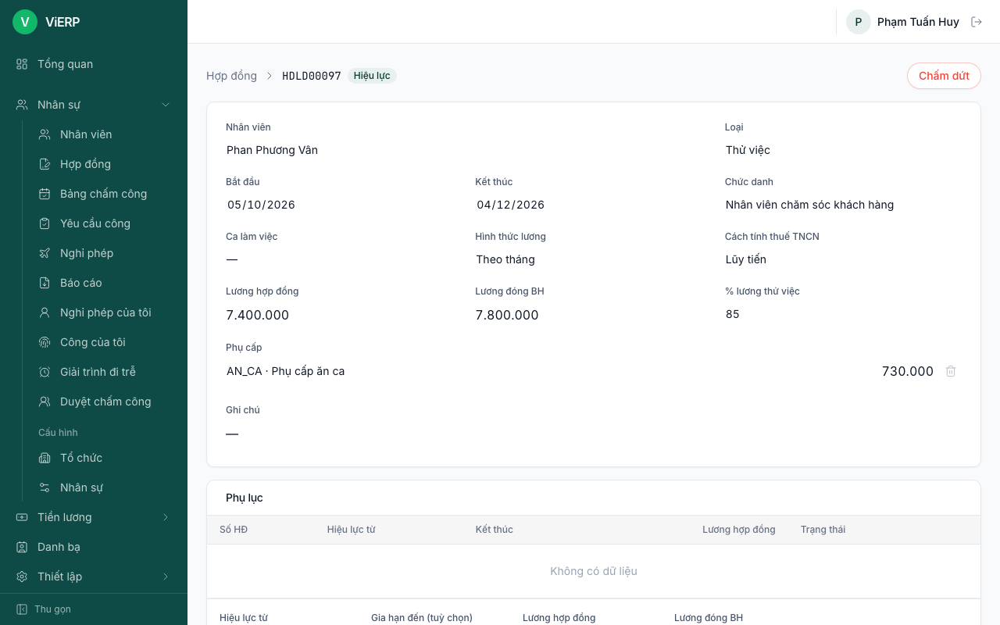

**Lưu ý:** hộp vàng "Cảnh báo pháp luật lao động" chỉ để nhắc (ví dụ thời hạn thử việc), không chặn việc lưu.

## 7.8. Điều chỉnh lương bằng phụ lục

Không sửa lương trực tiếp trên hợp đồng đã hiệu lực. Hãy thêm phụ lục có ngày hiệu lực.

1. Mở hợp đồng đang hiệu lực, kéo xuống phần **Phụ lục**.
2. Nhập **Hiệu lực từ**, **Lương hợp đồng** mới, **Lương đóng BH**, và **Gia hạn đến (tuỳ chọn)**.
3. Nhấn **Thêm phụ lục**, rồi người có quyền duyệt nhấn **Duyệt**.

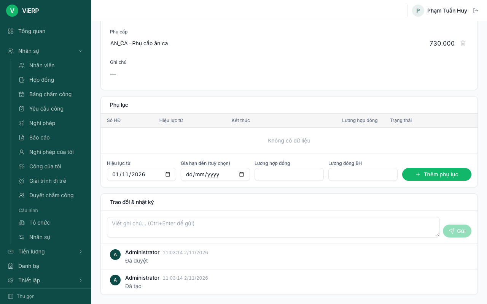

Muốn kết thúc hợp đồng, nhấn **Chấm dứt**, nhập **Ngày chấm dứt** và **Lý do**.

## 7.9. Bảng chấm công tháng

1. Mở **Nhân sự**, **Bảng chấm công**. Danh sách cho thấy các tháng đã có bảng.
2. Chọn **Kỳ (tháng)** rồi nhấn **Tạo bảng công**.

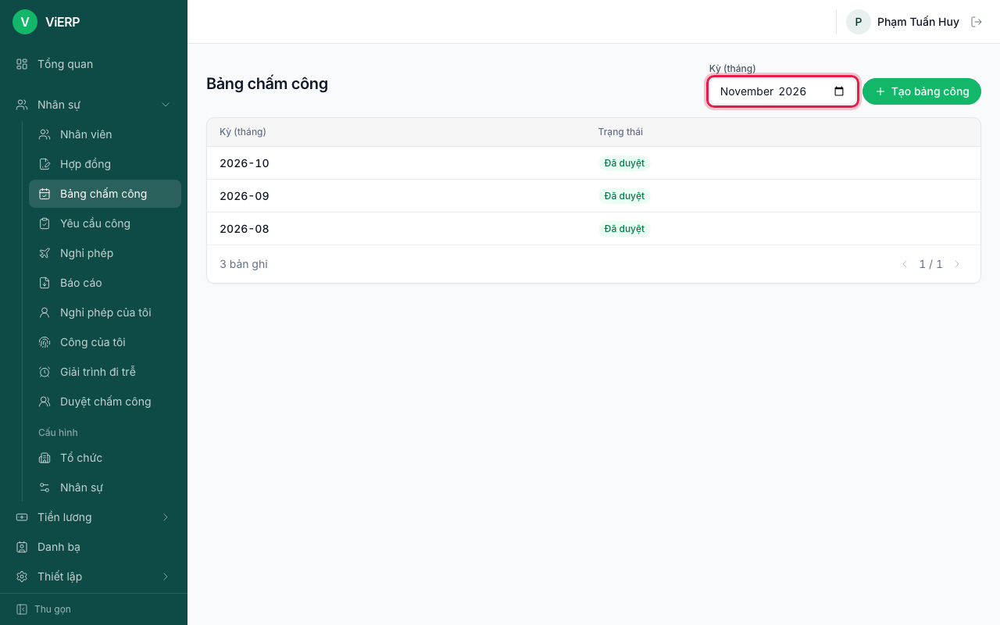

3. Trong bảng mới, nhấn **Điền công chuẩn** để điền ngày công chuẩn cho mọi người (hoặc **Nhập CSV**). Hệ thống chỉ điền các ngày đã tới theo đồng hồ của máy chủ.
4. Nhấn vào dòng một nhân viên để sửa từng ngày trong cửa sổ **Sửa ngày công** (công, làm thêm giờ, nghỉ, đi trễ), rồi **Lưu dòng**. Ảnh dưới lấy từ bảng tháng 10 đã duyệt nên chỉ để xem (không có nút **Lưu dòng**); khi bảng chưa khoá, nút này hiện ở cuối cửa sổ.

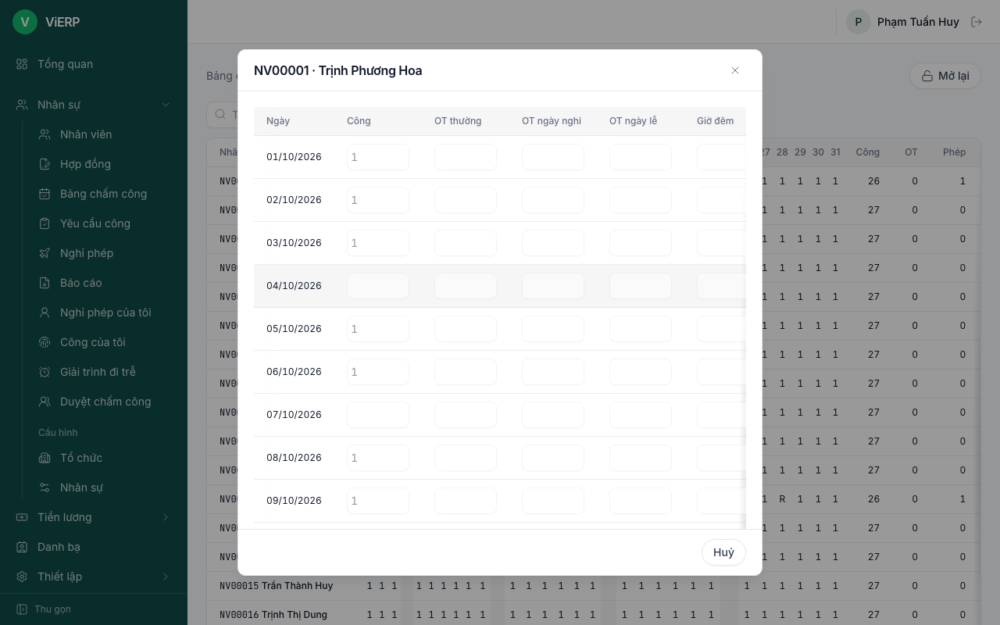

Cuộn ngang trong cửa sổ để thấy các cột làm thêm giờ, **Mã nghỉ** (P là nghỉ phép), **Ngày nghỉ** và **Trễ (phút)**:

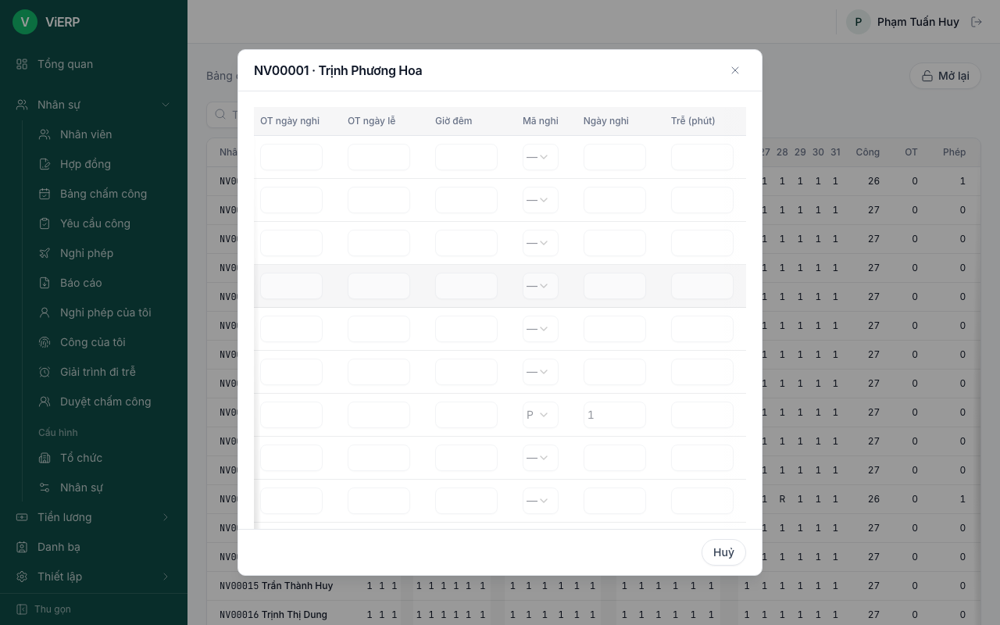

5. Người **khác người tạo** nhấn **Duyệt và khoá**. Bảng thành **Đã duyệt**. Nhấn **Mở lại** nếu cần sửa tiếp.

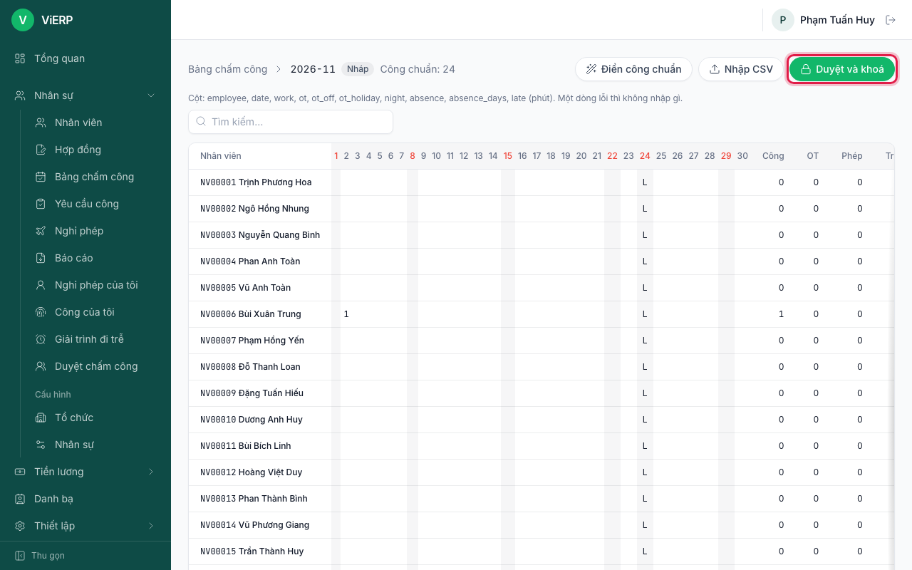

Sau khi nhấn **Điền công chuẩn**, **Lưu** hay **Duyệt và khoá**, có thể hiện hộp cảnh báo vàng phía trên bảng, liệt kê nhân viên chưa gắn tài khoản đăng nhập nên không tự check-in được; nó chỉ để nhắc, không chặn việc duyệt. Bảng tháng đã duyệt và khoá (tháng 10) trông như sau; ô "P" là nghỉ phép, "R" nghỉ việc riêng, và có nút **Mở lại**:

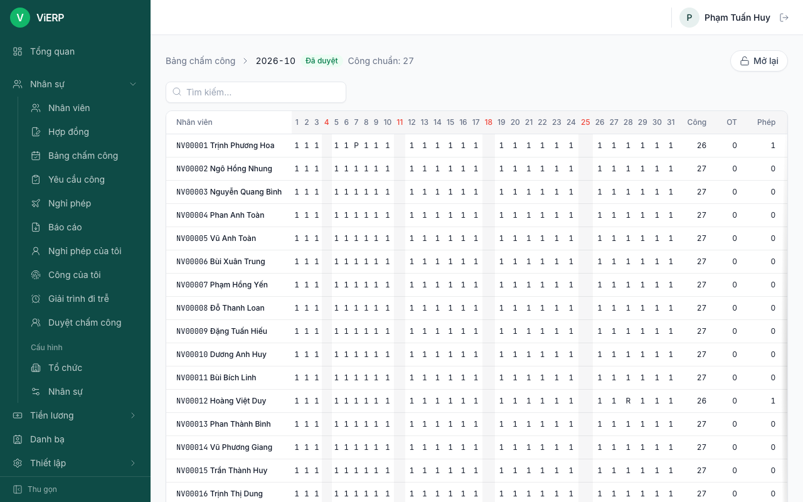

**Lưu ý:** tính lương cần bảng chấm công của kỳ đã duyệt, nếu không báo "Bảng chấm công của kỳ này chưa được duyệt".

## 7.10. Duyệt đơn nghỉ

1. Mở **Nhân sự**, **Nghỉ phép**, tab **Đơn nghỉ**. Lọc trạng thái **Chờ duyệt**.
2. Nhấn **Duyệt** hoặc **Từ chối**.

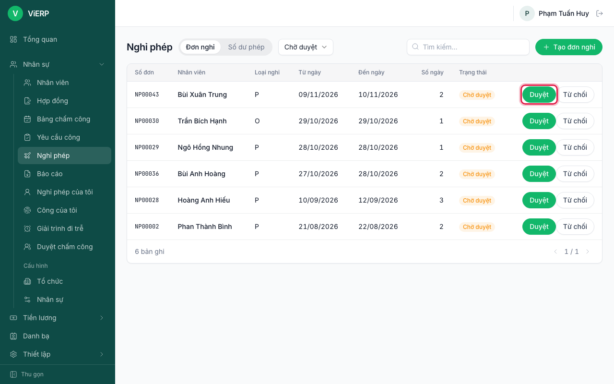

3. Khi từ chối, nhập **Lý do từ chối** rồi xác nhận.

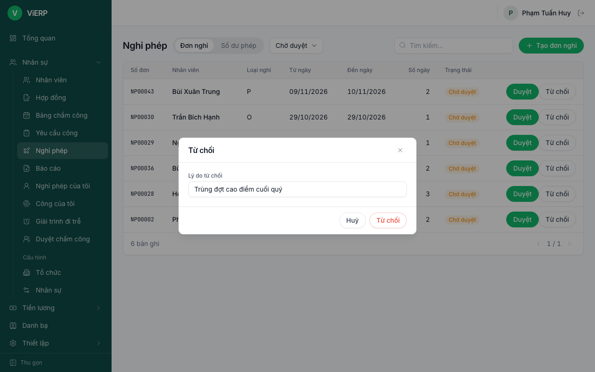

4. Nhấn **Tạo đơn nghỉ** để tạo thay cho nhân viên.
5. Tab **Số dư phép**: xem số ngày phép từng người, nhấn **Tạo phép năm** để cấp phép năm cho cả công ty, hoặc **Cấp phép** để cấp cho một người.

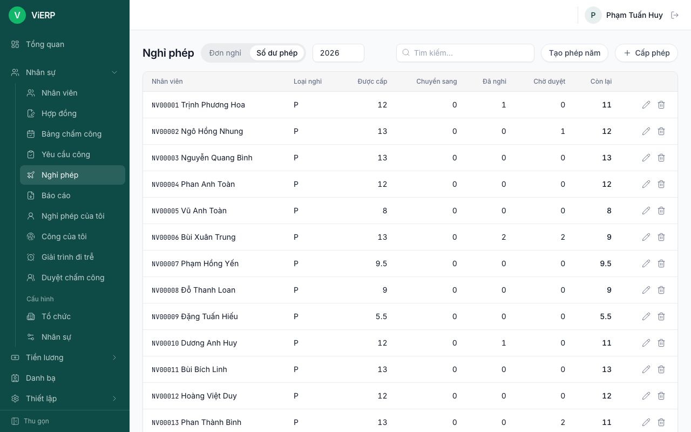

## 7.11. Yêu cầu công

1. Mở **Nhân sự**, **Yêu cầu công**: các yêu cầu quên check-in, làm thêm giờ của nhân viên (ảnh có một yêu cầu làm thêm giờ do nhân viên gửi ở mục 7.2).
2. Mở yêu cầu để duyệt, hoặc tạo thay nhân viên chưa có tài khoản đăng nhập.

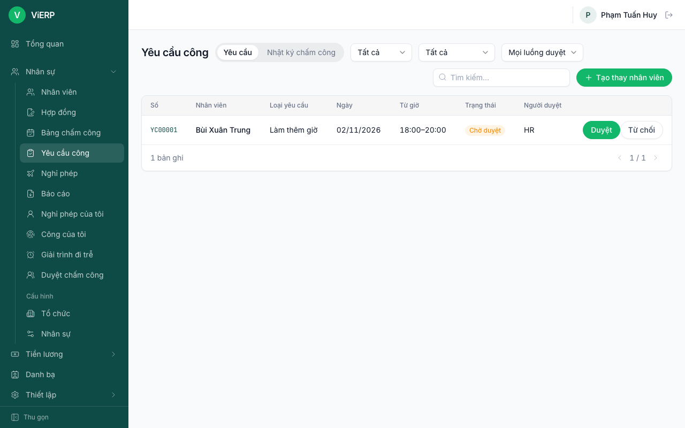

## 7.12. Tổ chức

Mở **Nhân sự**, **Tổ chức** (nhóm Cấu hình). Các tab: **Phòng ban** (phòng ban cha, trưởng phòng, tài khoản hạch toán chi phí lương), **Chức danh**, **Ca làm việc**, **Phụ cấp**, **Ngày lễ**, **Loại nghỉ**. Nhấn **Tạo mới** để thêm, biểu tượng bút để sửa.

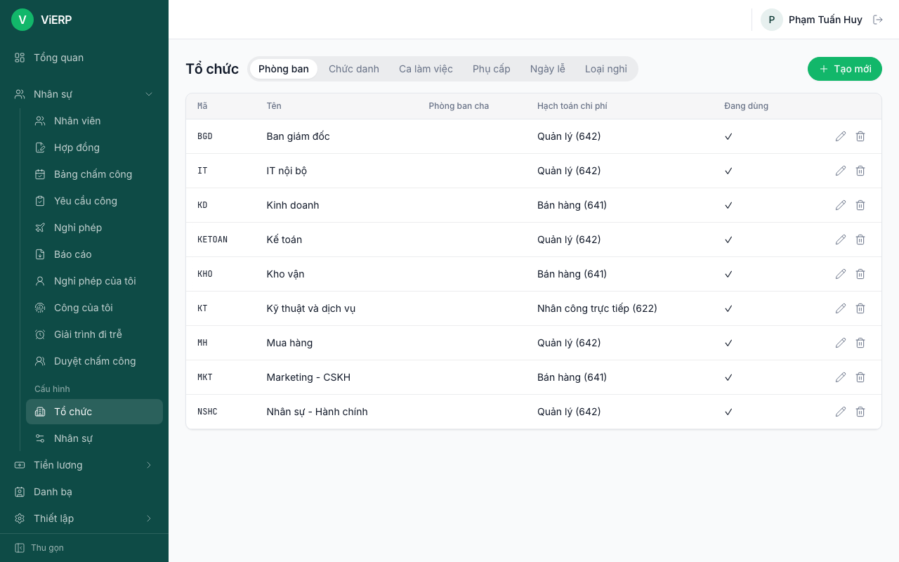

**Lưu ý:** ngày lễ cần tự thêm (ví dụ nghỉ Tết) để công và lương tính đúng.

## 7.13. Báo cáo nhân sự

Mở **Nhân sự**, **Báo cáo**: Danh sách nhân viên, Biến động nhân sự, Hợp đồng sắp hết hạn, Số dư phép năm, Tổng hợp bảng công. Nhấn **Tải CSV** để lưu. Tệp không chứa CCCD, tài khoản ngân hàng hay lương.

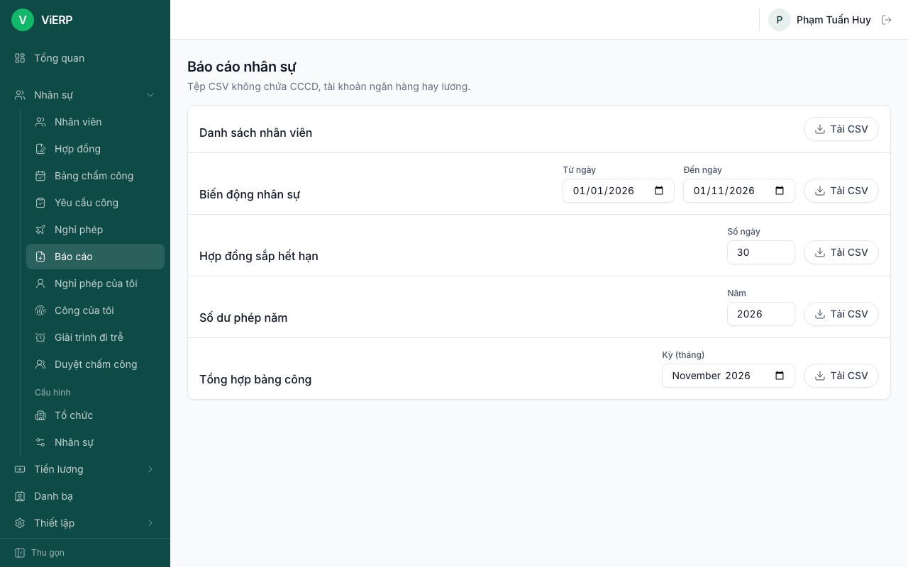

## 7.14. Cấu hình nhân sự

Mở **Nhân sự**, **Cấu hình**, **Nhân sự** để đặt: ngày làm việc trong tuần, phép năm cơ bản (ngày) và thâm niên, giới hạn làm thêm giờ, **Chấm công từ ngày** (để trống là tắt chấm công), **Ca mặc định**, số ngày được bổ sung lùi tối đa. Nhấn **Lưu** sau khi đổi.

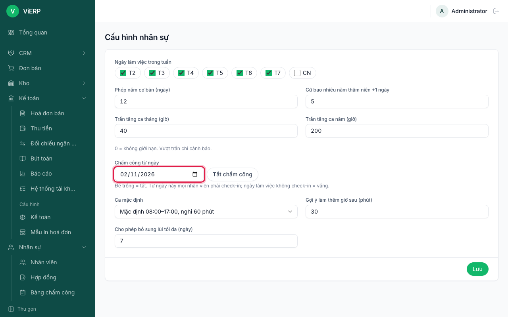
