# 8. Tiền lương

Bảng lương tính từ bảng chấm công đã duyệt, hợp đồng, phụ cấp, bảo hiểm và thuế TNCN. Trong ví dụ: nhân sự (`huy.pt`) tạo bảng lương, giám đốc (`hoa.tp`) hạch toán và chi lương. Số tiền từng người chỉ người có quyền xem lương mới thấy.

Điều kiện: bảng chấm công của kỳ đã **Duyệt và khoá** ([mục 7.9](07-nhan-su.md#79-bảng-chấm-công-tháng)).

## 8.1. Xem danh sách bảng lương

1. Mở **Tiền lương**, **Bảng lương**.
2. Cột gồm **Số**, **Kỳ**, **Ngày hạch toán**, **Số người**, **Tổng thu nhập**, **Thực lĩnh**, **Trạng thái** (Nháp, Đã hạch toán, Đã huỷ) và tình trạng chi (Chưa chi, Chi một phần, Đã chi đủ).

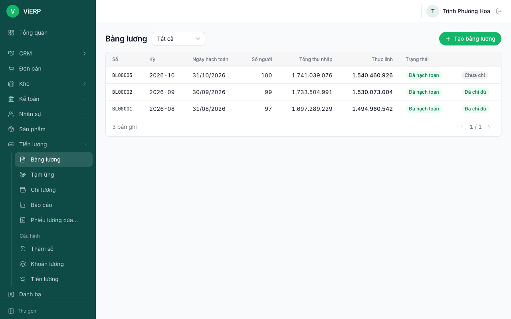

## 8.2. Tạo bảng lương

1. Nhấn **Tạo bảng lương**.
2. Nhập **Kỳ** (tháng), **Ngày hạch toán**, **Ghi chú**. Nhấn **Tạo bảng lương** trong hộp thoại.

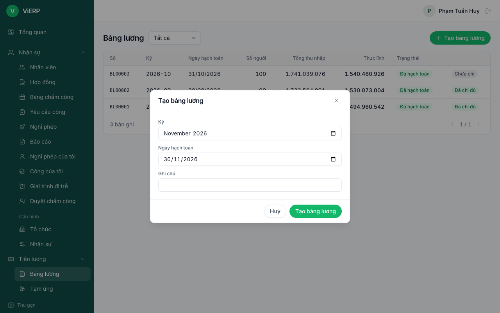

**Kết quả:** bảng lương **Nháp** với nút **Tính lại** và khung vàng **Cảnh báo** nêu vấn đề cần xem (ví dụ có công nhưng không có hợp đồng hiệu lực). Bảng nháp tháng 11 trong ví dụ có số liệu nhỏ vì bảng chấm công tháng 11 mới đầu tháng:

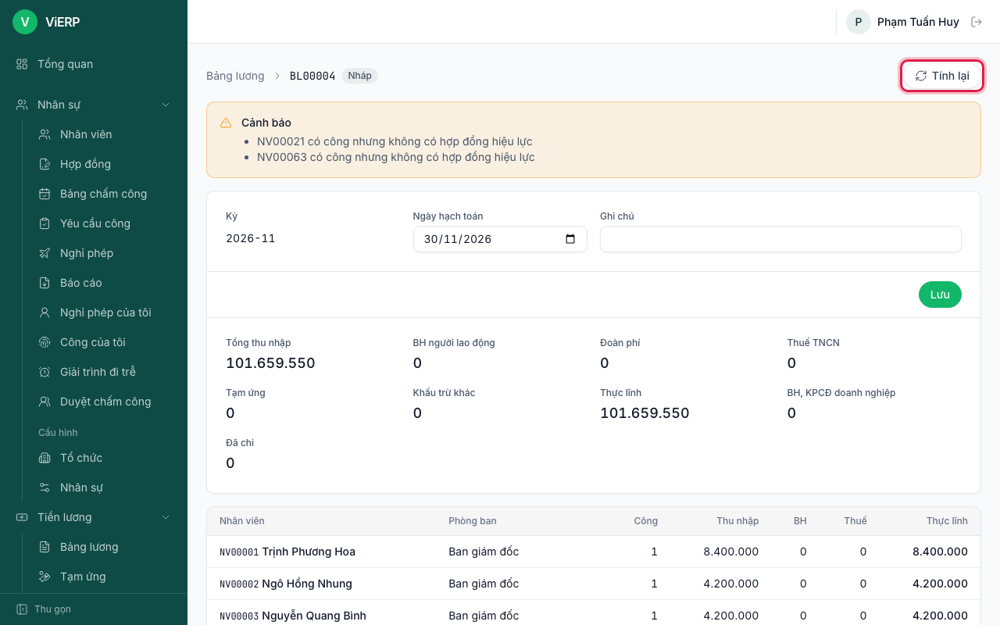

Một bảng lương đầy đủ (kỳ 2026-10, đã hạch toán) có các tổng **Tổng thu nhập**, **BH người lao động**, **Đoàn phí**, **Thuế TNCN**, **Tạm ứng**, **Khấu trừ khác**, **Thực lĩnh**, **BH, KPCĐ doanh nghiệp** và danh sách từng người:

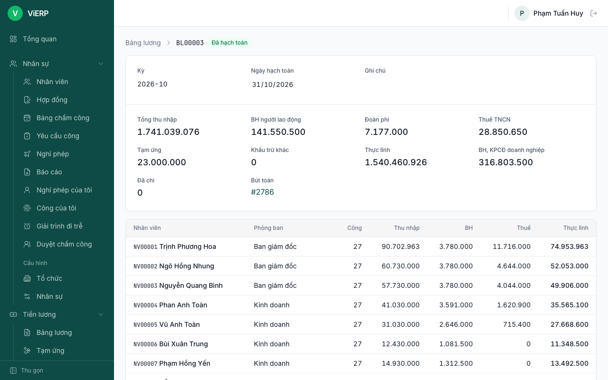

## 8.3. Xem và chỉnh phiếu lương một người

1. Nhấn vào dòng một nhân viên trong bảng lương.
2. Phiếu chia: **Ngày công và giờ**, **Thu nhập**, **Khấu trừ**, phần doanh nghiệp đóng, **Thực lĩnh**.

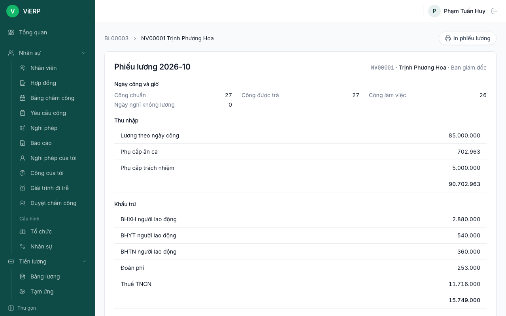

3. Cần thưởng hay khấu trừ riêng (chỉ khi bảng lương còn **Nháp**): ở **Khoản nhập tay** nhấn **Thêm khoản**, chọn khoản, nhập số tiền và ghi chú, rồi **Lưu khoản nhập tay**. Quay lại bảng lương và nhấn **Tính lại**.

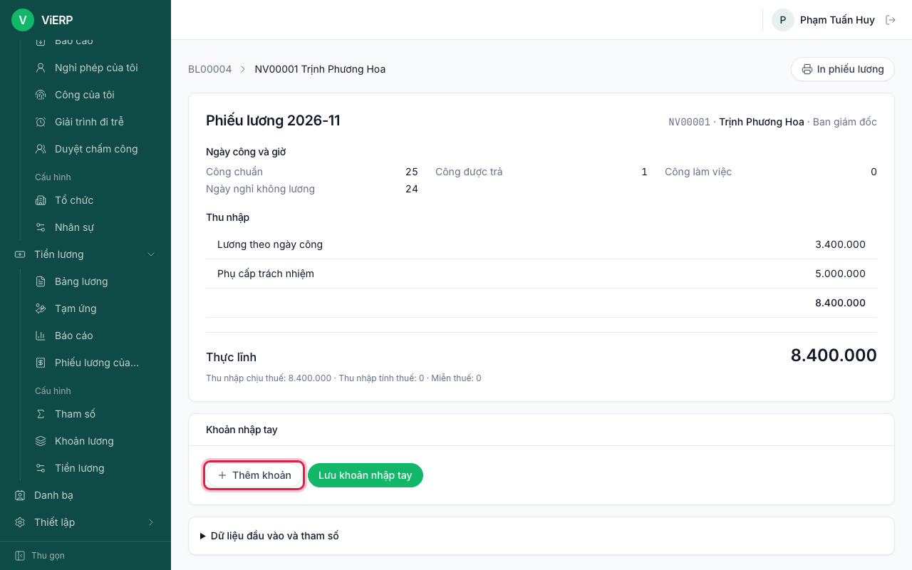

4. Nhấn **In phiếu lương** để in.

## 8.4. Hạch toán bảng lương

1. Người có quyền duyệt (khác người tạo) mở bảng lương nháp, nhấn **Hạch toán**.

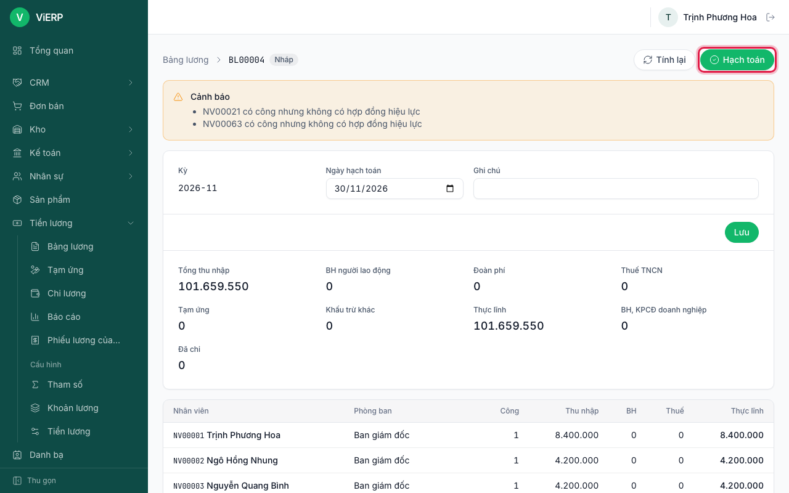

2. Trình duyệt hỏi xác nhận (sau đó không sửa được). Chọn OK.

**Kết quả:** trạng thái **Đã hạch toán**; hiện liên kết **Bút toán** (ví dụ #2786 ở kỳ 2026-10). Ảnh dưới là bảng lương kỳ 10 đã hạch toán (bảng nháp tháng 11 ở trên chưa hạch toán trong ví dụ). Bút toán ghi chi phí lương theo phòng ban (kể cả phần doanh nghiệp đóng) vào Nợ, và ghi Có phải trả người lao động (334), các khoản bảo hiểm, kinh phí công đoàn, thuế TNCN phải nộp. Mở bút toán để xem chi tiết.

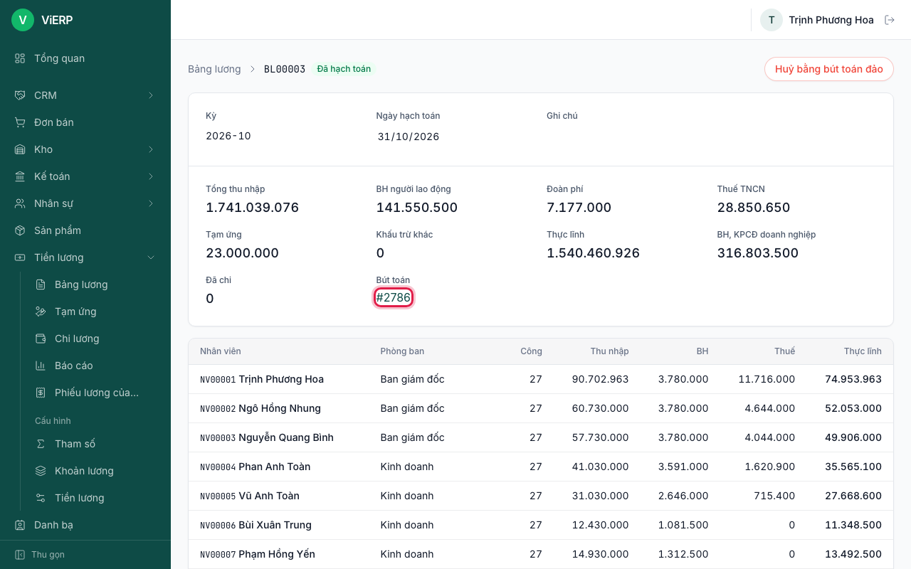

**Lưu ý:**
- Muốn hoàn tác, nhấn **Huỷ bằng bút toán đảo** (phải huỷ các phiếu chi lương của bảng đó trước).
- Nếu dữ liệu nguồn đổi sau khi tính, hệ thống báo cần tính lại bảng lương.

## 8.5. Chi lương

1. Mở **Tiền lương**, **Chi lương**, nhấn **Tạo mới**.
2. Chọn **Bảng lương** (chỉ bảng đã hạch toán), kiểm tra **Ngày** và **Hình thức** (Chuyển khoản hoặc Tiền mặt).
3. Bảng liệt kê **Thực lĩnh**, **Còn phải chi**, **Chi lần này**. Mặc định chi hết; có thể sửa để chi một phần.

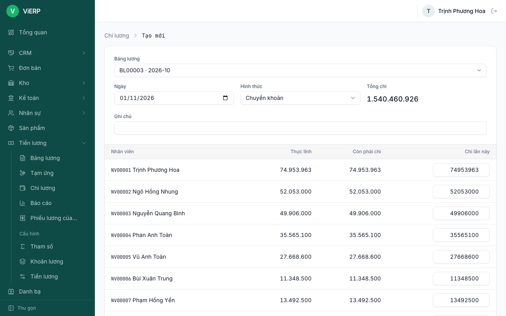

4. Nhấn **Lưu**, rồi **Duyệt chi**.

**Kết quả:** phiếu **Đã hạch toán**. Bút toán: **Nợ 334 / Có 112** (hoặc 111 nếu tiền mặt). Với chuyển khoản, nhấn **Tải file chuyển khoản** để lấy tệp CSV nộp ngân hàng (cần cả quyền xem lương và quyền xem dữ liệu cá nhân).

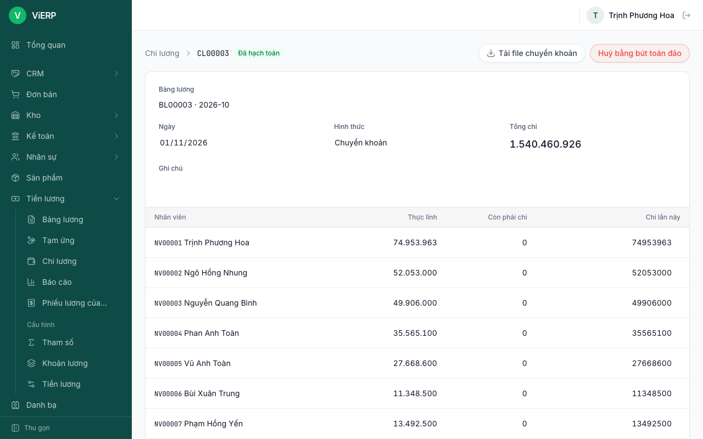

## 8.6. Tạm ứng lương

1. Mở **Tiền lương**, **Tạm ứng** để xem danh sách.

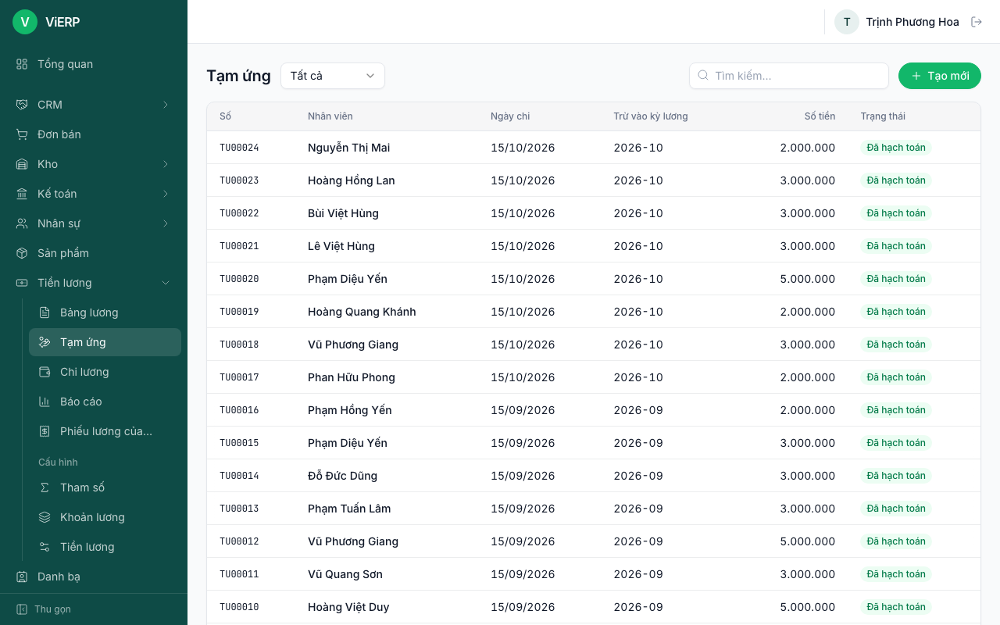

2. Nhấn **Tạo mới**: chọn **Nhân viên**, **Ngày chi**, **Trừ vào kỳ lương**, **Số tiền**, **Hình thức**. Nhấn **Lưu**.

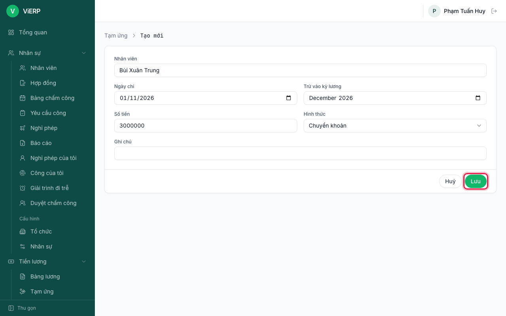

3. Người có quyền (khác người nhập) mở phiếu và nhấn **Duyệt**.

**Kết quả:** bút toán **Nợ 334 / Có 111 hoặc 112**; khoản ứng tự trừ vào bảng lương của kỳ đã chọn.

## 8.7. Báo cáo lương

1. Mở **Tiền lương**, **Báo cáo**, chọn bảng lương.
2. Nhấn một trong bốn nút để tải CSV: **Bảng lương chi tiết**, **Bảo hiểm**, **Thuế TNCN**, **Theo phòng ban**. Chỉ người có quyền xem lương mới tải được.

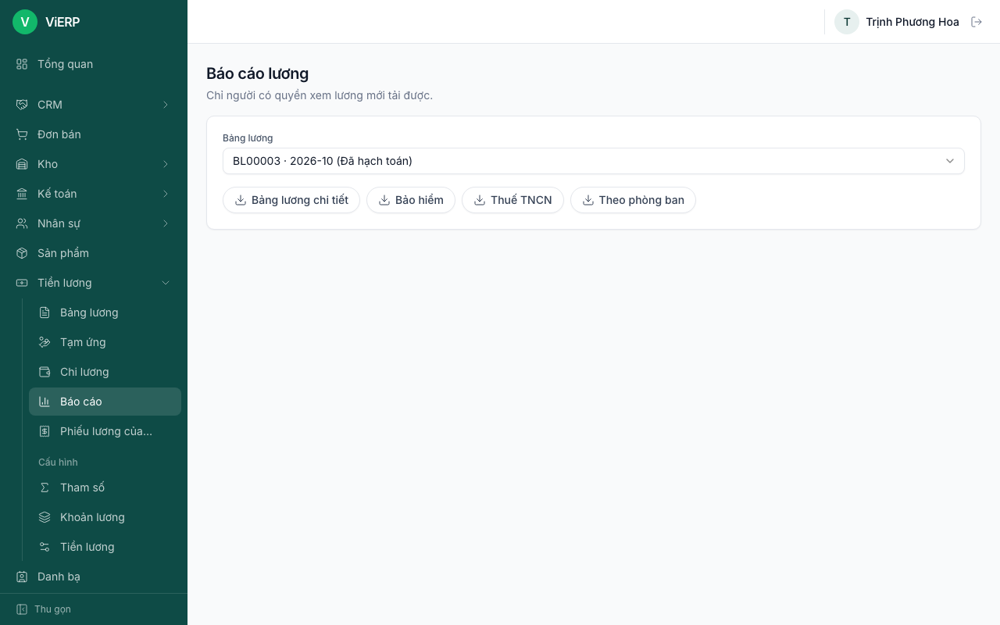

## 8.8. Tham số, khoản lương và cấu hình

**Tham số pháp định** (**Tiền lương**, **Tham số**): mỗi giá trị có **Hiệu lực từ**. Khi luật đổi, nhấn **Thêm giá trị** mới, đừng sửa giá trị cũ. Có thêm **Biểu thuế lũy tiến**.

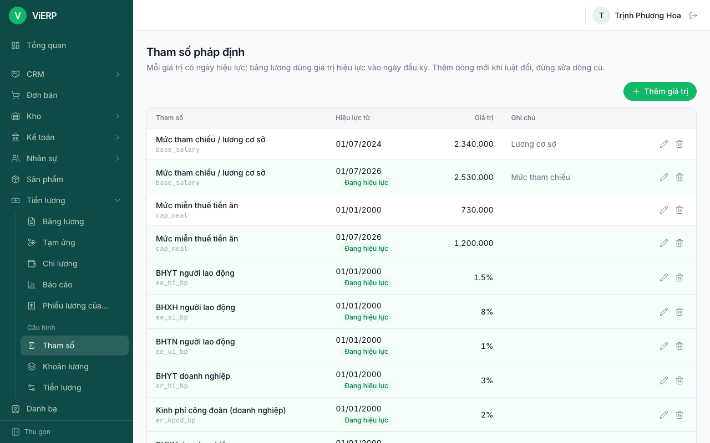

**Khoản lương** (**Khoản lương**): các khoản thu nhập, khấu trừ với cách tính, quy định thuế TNCN và tài khoản hạch toán.

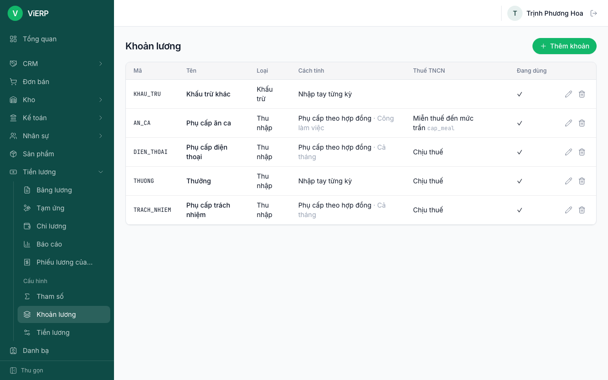

**Cấu hình tiền lương** (**Tiền lương**, **Cấu hình**, **Tiền lương**): công chuẩn, giờ làm mỗi ngày, ngày lễ, KPCĐ 2%, hình thức chi mặc định.

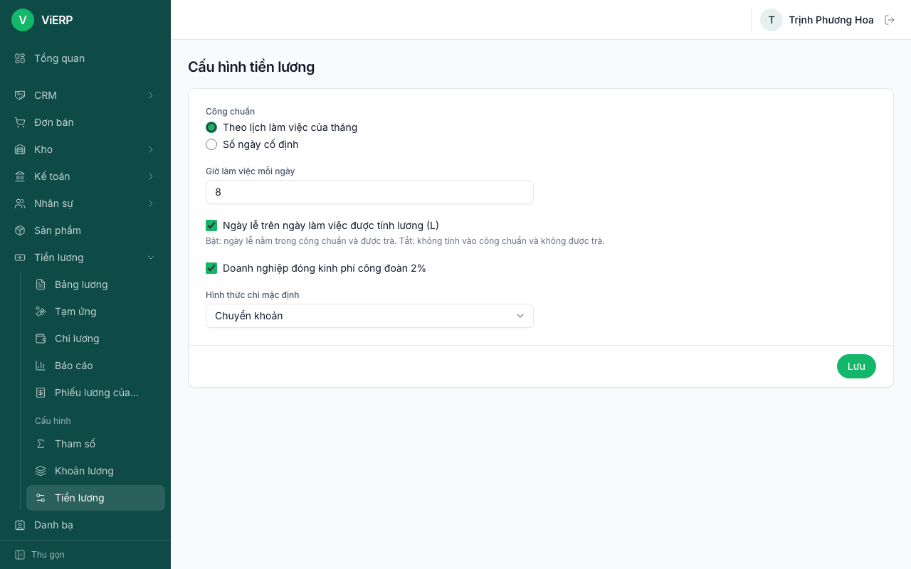

## 8.9. Phiếu lương của tôi (mọi nhân viên)

1. Mở **Phiếu lương của tôi**. Danh sách các kỳ đã hạch toán của bạn.

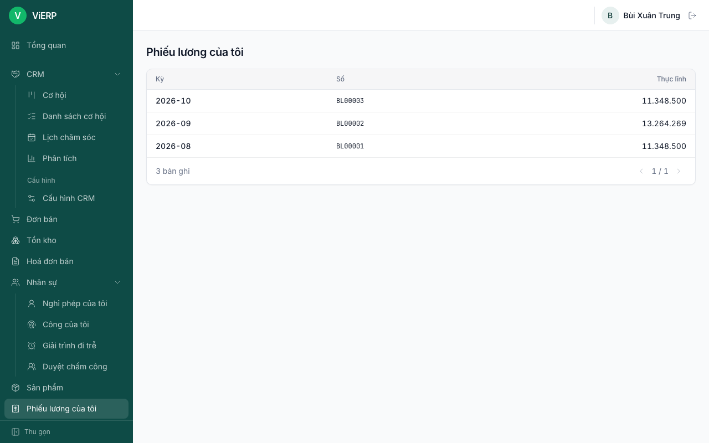

2. Nhấn một kỳ để xem chi tiết; nhấn **In phiếu lương** để in.

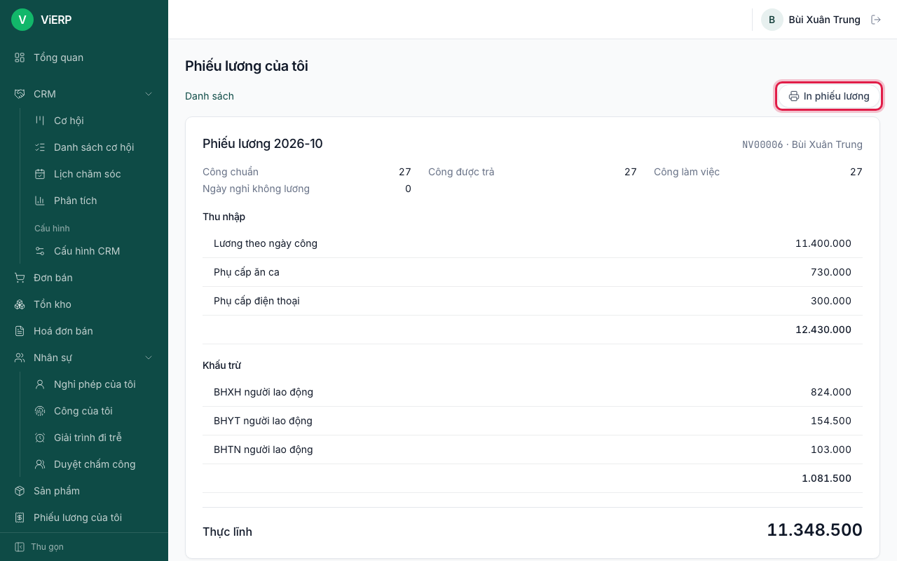

Trên điện thoại:

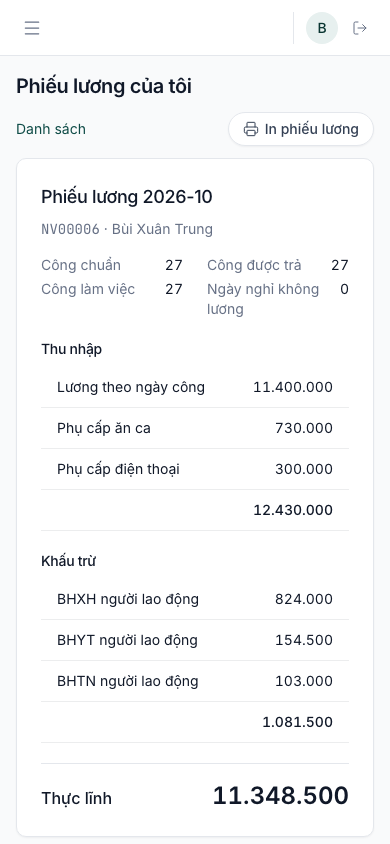
