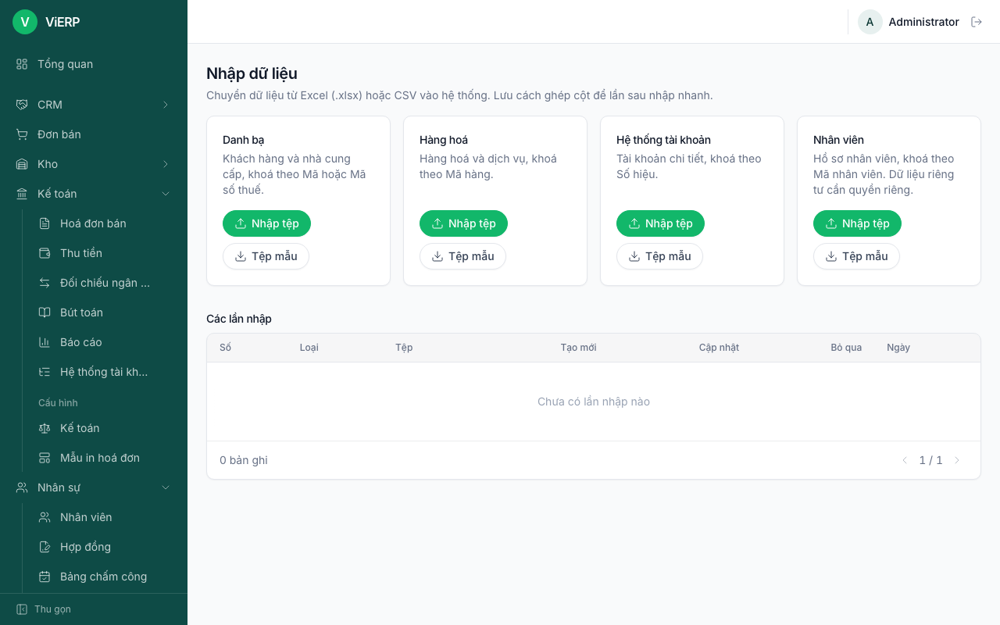
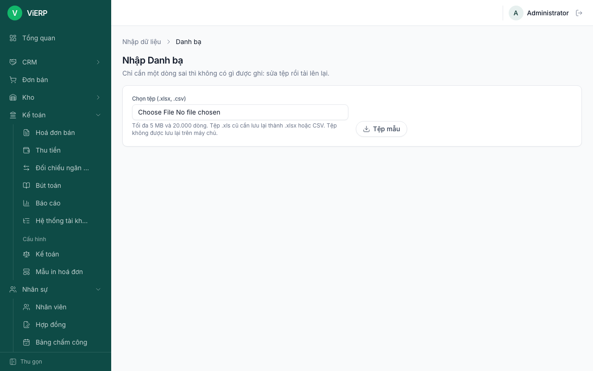
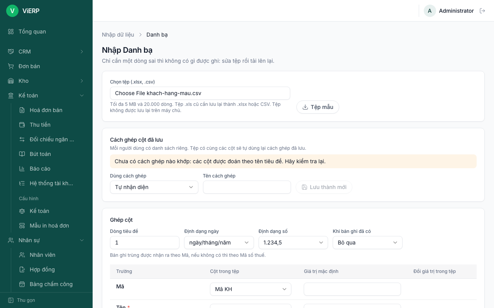
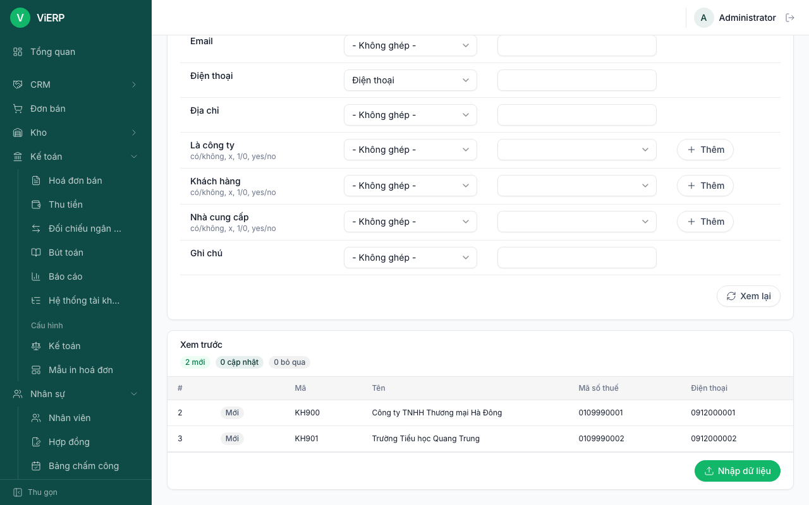
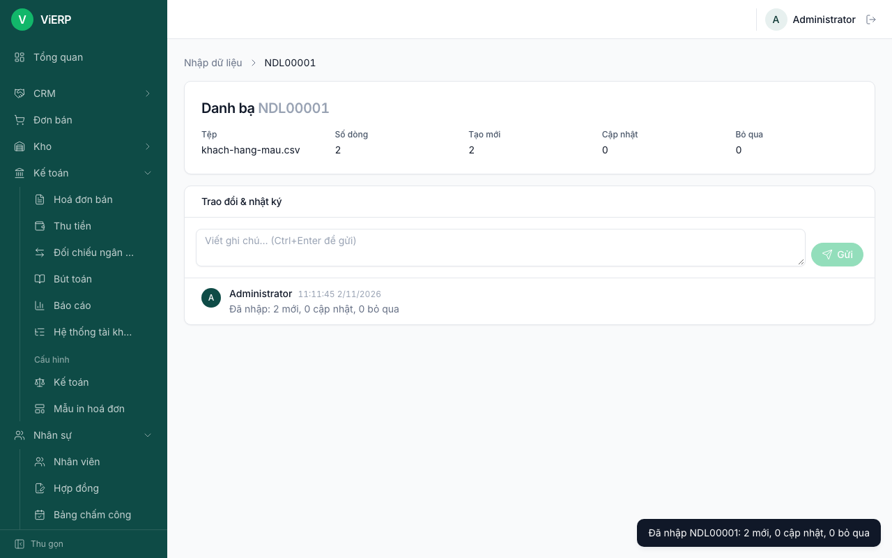
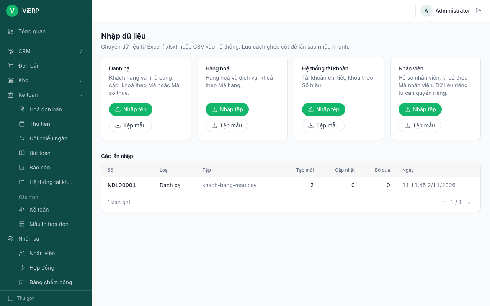
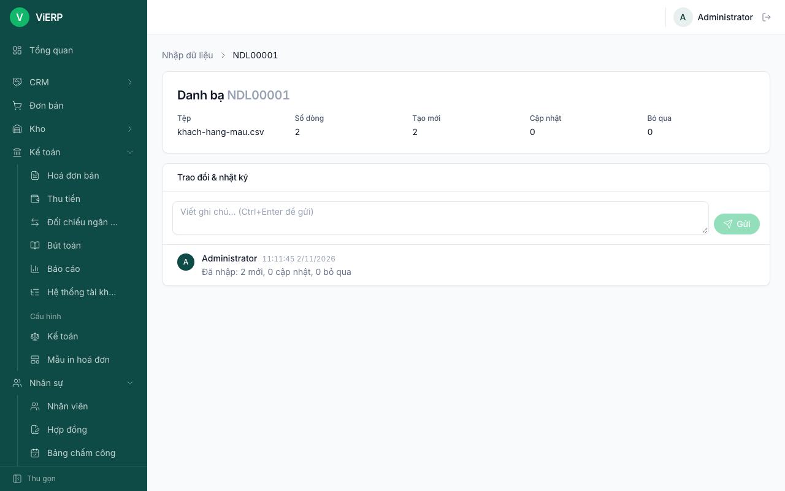

# 9. Nhập dữ liệu từ Excel/CSV

Dùng khi chuyển dữ liệu từ phần mềm hoặc bảng tính cũ sang ViERP: **Danh bạ**, **Hàng hoá**, **Hệ thống tài khoản**, **Nhân viên**. Cần quyền xem "Nhập dữ liệu" và quyền tạo/sửa của loại dữ liệu đích (trong bản demo là `admin`).

**Nguyên tắc quan trọng:** chỉ cần một dòng sai thì không có gì được ghi. Sửa tệp rồi tải lại.

## 9.1. Trang Nhập dữ liệu

1. Mở **Nhập dữ liệu** ở menu.
2. Mỗi loại dữ liệu là một thẻ có **Nhập tệp** và **Tệp mẫu** (tải tệp mẫu để biết cần những cột nào).
3. Bảng **Các lần nhập** liệt kê những lần nhập trước.

## 9.2. Nhập danh bạ từ tệp

1. Nhấn **Nhập tệp** ở thẻ **Danh bạ**.

2. Ở **Chọn tệp (.xlsx, .csv)** chọn tệp của bạn (tối đa 5 MB và 20.000 dòng; tệp .xls cũ cần lưu lại thành .xlsx hoặc CSV). Tệp không được lưu trên máy chủ.
3. Phần **Cách ghép cột đã lưu**: nếu các cột trùng một cách ghép đã lưu thì tự chọn; nếu không, hệ thống đoán theo tên tiêu đề, bạn kiểm tra lại.
4. Phần **Ghép cột**: chọn **Dòng tiêu đề**, **Định dạng ngày**, **Định dạng số**, và **Khi bản ghi đã có** (Bỏ qua, Cập nhật (ô trống giữ nguyên), hoặc Báo lỗi). Với từng **Trường**, chọn **Cột trong tệp**, hoặc đặt **Giá trị mặc định**, hoặc **Đổi giá trị trong tệp** (ví dụ "x" thành "có").

5. Cuộn xuống, nhấn **Xem lại** để cập nhật **Xem trước**. Đọc số **mới / cập nhật / bỏ qua / lỗi**; nếu có lỗi, nhấn **Tải danh sách lỗi (CSV)** để biết dòng nào sai.

6. Khi không còn lỗi, nhấn **Nhập dữ liệu**.

**Kết quả:** hệ thống mở trang của lần nhập (ví dụ NDL00001) với số dòng, tạo mới, cập nhật, bỏ qua, và ghi vào nhật ký.

Để lưu cách ghép cột cho lần sau, nhập **Tên cách ghép** rồi nhấn **Lưu thành mới** (mỗi người có danh sách riêng).

**Lưu ý:** nhập cột dữ liệu cá nhân của nhân viên cần quyền xem/sửa dữ liệu cá nhân.

## 9.3. Xem lại một lần nhập

1. Ở trang **Nhập dữ liệu**, bảng **Các lần nhập** liệt kê từng lần. Nhấn một dòng để mở.

2. Xem **Tệp**, **Số dòng**, **Tạo mới**, **Cập nhật**, **Bỏ qua** và nhật ký.

