# 10. Quản trị hệ thống

Dành cho quản trị viên (tài khoản `admin` hoặc vai trò có quyền tương ứng).

## 10.1. Người dùng

1. Mở **Thiết lập**, **Người dùng**. Danh sách cho biết tên, tên đăng nhập, vai trò, trạng thái.

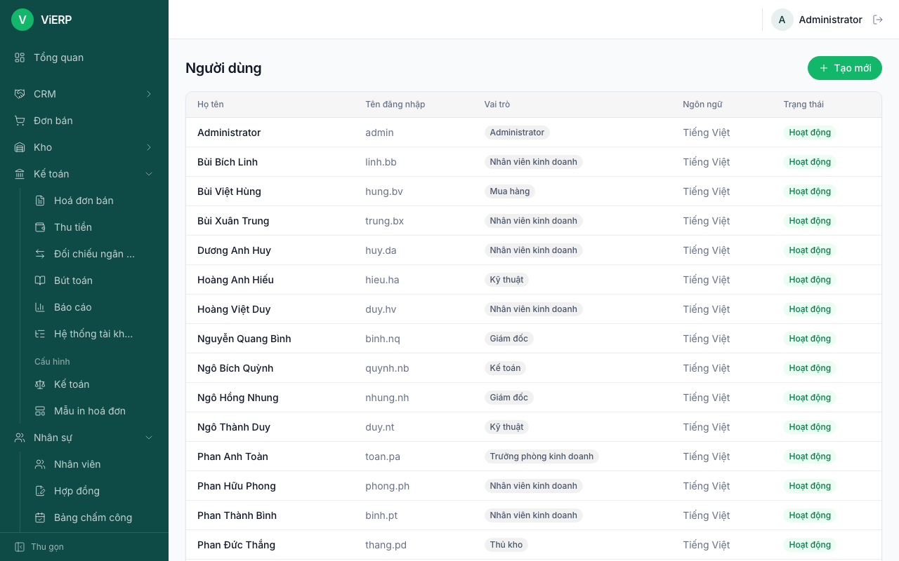

2. Nhấn **Tạo mới** hoặc nhấn vào một người để sửa. Hộp thoại có: **Họ tên**, **Tên đăng nhập**, **Mật khẩu** (ít nhất 6 ký tự; để trống nếu không đổi), **Ngôn ngữ**, **Vai trò** (tick một hoặc nhiều), **Hoạt động**.
3. Nhấn **Lưu**.

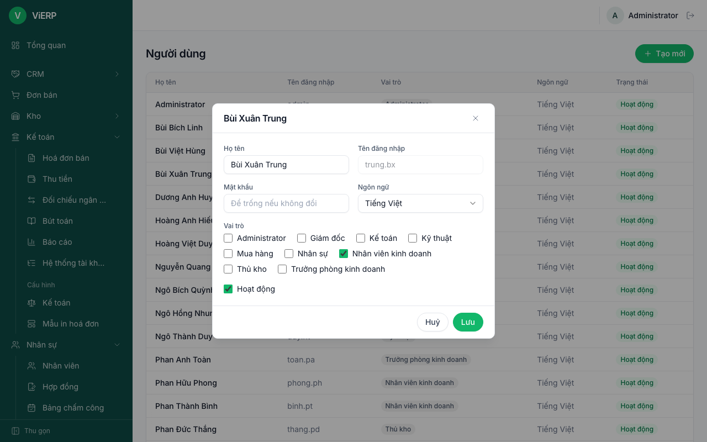

**Lưu ý:** không tự khoá được tài khoản của mình, và luôn phải còn ít nhất một quản trị đang hoạt động. Muốn người dùng thấy các trang "của tôi" (nghỉ phép, công, phiếu lương), gắn tài khoản với hồ sơ nhân viên ([mục 7.6](07-nhan-su.md)).

## 10.2. Vai trò và quyền

1. Mở **Thiết lập**, **Vai trò**. Vai trò **Quản trị** có nhãn **Toàn quyền** và bị khoá.

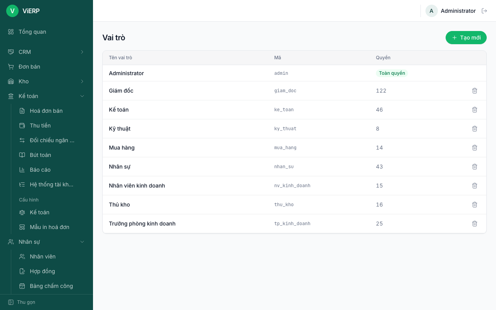

2. Nhấn một vai trò để sửa quyền. Quyền hiển thị dạng ma trận theo từng ứng dụng: mỗi hàng là một đối tượng (Danh bạ, Sản phẩm...), các cột **Xem / Thêm / Sửa / Xoá / Huỷ nháp / Duyệt**. Tick ô nào người dùng được làm việc đó.
3. Bên dưới mỗi ứng dụng có thêm các quyền riêng, ví dụ "Được duyệt chứng từ do chính mình nhập", "Xem và giao cơ hội của mọi nhân viên". Quyền tạo mã truy cập API cho AI là ô **Thêm** ở dòng **Mã truy cập API** của nhóm **Hệ thống**.
4. Nhấn **Lưu**.

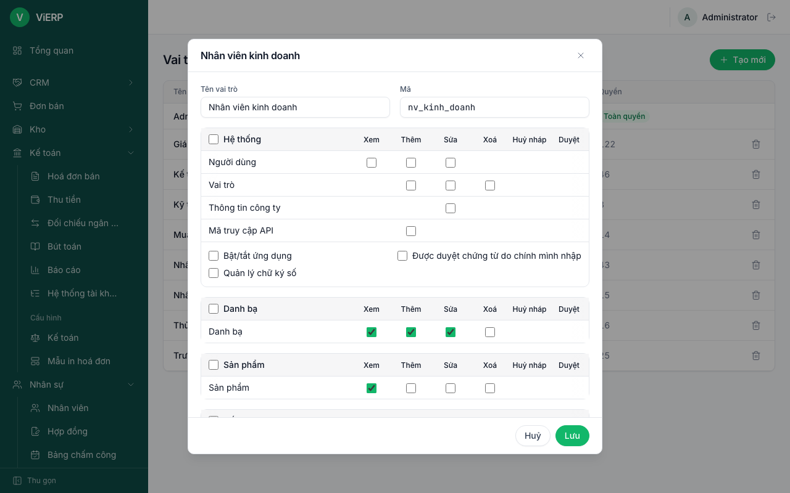

**Lưu ý:** làm một việc trên một đối tượng thì tự được quyền Xem đối tượng đó. Cấp quyền "tự duyệt" cẩn thận vì nó bỏ nguyên tắc người nhập khác người duyệt.

## 10.3. Ứng dụng

1. Mở **Thiết lập**, **Ứng dụng**.
2. Mỗi ứng dụng có trạng thái **Đang bật** hoặc **Đang tắt** và nút bật/tắt. Ứng dụng phụ thuộc ứng dụng khác sẽ ghi "Cần ...".

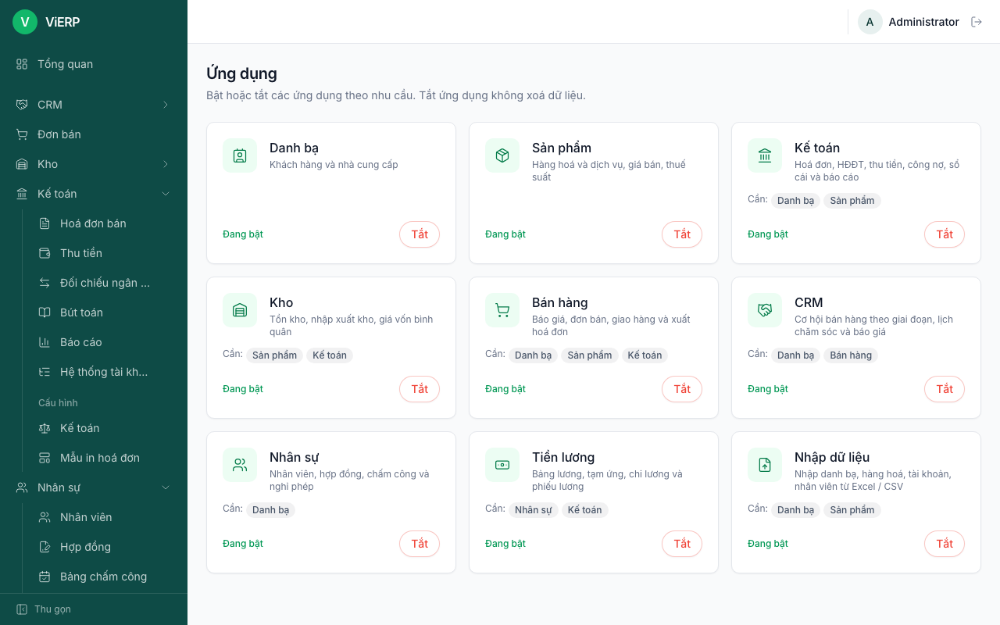

**Lưu ý:** tắt ứng dụng không xoá dữ liệu.

## 10.4. Thông tin công ty, tài khoản ngân hàng, chữ ký số

Mở **Thiết lập**, **Công ty**.

**Thông tin chung:** **Tên công ty**, **Mã số thuế**, **Địa chỉ**, **Điện thoại**, **Email**, **Website**, **Logo**. Các thông tin này in lên hoá đơn.

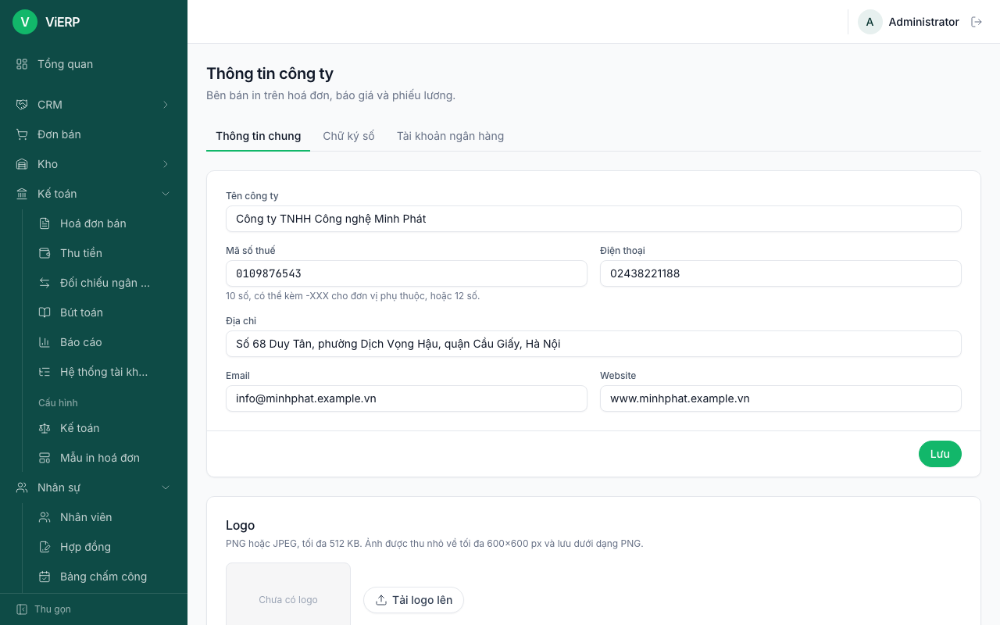

**Tài khoản ngân hàng:** **Ngân hàng**, **Số tài khoản**, **Chủ tài khoản** (viết hoa không dấu), **Tài khoản mặc định**, **In trên hoá đơn**. Dùng để tạo mã QR chuyển khoản trên hoá đơn và để đối chiếu ngân hàng.

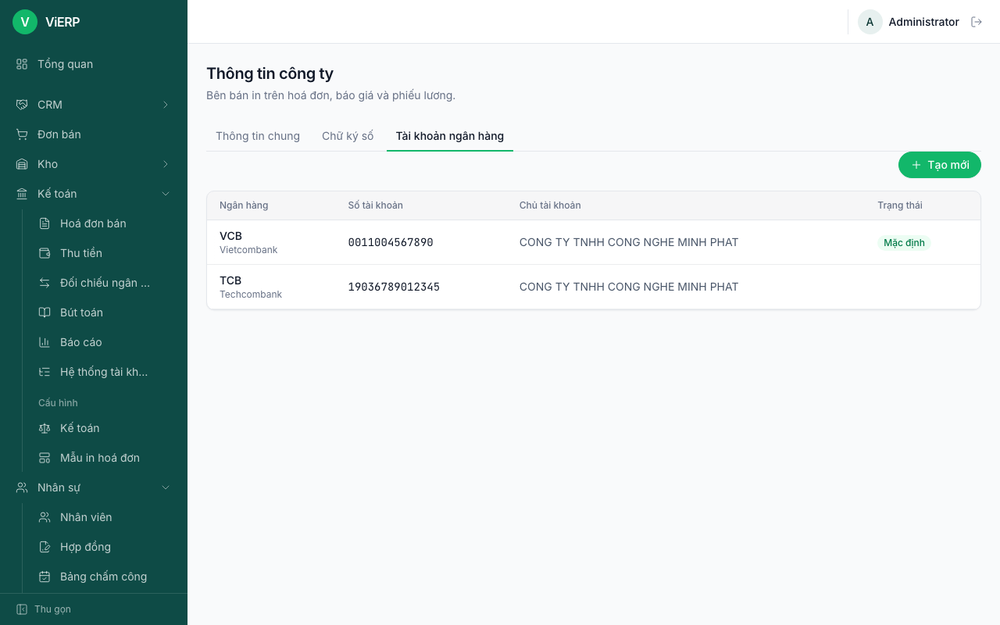

**Chữ ký số:** cấu hình ký hoá đơn điện tử. Bản thử (sandbox) không có giá trị pháp lý; cần khoá bí mật của máy chủ.

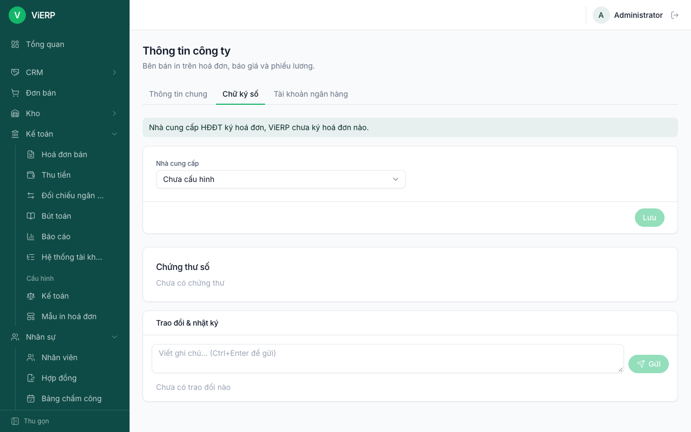

## 10.5. Chuẩn mực kế toán và Tài khoản hạch toán

1. Mở **Kế toán**, nhóm **Cấu hình**, **Kế toán**.
2. **Chuẩn mực kế toán**: TT200, TT99 hoặc TT133. Chọn chuẩn mực và **Áp dụng từ ngày**, nhấn **Xem trước thay đổi**, kiểm tra rồi **Áp dụng**. Tài khoản và bút toán cũ được giữ nguyên.
3. **Tài khoản hạch toán**: bảng **Mục đích** (tiền mặt, tiền gửi ngân hàng, phải thu khách hàng, doanh thu...) đối với **Tài khoản**. Chương trình luôn hạch toán theo bảng này, không theo số hiệu cố định. Một mục đích không đổi sang tài khoản khác được khi tài khoản hiện tại của nó đang có số dư.

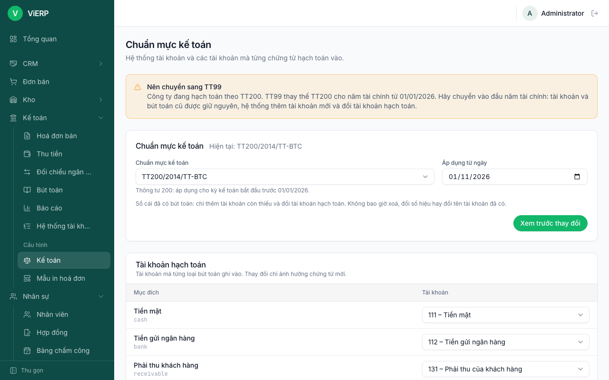

**Lưu ý:** tài khoản đã có số dư không đổi được ("Tài khoản ... còn số dư, không thể đổi"). Nên chuyển chuẩn mực vào đầu năm tài chính.

## 10.6. Mẫu in hoá đơn

1. Mở **Kế toán**, nhóm **Cấu hình**, **Mẫu in hoá đơn**. Nhấn **Tạo mới** hoặc mở một mẫu.

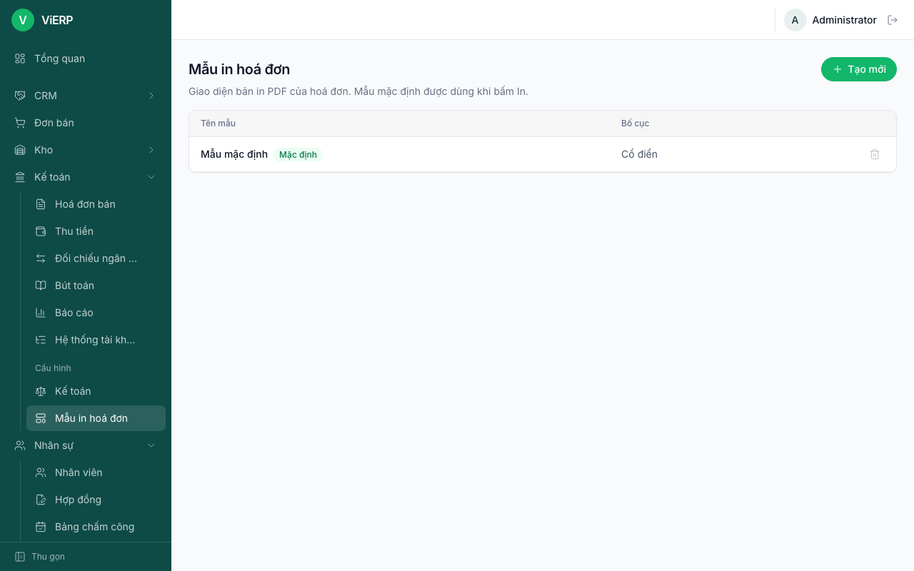

2. Chọn **Bố cục** (Cổ điển, Hiện đại, Gọn), màu chủ đạo, cỡ chữ, vị trí logo, nội dung đầu và cuối trang, khối chữ ký, các tuỳ chọn hiển thị. Khung **Xem trước** cho xem với **Dữ liệu mẫu** hoặc một **Hoá đơn thật** (bản xem trước là PDF nên để trống trong ảnh chụp; trên màn hình thật sẽ hiện hoá đơn).
3. Nhấn **Lưu**. Nhấn **Đặt mặc định** để dùng cho mọi hoá đơn.

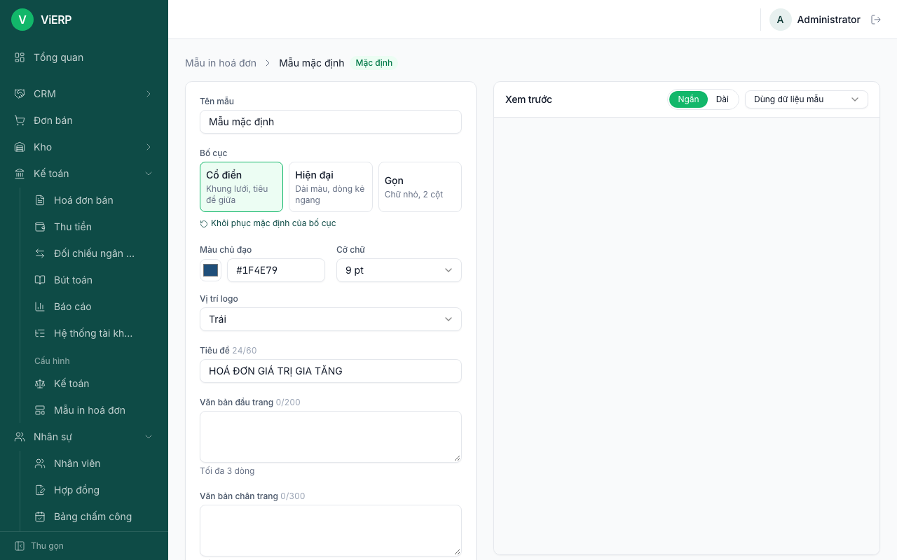

## 10.7. Cấu hình khác

Cấu hình CRM, nhân sự và tiền lương nằm ở nhóm **Cấu hình** của từng ứng dụng: xem [chương 3](03-crm.md#310-cấu-hình-crm-quản-lý), [chương 7](07-nhan-su.md#714-cấu-hình-nhân-sự), [chương 8](08-tien-luong.md#88-tham-số-khoản-lương-và-cấu-hình).
