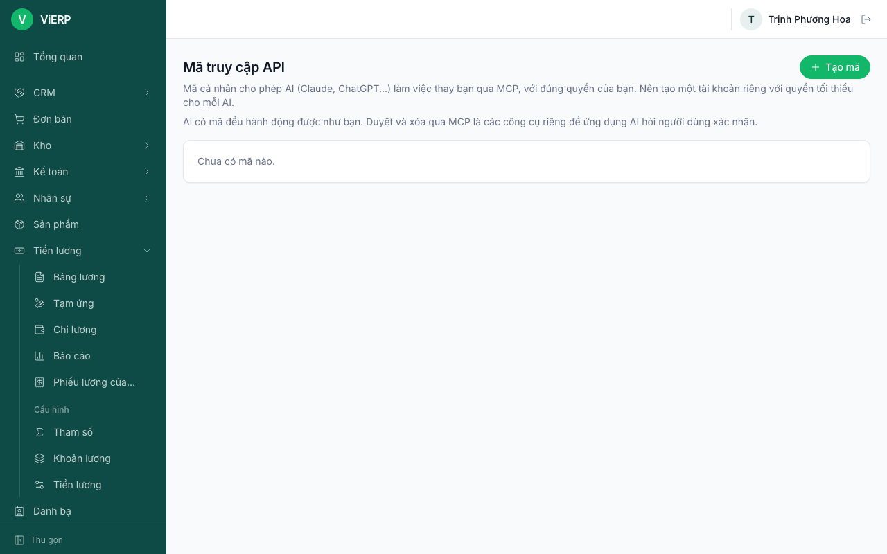
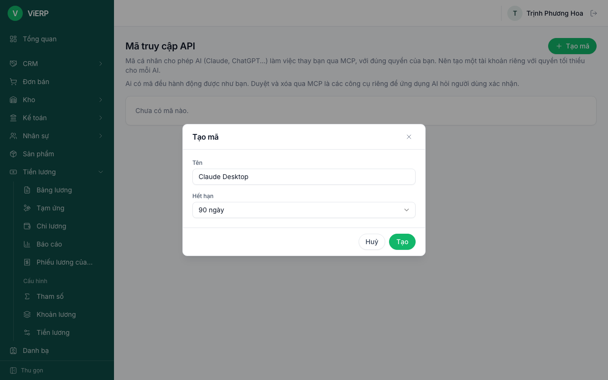
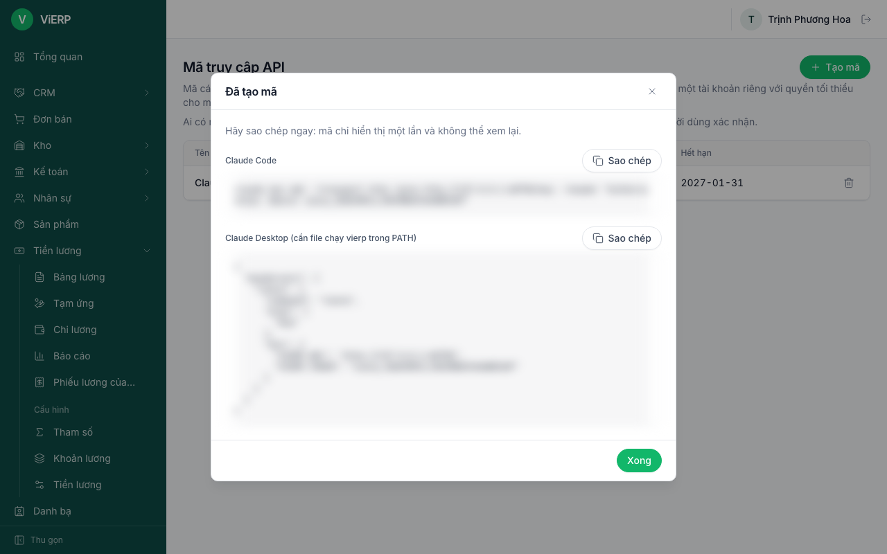
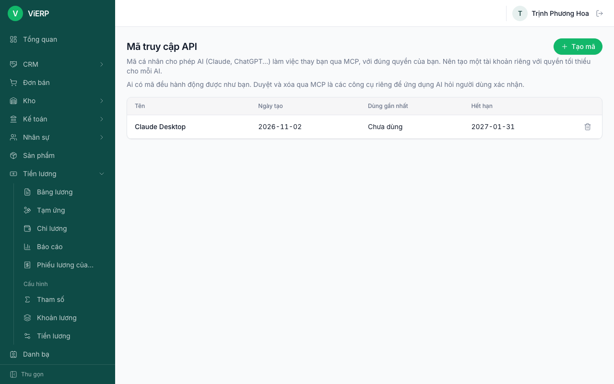

# 11. Kết nối AI (mã truy cập API)

ViERP cho phép trợ lý AI (Claude Code, Claude Desktop) làm việc thay bạn qua giao thức MCP, bằng một **mã truy cập API** cá nhân. AI chỉ làm được đúng những gì người sở hữu mã được phép. Cần quyền "Tạo mã truy cập API cho AI".

## 11.1. Tạo mã truy cập

1. Mở **Thiết lập**, **Mã truy cập API**. Trang giải thích cách dùng, kèm cảnh báo an toàn.

2. Nhấn **Tạo mã**. Nhập **Tên** dễ nhớ (ví dụ "Claude Desktop") và chọn **Hết hạn** (30, 90, 365 ngày hoặc không hết hạn).

3. Nhấn **Tạo**. Hộp thoại **Đã tạo mã** hiện ra. **Sao chép ngay** vì mã chỉ hiển thị một lần và không xem lại được. Hộp thoại có sẵn hai đoạn lệnh: **Claude Code** và **Claude Desktop**, mỗi đoạn có nút **Sao chép**. Nhấn **Xong** khi đã lưu.

Lưu ý: hình đã làm mờ mã. Không bao giờ gửi mã qua email, chat chung hay đưa vào kho mã nguồn.

## 11.2. Xem danh sách và thu hồi mã

1. Danh sách hiện tên, ngày hết hạn của từng mã.
2. Nhấn biểu tượng thùng rác (**Thu hồi**) rồi xác nhận khi nghi ngờ lộ mã hoặc không dùng nữa. Mã thu hồi dừng hoạt động ngay.

## 11.3. Cấu hình phía AI

Đoạn lệnh có sẵn trong hộp thoại tạo mã là cách dễ nhất. Tóm tắt:

- **Claude Code:** `claude mcp add --transport http vierp https://<máy chủ>/mcp --header "Authorization: Bearer <mã>"`
- **Claude Desktop:** cài tệp chạy `vierp` vào PATH (tệp tạo bằng `make build-macos` / `make build-linux` có tên dạng `vierp-darwin-arm64`, hãy đổi tên thành `vierp` hoặc ghi đúng đường dẫn tệp), rồi khai báo máy chủ `vierp mcp` với hai biến `VIERP_URL` (địa chỉ ViERP) và `VIERP_TOKEN` (mã vừa tạo).
- **Bộ kỹ năng (plugin) cho Claude Code:** `/plugin marketplace add <repo>` rồi `/plugin install vierp@vierp`. Bộ này có các kỹ năng: bán hàng đến thu tiền, CRM, kế toán, nhân sự và lương, nhập dữ liệu.

AI có sáu công cụ: `whoami`, `list_endpoints`, `api_get`, `api_write`, `api_approve`, `api_delete`.

## 11.4. Quy tắc an toàn

- AI hành động với **đúng quyền của người sở hữu mã**. Hãy tạo một người dùng riêng cho AI với quyền tối thiểu thay vì dùng tài khoản quản trị.
- Các trang quản trị bị chặn với mã API ("Mã truy cập API không dùng được chức năng này...").
- Ghi sổ, duyệt và xoá là các công cụ riêng (`api_approve`, `api_delete`) để ứng dụng AI hỏi bạn trước khi chạy. Hãy giữ chế độ hỏi xác nhận trong ứng dụng AI. ViERP vẫn kiểm tra quyền, quy tắc tự duyệt và khoá sổ như khi dùng giao diện.
- Không cấp quyền xem dữ liệu cá nhân hay lương cho người dùng của AI (liên quan Nghị định 13/2023 về bảo vệ dữ liệu cá nhân).
- Mã vẫn dùng được sau khi đổi mật khẩu. Mã chỉ ngừng khi: hết hạn, bị thu hồi, người dùng bị khoá, hoặc người dùng mất quyền. Muốn cắt nhanh mọi mã của một nhóm, bỏ quyền "Tạo mã truy cập API cho AI" khỏi vai trò: mã của mọi người dùng thuộc vai trò đó ngừng ngay lập tức.
